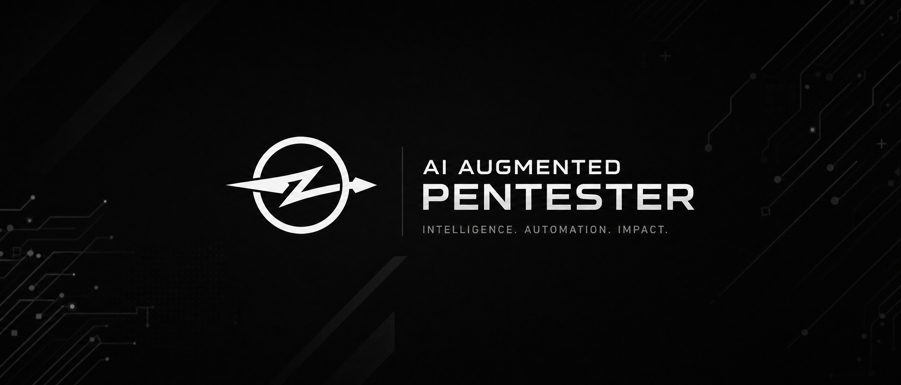

<p align="center">
  <a href="README.md">English</a> |
  <a href="README.zh.md">简体中文</a> |
  <a href="README.zht.md">繁體中文</a> |
  <a href="README.ko.md">한국어</a> |
  <a href="README.de.md">Deutsch</a> |
  <a href="README.es.md">Español</a> |
  <a href="README.fr.md">Français</a> |
  <a href="README.it.md">Italiano</a> |
  <a href="README.da.md">Dansk</a> |
  <a href="README.ja.md">日本語</a> |
  <a href="README.pl.md">Polski</a> |
  <a href="README.ru.md">Русский</a> |
  <a href="README.bs.md">Bosanski</a> |
  <a href="README.ar.md">العربية</a> |
  <a href="README.no.md">Norsk</a> |
  <a href="README.br.md">Português (Brasil)</a> |
  <a href="README.th.md">ไทย</a> |
  <a href="README.tr.md">Türkçe</a> |
  <a href="README.uk.md">Українська</a> |
  <a href="README.bn.md">বাংলা</a> |
  <a href="README.el.md">Ελληνικά</a> |
  <a href="README.vi.md">Tiếng Việt</a> |
  <a href="README.hi.md">हिन्दी</a>
</p>

<p align="center">
  <picture>
    <source srcset="assets/hero-dark.webp" type="image/webp">
    
  </picture>
</p>

<h3 align="center">Open-source AI agent that runs complete penetration tests.</h3>

<p align="center">
  Plug in any LLM — Claude, GPT, Gemini, or 150+ others — and get autonomous<br>
  reconnaissance, vulnerability discovery, exploitation, and reporting from your terminal.
</p>

<p align="center">
  <a href="#quick-start">Quick Start</a> ·
  <a href="#who-is-this-for">Who Is This For</a> ·
  <a href="#how-it-works">How It Works</a> ·
  <a href="#agents">Agents</a> ·
  <a href="#hackbrowser">HackBrowser</a> ·
  <a href="#vortex">Vortex</a> ·
  <a href="#bolt--mcp">Bolt & MCP</a> ·
  <a href="#web-ui">Web UI</a> ·
  <a href="https://docs.cyberstrike.io">Docs</a>
</p>

<p align="center">
  <a href="https://www.npmjs.com/package/@cyberstrike-io/cyberstrike"></a>
  <a href="https://www.npmjs.com/package/@cyberstrike-io/cyberstrike"></a>
  <a href="https://github.com/CyberStrikeus/CyberStrike/stargazers"></a>
  <a href="https://github.com/CyberStrikeus/CyberStrike/actions/workflows/publish.yml"></a>
  <a href="https://discord.gg/snunAaHf6U"></a>
  <a href="https://github.com/CyberStrikeus/CyberStrike/blob/dev/LICENSE"></a>
</p>

---

### Quick Start

```bash
npm i -g @cyberstrike-io/cyberstrike@latest && cyberstrike
```

CyberStrike launches in your terminal, asks for your LLM provider on first run, and you're ready. No separate AI costs — it runs on top of your existing Claude, OpenAI, or any other LLM subscription.

Point it at a target. CyberStrike runs reconnaissance, finds attack surfaces, tests for vulnerabilities, and delivers a report — each finding with severity, proof-of-concept requests, CWE mapping, and remediation steps. No manual tool chaining, no copy-pasting between terminals.

Explore the full documentation at **[docs.cyberstrike.io](https://docs.cyberstrike.io)**.

---

### Who Is This For

- **Pentesters** — Automate the repetitive parts. Let agents handle recon and initial testing while you focus on the creative attack chains that need human intuition.
- **Bug Bounty Hunters** — Faster reconnaissance, wider coverage, consistent methodology across programs. CyberStrike doesn't get tired at 3am.
- **Security Teams** — Run structured OWASP assessments with reproducible methodology. Get reports that map to standards your compliance team understands.
- **Security Researchers** — Extend CyberStrike with custom agents, skills, and MCP servers. The plugin system makes it a platform, not just a tool.

---

### How It Works

CyberStrike injects offensive security methodology — OWASP testing procedures, vulnerability patterns, attack chain reasoning — into every AI interaction, turning a general-purpose model into a security specialist.

You describe the target. CyberStrike selects the right agent, loads relevant skills from a library of 7,600+ methodology documents, picks tools, and runs the assessment. Findings are confirmed with a 3-gate protocol (baseline → attack → response diff) — speculative results are discarded.

<details>
<summary><b>Supported AI providers (150+)</b></summary>
<br>

| Provider | Models | Notes |
|----------|--------|-------|
| **Anthropic** | Claude 4.5, Claude 4 | Best performance with extended thinking |
| **OpenAI** | GPT-5, GPT-4.1, o3, o4 | Full tool-use + reasoning |
| **Google** | Gemini 2.5 Pro/Flash | Long context for large codebases |
| **Amazon Bedrock** | All Bedrock models | IAM auth, no API keys needed |
| **Azure OpenAI** | All Azure-hosted models | Enterprise deployments |
| **GitHub Copilot** | GPT-5, Claude, Gemini | Use your Copilot subscription |
| **Ollama / LM Studio** | Any local model | Fully offline, air-gapped |
| **OpenRouter** | 300+ models | Single API, any model |

Plus Groq, Mistral, xAI, DeepSeek, Cerebras, Cohere, Together AI, and any OpenAI-compatible endpoint — [150+ providers total](https://models.dev).

</details>

---

### Agents

Switch agents with `Tab`. Each one carries domain-specific methodology and testing patterns.

| Agent | What It Does |
|-------|-------------|
| **cyberstrike** | Full-access primary agent — recon, exploitation, reporting |
| **wstg-agent** | OWASP WSTG orchestrator + 12 specialist sub-agents for web testing |
| **general** | General-purpose security assistant |
| **explore** | Read-only reconnaissance and analysis |

The web pipeline runs 8 parallel testers on intercepted traffic — testing access control, injection, authentication, business logic, and file security across every request.

> **CyberStrike Pro** adds cloud security (AWS/Azure/GCP), internal network (Active Directory, Kerberos), and mobile application (Android/iOS, Frida) agents. [Learn more →](https://cyberstrike.io)

---

### HackBrowser

Built-in browser for web application testing. Start with `/hackbrowser`.

Browse manually or let it crawl autonomously with multiple accounts. Every HTTP request routes through the agent pipeline — no export steps, no proxy setup. CyberStrike builds a live map of credentials, roles, and endpoints as traffic flows, and the testing agents use it directly.

---

### Vortex

HTTP traffic engine for security testing. Intercept, filter, and analyze requests with a purpose-built DSL. Write rules as data — portable, versionable, composable — and let the canary engine verify findings automatically.

If you've used Caido or Burp Suite's proxy: Vortex is the same concept, native to CyberStrike's agent pipeline.

---

### Bolt & MCP

**Bolt** runs your security tools on remote servers. Deploy on any VPS or Docker container, pair with Ed25519 keys, and control from your terminal. One CyberStrike instance orchestrates many Bolt servers — each with its own toolkit and network position.

**MCP servers** extend CyberStrike with specialized security tools:

| Server | Tools | Domain |
|--------|-------|--------|
| [hackbrowser-mcp](https://github.com/badchars/hackbrowser-mcp) | 39 | Browser security testing |
| [cloud-audit-mcp](https://github.com/badchars/cloud-audit-mcp) | 38 | Cloud security — AWS, Azure, GCP |
| [github-security-mcp](https://github.com/badchars/github-security-mcp) | 39 | GitHub security posture |
| [cve-mcp](https://github.com/badchars/cve-mcp) | 23 | CVE intelligence — NVD, EPSS, KEV, GHSA |
| [osint-mcp-server](https://github.com/badchars/osint-mcp-server) | 37 | OSINT — Shodan, VirusTotal, Censys, DNS |

All open source. All installable with `npx`. More security MCP servers at [github.com/badchars](https://github.com/badchars).

---

### Web UI

Run `cyberstrike web` for a browser-based interface. Add a [Cloudflare Tunnel](https://developers.cloudflare.com/cloudflare-one/connections/connect-networks/) for secure remote access — zero open ports, end-to-end encryption, password-protected API.

**[app.cyberstrike.io](https://app.cyberstrike.io)** is a hosted static frontend that connects to your server. No backend, no data storage — or self-host from `packages/app/dist/`.

---

### Installation

```bash
# npm (recommended)
npm i -g @cyberstrike-io/cyberstrike@latest

# bun / pnpm / yarn
bun add -g @cyberstrike-io/cyberstrike@latest

# macOS (Homebrew)
brew install CyberStrikeus/tap/cyberstrike

# Windows (Scoop)
scoop install cyberstrike

# Linux / macOS (curl)
curl -fsSL https://cyberstrike.io/install.sh | bash
```

---

### Contributing

We welcome contributions: security agents and skills, MCP servers, methodology guides, and core improvements. Read the [Contributing Guide](./CONTRIBUTING.md) before submitting a PR.

---

### License

[AGPL-3.0-only](./LICENSE) — Free for personal and open-source use. Commercial licensing available via [contact@cyberstrike.io](mailto:contact@cyberstrike.io).

---

<p align="center">
  <a href="https://cyberstrike.io"><b>cyberstrike.io</b></a> · <a href="https://docs.cyberstrike.io"><b>Docs</b></a> · <a href="https://discord.gg/snunAaHf6U"><b>Discord</b></a> · <a href="https://x.com/cyberstrikeio"><b>X.com</b></a> · <a href="https://github.com/CyberStrikeus/CyberStrike"><b>GitHub</b></a>
</p>
<p align="center">
  <sub>Built by hackers who got tired of copy-pasting between terminals.</sub>
</p>
