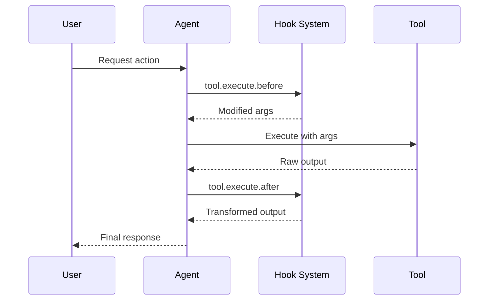

Hooks let you extend and customize Cyberstrike behavior at key points during execution. They are implemented as **plugins** — TypeScript/JavaScript modules that return a set of hook functions.

## Available Hooks

| Hook | When it runs | You can… |
|------|--------------|----------|
| `event` | On any bus event | Observe events (logging, analytics) |
| `config` | After config loads | Inspect/adjust the loaded config |
| `tool` | Registration | Add custom tools (map of name → definition) |
| `auth` | Registration | Add a custom auth provider |
| `chat.message` | A user message is received | Read/append message parts |
| `chat.params` | Before an LLM call | Change `temperature`, `topP`, `topK`, `options` |
| `chat.headers` | Before an LLM request | Add/modify request `headers` |
| `permission.ask` | A permission is requested | Set `status` to `allow`/`deny`/`ask` |
| `command.execute.before` | A slash command runs | Inject `parts` |
| `tool.execute.before` | Before a tool runs | Modify `args`, or throw to block |
| `tool.execute.after` | After a tool runs | Transform `title`/`output`/`metadata` |
| `tool.definition` | Tool sent to the LLM | Rewrite a tool's `description`/`parameters` |
| `shell.env` | A shell command runs | Add environment variables |
| `experimental.chat.messages.transform` | Before an LLM call | Rewrite the full message list |
| `experimental.chat.system.transform` | Before an LLM call | Rewrite the system prompt array |
| `experimental.session.compacting` | Before compaction | Add context or replace the compaction prompt |
| `experimental.text.complete` | A text part completes | Rewrite the completed text |

### Hook Execution Flow



---

## Creating a Plugin

A plugin is `(input: PluginInput) => Promise<Hooks>`. Import the types from `@cyberstrike-io/plugin`:

```typescript title=".cyberstrike/plugin/guard.ts"
import type { Plugin } from "@cyberstrike-io/plugin"

export const GuardPlugin: Plugin = async ({ project, directory, $ }) => {
  return {
    "tool.execute.before": async (input, output) => {
      if (input.tool === "bash" && /rm\s+-rf/.test(output.args.command)) {
        throw new Error("blocked: rm -rf")
      }
    },
    "permission.ask": async (input, output) => {
      if (input.type === "read") output.status = "allow"
    },
  }
}
```

### Plugin Input

The plugin receives context about the current environment:

| Property | Type | Description |
|----------|------|-------------|
| `client` | `CyberstrikeClient` | SDK client instance |
| `project` | `Project` | Current project info |
| `directory` | `string` | Working directory |
| `worktree` | `string` | Git worktree path |
| `serverUrl` | `URL` | Local server URL |
| `$` | `BunShell` | Bun shell for commands |

---

## Registering Plugins

### Local File (no publishing)

Drop a `.ts`/`.js` file into a `plugin/` (or `plugins/`) directory inside any `.cyberstrike/` folder — project or `~/.cyberstrike/`:

```
.cyberstrike/
└── plugin/
    └── guard.ts
```

Cyberstrike discovers it automatically and installs `@cyberstrike-io/plugin` for you so local plugins can import the types.

### Config Array

Reference an npm package or a path in the `plugin` array (values are union-merged across config sources):

```json title="cyberstrike.json"
{
  "plugin": [
    "@myorg/cyberstrike-guard",
    "./local/guard.ts"
  ]
}
```

### Built-in Plugins

| Plugin | Purpose |
|--------|---------|
| `AnthropicAuthPlugin` | Anthropic OAuth |
| `CodexAuthPlugin` | OpenAI/Codex OAuth |
| `CopilotAuthPlugin` | GitHub Copilot auth |
| `@gitlab/opencode-gitlab-auth` | GitLab integration |

---

## Pre-Tool Hook (tool.execute.before)

Intercept tool calls before execution to modify arguments or block execution.

```typescript
"tool.execute.before": async (
  input: { tool: string; sessionID: string; callID: string },
  output: { args: any },
) => Promise<void>
```

To **block** a tool, throw from the hook:

```typescript
"tool.execute.before": async (input, output) => {
  if (input.tool !== "Bash") return

  const dangerous = ["rm -rf", "mkfs", "dd if=", "> /dev/"]
  for (const pattern of dangerous) {
    if (output.args.command.includes(pattern)) {
      throw new Error(`Blocked dangerous command: ${pattern}`)
    }
  }
}
```

#### Modifying Arguments

```typescript
"tool.execute.before": async (input, output) => {
  if (input.tool === "Bash" && output.args.command.startsWith("git push")) {
    output.args.command = output.args.command.replace("git push", "git push --dry-run")
  }
}
```

---

## Post-Tool Hook (tool.execute.after)

Process tool output after execution for transformation or notification.

```typescript
"tool.execute.after": async (
  input: { tool: string; sessionID: string; callID: string; args: any },
  output: { title: string; output: string; metadata: any },
) => Promise<void>
```

#### Redacting Sensitive Data

```typescript
"tool.execute.after": async (input, output) => {
  output.output = output.output.replace(/sk-[a-zA-Z0-9]{32,}/g, "[REDACTED]")
  output.output = output.output.replace(/password[=:]\s*\S+/gi, "password=[REDACTED]")
}
```

#### Sending Notifications

```typescript
"tool.execute.after": async (input, output) => {
  if (input.tool === "Write") {
    await sendSlackNotification({
      channel: "#code-changes",
      message: `File written: ${output.title}`,
    })
  }
}
```

---

## Permission Hook (permission.ask)

Customize permission decisions programmatically.

```typescript
"permission.ask": async (
  input: Permission,
  output: { status: "ask" | "deny" | "allow" },
) => Promise<void>
```

```typescript
"permission.ask": async (input, output) => {
  const safe = ["Read", "Glob", "Grep", "LSP"]
  if (safe.includes(input.tool)) {
    output.status = "allow"
    return
  }
  if (input.tool === "Write" && input.path?.includes("/test/")) {
    output.status = "allow"
  }
}
```

---

## Chat Hooks

### chat.message

Preprocess incoming messages:

```typescript
"chat.message": async (
  input: { sessionID: string; agent?: string; model?: { providerID: string; modelID: string } },
  output: { message: UserMessage; parts: Part[] },
) => Promise<void>
```

### chat.params

Modify LLM parameters:

```typescript
"chat.params": async (input, output) => {
  if (input.agent === "web-application") {
    output.temperature = 0.3
  }
}
```

### chat.headers

Add custom HTTP headers:

```typescript
"chat.headers": async (input, output) => {
  output.headers["X-Custom-Header"] = "value"
  output.headers["X-Session-ID"] = input.sessionID
}
```

---

## Tool Definition Hook

Rewrite a tool's description or parameters before sending to the LLM:

```typescript
"tool.definition": async (
  input: { toolID: string },
  output: { description: string; parameters: any },
) => Promise<void>
```

---

## Command & Shell Hooks

```typescript
"command.execute.before": async (
  input: { command: string; sessionID: string; arguments: string },
  output: { parts: Part[] },
) => Promise<void>

"shell.env": async (
  input: { cwd: string },
  output: { env: Record<string, string> },
) => Promise<void>
```

---

## Lifecycle Hooks

```typescript
event:  (input: { event: Event }) => Promise<void>
config: (input: Config) => Promise<void>
```

---

## Experimental Hooks

```typescript
"experimental.chat.messages.transform": async (input: {}, output: { messages: { info: Message; parts: Part[] }[] }) => Promise<void>
"experimental.chat.system.transform":   async (input: { sessionID?: string; model: Model }, output: { system: string[] }) => Promise<void>
"experimental.session.compacting":      async (input: { sessionID: string }, output: { context: string[]; prompt?: string }) => Promise<void>
"experimental.text.complete":           async (input: { sessionID: string; messageID: string; partID: string }, output: { text: string }) => Promise<void>
```

---

## Custom Tools

Add custom tools through plugins:

```typescript
return {
  tool: {
    my_scanner: {
      description: "Custom vulnerability scanner",
      parameters: {
        type: "object",
        properties: {
          target: { type: "string", description: "Target URL to scan" },
          depth: { type: "number", description: "Scan depth", default: 3 },
        },
        required: ["target"],
      },
      execute: async (args) => ({
        title: `Scanned ${args.target}`,
        output: await scan(args.target),
      }),
    },
  },
}
```

---

## Authentication Hooks

Create custom authentication providers:

```typescript
const authHook: AuthHook = {
  provider: "my-provider",
  methods: [
    {
      type: "api",
      label: "API Key",
      prompts: [
        {
          type: "text",
          key: "apiKey",
          message: "Enter your API key",
          placeholder: "sk-...",
          validate: (value) => {
            if (!value.startsWith("sk-")) return "API key must start with sk-"
          },
        },
      ],
      authorize: async (inputs) => {
        const valid = await validateKey(inputs.apiKey)
        if (valid) return { type: "success", key: inputs.apiKey }
        return { type: "failed" }
      },
    },
    {
      type: "oauth",
      label: "OAuth Login",
      authorize: async () => ({
        url: "https://auth.example.com/oauth",
        instructions: "Complete login in browser",
        method: "auto",
        callback: async () => ({ type: "success", key: "obtained-key" }),
      }),
    },
  ],
}
```

---

## Publishing Plugins

Package your plugin like any npm module:

```json title="package.json"
{
  "name": "@myorg/cyberstrike-guard",
  "type": "module",
  "main": "./index.ts",
  "peerDependencies": { "@cyberstrike-io/plugin": "*" }
}
```

```bash
npm publish --access public
```

---

## Testing & Debugging

Run Cyberstrike with debug logging to see plugins load and hooks fire:

```bash
cyberstrike --log-level DEBUG --print-logs
```

Since hooks mutate `output` (or throw), you can unit-test them by calling the hook with a fake `input`/`output` and asserting on the mutated `output`.

---

## Best Practices

### Performance

1. Keep hooks lightweight to avoid latency
2. Use async operations for external calls
3. Cache expensive computations

### Security

1. Validate all inputs in hooks
2. Sanitize outputs before returning
3. Use environment variables for secrets
4. Log security-relevant events

<Aside variant="caution">
  Plugins run with full access to your machine and Cyberstrike internals. Only install plugins you trust, and keep hooks fast — they run inline with tool calls and LLM requests.
</Aside>
