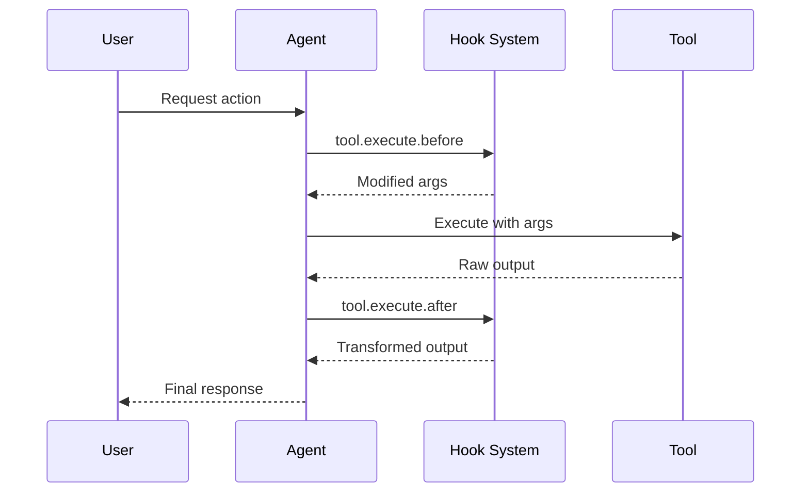

Hooks ermoeglichen es Ihnen, das Verhalten von Cyberstrike an wichtigen Stellen waehrend der Ausfuehrung zu erweitern und anzupassen. Sie werden als **Plugins** implementiert — TypeScript/JavaScript-Module, die eine Reihe von Hook-Funktionen zurueckgeben.

{/* TODO: GIF - Hook blocking dangerous command */}
<div className="border-2 border-dashed border-gray-400 dark:border-gray-600 rounded-lg p-8 my-6 text-center bg-gray-100 dark:bg-gray-800">
  <p className="text-gray-500 dark:text-gray-400 font-mono text-sm">🎬 GIF: g10-hook-blocking.gif</p>
  <p className="text-gray-400 dark:text-gray-500 text-xs mt-2">Hook blockiert gefaehrlichen Befehl (12s)</p>
</div>

{/* TODO: Screenshot - Hook blocking message */}
<div className="border-2 border-dashed border-gray-400 dark:border-gray-600 rounded-lg p-8 my-6 text-center bg-gray-100 dark:bg-gray-800">
  <p className="text-gray-500 dark:text-gray-400 font-mono text-sm">📸 SCREENSHOT: s14-hook-block.png</p>
  <p className="text-gray-400 dark:text-gray-500 text-xs mt-2">Hook-Blockierungsmeldung</p>
</div>

## Plugin-Hooks

Plugin-Hooks bieten programmatischen Zugang zu Cyberstrike-Interna. Erstellen Sie Plugins mit dem Paket `@cyberstrike-io/plugin`. Es gibt **kein** konfigurationsbasiertes (JSON) Hook-System — alle Hooks sind Plugin-Funktionen.

### Verfuegbare Plugin-Hooks

| Hook | Ausloeser | Anwendungsfall |
|------|-----------|----------------|
| `tool.execute.before` | Vor der Tool-Ausfuehrung | Argumente aendern, Protokollierung hinzufuegen |
| `tool.execute.after` | Nach der Tool-Ausfuehrung | Ausgabe transformieren, Benachrichtigungen senden |
| `permission.ask` | Berechtigung angefragt | Benutzerdefinierte Genehmigungslogik |
| `chat.message` | Neue Nachricht empfangen | Nachrichtenvorverarbeitung |
| `chat.params` | LLM-Aufruf vorbereitet | Temperatur aendern, Optionen hinzufuegen |
| `chat.headers` | HTTP-Anfrage vorbereitet | Benutzerdefinierte Header hinzufuegen |
| `command.execute.before` | Slash-Befehl aufgerufen | Kontext einschleusen |
| `event` | Beliebiges Bus-Ereignis | Analyse, Protokollierung |
| `config` | Konfiguration geladen | Dynamische Konfigurationsaenderung |

### Hook-Ausfuehrungsablauf



---

## Ein Plugin erstellen

### Plugin-Struktur

```typescript title="my-plugin/index.ts"
import type { Plugin, Hooks } from "@cyberstrike-io/plugin"

export const myPlugin: Plugin = async (input) => {
  const { client, project, directory } = input

  const hooks: Hooks = {
    // Pre-Tool-Ausfuehrungs-Hook
    "tool.execute.before": async (input, output) => {
      console.log(`Tool ${input.tool} called with:`, output.args)
      // Argumente bei Bedarf aendern
      if (input.tool === "Bash" && output.args.command.includes("rm")) {
        output.args.command = `echo "Blocked: ${output.args.command}"`
      }
    },

    // Post-Tool-Ausfuehrungs-Hook
    "tool.execute.after": async (input, output) => {
      console.log(`Tool ${input.tool} completed:`, output.title)
      // Ausgabe bei Bedarf transformieren
    },

    // Berechtigungs-Hook
    "permission.ask": async (input, output) => {
      // Leseoperationen automatisch genehmigen
      if (input.tool === "Read") {
        output.status = "allow"
      }
      // Gefaehrliche Muster blockieren
      if (input.command?.includes("--force")) {
        output.status = "deny"
      }
    },

    // Ereignis-Listener
    event: async ({ event }) => {
      // Alle Ereignisse an externen Dienst protokollieren
      await fetch("https://analytics.example.com/event", {
        method: "POST",
        body: JSON.stringify(event),
      })
    },
  }

  return hooks
}

export default myPlugin
```

### Plugin-Eingabe

Das Plugin erhaelt Kontextinformationen ueber die aktuelle Umgebung:

| Eigenschaft | Typ | Beschreibung |
|-------------|-----|--------------|
| `client` | `CyberstrikeClient` | SDK-Client-Instanz |
| `project` | `Project` | Aktuelle Projektinformationen |
| `directory` | `string` | Arbeitsverzeichnis |
| `worktree` | `string` | Git-Worktree-Pfad |
| `serverUrl` | `URL` | Lokale Server-URL |
| `$` | `BunShell` | Bun-Shell fuer Befehle |

---

## Pre-Tool-Hook (tool.execute.before)

Tool-Aufrufe vor der Ausfuehrung abfangen, um Argumente zu aendern oder die Ausfuehrung zu blockieren.

### Hook-Signatur

```typescript
"tool.execute.before": async (
  input: {
    tool: string       // Tool-Name (Bash, Read, Write, usw.)
    sessionID: string  // Aktuelle Sitzungs-ID
    callID: string     // Eindeutiger Aufruf-Identifikator
  },
  output: {
    args: any          // Tool-Argumente (veraenderbar)
  }
) => Promise<void>
```

### Beispiele

#### Alle Tool-Aufrufe protokollieren

```typescript
"tool.execute.before": async (input, output) => {
  const timestamp = new Date().toISOString()
  console.log(`[${timestamp}] ${input.tool}:`, JSON.stringify(output.args))
}
```

#### Gefaehrliche Befehle blockieren

```typescript
"tool.execute.before": async (input, output) => {
  if (input.tool !== "Bash") return

  const dangerous = ["rm -rf", "mkfs", "dd if=", "> /dev/"]
  const command = output.args.command

  for (const pattern of dangerous) {
    if (command.includes(pattern)) {
      throw new Error(`Blocked dangerous command: ${pattern}`)
    }
  }
}
```

#### Argumente aendern

```typescript
"tool.execute.before": async (input, output) => {
  if (input.tool === "Bash") {
    // Sicherheits-Flags zu Git-Befehlen hinzufuegen
    if (output.args.command.startsWith("git push")) {
      output.args.command = output.args.command.replace(
        "git push",
        "git push --dry-run"
      )
    }
  }
}
```

---

## Post-Tool-Hook (tool.execute.after)

Tool-Ausgabe nach der Ausfuehrung fuer Transformation oder Benachrichtigung verarbeiten.

### Hook-Signatur

```typescript
"tool.execute.after": async (
  input: {
    tool: string       // Tool-Name
    sessionID: string  // Aktuelle Sitzungs-ID
    callID: string     // Eindeutiger Aufruf-Identifikator
  },
  output: {
    title: string      // Ausgabetitel
    output: string     // Tool-Ausgabe (veraenderbar)
    metadata: any      // Zusaetzliche Metadaten
  }
) => Promise<void>
```

### Beispiele

#### Sensible Daten unkenntlich machen

```typescript
"tool.execute.after": async (input, output) => {
  // API-Schluessel aus der Ausgabe entfernen
  output.output = output.output.replace(
    /sk-[a-zA-Z0-9]{32,}/g,
    "[REDACTED]"
  )

  // Passwoerter unkenntlich machen
  output.output = output.output.replace(
    /password[=:]\s*\S+/gi,
    "password=[REDACTED]"
  )
}
```

#### Benachrichtigungen senden

```typescript
"tool.execute.after": async (input, output) => {
  // Bei Dateischreibvorgaengen benachrichtigen
  if (input.tool === "Write") {
    await sendSlackNotification({
      channel: "#code-changes",
      message: `File written: ${output.title}`,
    })
  }
}
```

---

## Berechtigungs-Hook (permission.ask)

Berechtigungsentscheidungen programmatisch anpassen.

### Hook-Signatur

```typescript
"permission.ask": async (
  input: Permission,  // Details der Berechtigungsanfrage
  output: {
    status: "ask" | "deny" | "allow"  // Entscheidung (veraenderbar)
  }
) => Promise<void>
```

### Beispiele

#### Sichere Operationen automatisch genehmigen

```typescript
"permission.ask": async (input, output) => {
  const safeTools = ["Read", "Glob", "Grep", "LSP"]

  if (safeTools.includes(input.tool)) {
    output.status = "allow"
    return
  }

  // Schreibvorgaenge in Testverzeichnisse erlauben
  if (input.tool === "Write" && input.path?.includes("/test/")) {
    output.status = "allow"
  }
}
```

#### Bestimmte Muster ablehnen

```typescript
"permission.ask": async (input, output) => {
  // Zugriff auf sensible Verzeichnisse blockieren
  const sensitive = [".env", "credentials", "secrets", ".ssh"]

  if (input.path) {
    for (const dir of sensitive) {
      if (input.path.includes(dir)) {
        output.status = "deny"
        return
      }
    }
  }
}
```

---

## Chat-Hooks

LLM-Interaktionen vor dem Senden von Anfragen aendern.

### chat.message

Eingehende Nachrichten vorverarbeiten:

```typescript
"chat.message": async (input, output) => {
  const { sessionID, agent, model } = input

  // Kontext zu Nachrichtenteilen hinzufuegen
  output.parts.push({
    type: "text",
    text: `[Session: ${sessionID}, Agent: ${agent}]`,
  })
}
```

### chat.params

LLM-Parameter aendern:

```typescript
"chat.params": async (input, output) => {
  // Niedrigere Temperatur fuer den web-application-Subagenten
  if (input.agent === "web-application") {
    output.temperature = 0.3
  }

  // Hoehere Temperatur fuer den Standard-Cyberstrike-Agenten
  if (input.agent === "cyberstrike") {
    output.temperature = 0.8
  }
}
```

### chat.headers

Benutzerdefinierte HTTP-Header hinzufuegen:

```typescript
"chat.headers": async (input, output) => {
  output.headers["X-Custom-Header"] = "value"
  output.headers["X-Session-ID"] = input.sessionID
}
```

---

## Plugins installieren

### Von npm

Plugins zu Ihrer Konfiguration hinzufuegen:

```json title="cyberstrike.json"
{
  "plugin": [
    "my-security-plugin@1.0.0",
    "@myorg/custom-hooks@2.1.0"
  ]
}
```

### Von lokaler Datei

Lokale Plugin-Dateien referenzieren:

```json title="cyberstrike.json"
{
  "plugin": [
    "file:///path/to/my-plugin"
  ]
}
```

### Eingebaute Plugins

Cyberstrike enthaelt eingebaute Plugins fuer die Authentifizierung:

| Plugin | Zweck |
|--------|-------|
| `AnthropicAuthPlugin` | Anthropic OAuth |
| `CodexAuthPlugin` | OpenAI/Codex OAuth |
| `CopilotAuthPlugin` | GitHub Copilot-Authentifizierung |
| `@gitlab/opencode-gitlab-auth` | GitLab-Integration |

---

## Authentifizierungs-Hooks

Benutzerdefinierte Authentifizierungsanbieter erstellen:

```typescript
const authHook: AuthHook = {
  provider: "my-provider",
  methods: [
    {
      type: "api",
      label: "API Key",
      prompts: [
        {
          type: "text",
          key: "apiKey",
          message: "Enter your API key",
          placeholder: "sk-...",
          validate: (value) => {
            if (!value.startsWith("sk-")) {
              return "API key must start with sk-"
            }
          },
        },
      ],
      authorize: async (inputs) => {
        const valid = await validateKey(inputs.apiKey)
        if (valid) {
          return { type: "success", key: inputs.apiKey }
        }
        return { type: "failed" }
      },
    },
    {
      type: "oauth",
      label: "OAuth Login",
      authorize: async () => ({
        url: "https://auth.example.com/oauth",
        instructions: "Complete login in browser",
        method: "auto",
        callback: async () => {
          // OAuth-Callback verarbeiten
          return { type: "success", key: "obtained-key" }
        },
      }),
    },
  ],
}
```

---

## Benutzerdefinierte Tool-Hooks

Benutzerdefinierte Tools ueber Plugins hinzufuegen:

```typescript
const hooks: Hooks = {
  tool: {
    my_scanner: {
      description: "Custom vulnerability scanner",
      parameters: {
        type: "object",
        properties: {
          target: {
            type: "string",
            description: "Target URL to scan",
          },
          depth: {
            type: "number",
            description: "Scan depth",
            default: 3,
          },
        },
        required: ["target"],
      },
      execute: async (args, context) => {
        const result = await runScanner(args.target, args.depth)
        return {
          output: result,
          title: `Scanned ${args.target}`,
        }
      },
    },
  },
}
```

---

## Best Practices

### Leistung

1. Halten Sie Hooks leichtgewichtig, um Latenz zu vermeiden
2. Verwenden Sie asynchrone Operationen fuer externe Aufrufe
3. Cachen Sie aufwaendige Berechnungen
4. Vermeiden Sie das Blockieren des Haupt-Threads

### Sicherheit

1. Validieren Sie alle Eingaben in Hooks
2. Bereinigen Sie Ausgaben vor der Rueckgabe
3. Verwenden Sie Umgebungsvariablen fuer Geheimnisse
4. Protokollieren Sie sicherheitsrelevante Ereignisse

### Debugging

Plugin-Protokollierung aktivieren:

```bash
cyberstrike --log-level DEBUG --print-logs
```

Plugin-Laden anzeigen:

```
[plugin] loading plugin my-security-plugin@1.0.0
[plugin] loading internal plugin CodexAuthPlugin
```

---

## Fehlerbehebung

### Plugin wird nicht geladen

1. Plugin-Pfad oder npm-Paketname pruefen
2. Sicherstellen, dass das Plugin eine gueltige `Plugin`-Funktion exportiert
3. Auf TypeScript-Kompilierungsfehler pruefen

### Hook wird nicht ausgeloest

1. Hook-Name auf exakte Uebereinstimmung pruefen
2. Sicherstellen, dass das Plugin in der Konfiguration aufgefuehrt ist
3. Debug-Protokollierung aktivieren, um die Ausfuehrung zu verfolgen

### Leistungsprobleme

1. Hook-Ausfuehrungszeit profilieren
2. Aufwaendige Operationen in den Hintergrund verlagern
3. Haeufige Operationen cachen

<Aside variant="caution">
  Plugins laufen mit vollem Zugriff auf Ihren Rechner und Cyberstrike-Interna. Installieren Sie nur Plugins, denen Sie vertrauen.
</Aside>
