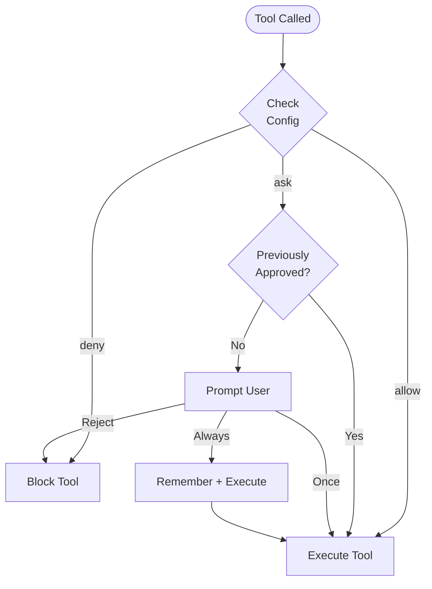

Cyberstrike uses a permission system to control which tools the AI agent can execute. This provides security boundaries while maintaining productivity.

## Permission Model



---

## Permission Modes

| Mode | Behavior | Use Case |
|------|----------|----------|
| `ask` | Prompt for approval | Default for sensitive tools |
| `allow` | Auto-approve | Trusted tools, automation |
| `deny` | Block execution | Restricted operations |

---

## Configuring Permissions

### Global Configuration

Set permissions in `~/.config/cyberstrike/cyberstrike.json`:

```json title="~/.config/cyberstrike/cyberstrike.json"
{
  "permission": {
    "read": "allow",
    "glob": "allow",
    "grep": "allow",
    "edit": "ask",
    "bash": "ask",
    "websearch": "ask"
  }
}
```

### Project Configuration

Override permissions per-project in `cyberstrike.json`:

```json title="cyberstrike.json"
{
  "permission": {
    "bash": "allow",
    "edit": "allow",
    "external_directory": "deny"
  }
}
```

Project settings override global settings.

---

## Permission Types

### File Operations

| Permission | Tools | Default | Description |
|------------|-------|---------|-------------|
| `read` | Read | `ask` | Read file contents |
| `edit` | Write, Edit | `ask` | Modify files |
| `glob` | Glob | `allow` | Find files by pattern |
| `grep` | Grep | `allow` | Search file contents |

### Command Execution

| Permission | Tools | Default | Description |
|------------|-------|---------|-------------|
| `bash` | Bash | `ask` | Execute shell commands |
| `task` | Task | `ask` | Create sub-agents |

### Web Operations

| Permission | Tools | Default | Description |
|------------|-------|---------|-------------|
| `websearch` | WebSearch | `ask` | Search the web |
| `webfetch` | WebFetch | `ask` | Fetch web content |
| `codesearch` | CodeSearch | `ask` | Search code repositories |

### Special Permissions

| Permission | Description |
|------------|-------------|
| `external_directory` | Access files outside project |
| `lsp` | Language server operations |
| `doom_loop` | Detect and break infinite loops |

---

## Permission Patterns

Permission patterns give fine-grained control by matching a tool's argument (a command string, a file path) against a glob and mapping it to an action.

### Pattern Format

A permission entry is either a single action, or a map of **glob → action**. The tool key groups its patterns:

```json
{
  "permission": {
    "bash": {
      "*": "ask",
      "ls *": "allow",
      "git status": "allow",
      "rm -rf *": "deny"
    },
    "edit": {
      "reports/**": "allow",
      ".env*": "deny"
    }
  }
}
```

The glob matches the tool's argument: for `bash` it's the command string, for `edit`/`read` it's the file path.

### Wildcards

Only two wildcards are supported:

| Token | Matches |
|-------|---------|
| `*` | any sequence of characters (including `/`) |
| `?` | any single character |

<Aside variant="caution">
  `*` and `?` are the **only** wildcards. Characters like `[`, `]`, `{`, `}`, `(`, `)`, and `|` are matched **literally**. There is no `**` (it behaves the same as `*`), and negation (`!pattern`) is not supported.
</Aside>

A pattern that ends in a space + `*` also matches the bare command with no arguments — so `"ls *"` matches both `ls` and `ls -la`.

### Pattern Precedence

When several patterns match, the **more specific (longer) pattern wins**. Patterns are evaluated shortest-first, and the last match applies — so a broad `"*": "ask"` can be overridden by a longer `"git status": "allow"`:

```json
{
  "permission": {
    "bash": {
      "*": "ask",
      "npm *": "allow",
      "npm publish*": "deny"
    }
  }
}
```

Here `npm test` is allowed, but `npm publish` is denied.

### Pattern Examples

#### Allow a toolchain, block the dangerous parts

```json
{
  "permission": {
    "bash": {
      "*": "ask",
      "git *": "allow",
      "git push*": "ask",
      "rm -rf *": "deny"
    }
  }
}
```

#### Restrict edits to a directory

```json
{
  "permission": {
    "edit": {
      "*": "deny",
      "src/**": "allow",
      "src/secrets/**": "deny"
    }
  }
}
```

---

## Agent Permissions

Configure permissions per-agent:

```json title="cyberstrike.json"
{
  "agent": {
    "web-application": {
      "permission": {
        "bash": "allow",
        "browser": "allow",
        "edit": "ask"
      }
    },
    "code-review": {
      "permission": {
        "read": "allow",
        "glob": "allow",
        "grep": "allow",
        "edit": "deny",
        "bash": "deny"
      }
    }
  }
}
```

---

## Interactive Approval

When a tool requires permission, Cyberstrike prompts for approval.

### Response Options

| Option | Behavior |
|--------|----------|
| **Once** | Approve this specific call |
| **Always** | Approve all similar calls in session |
| **Reject** | Block this call |

### Keyboard Shortcuts

| Key | Action |
|-----|--------|
| `y` | Approve once |
| `a` | Approve always |
| `n` | Reject |
| `Esc` | Reject |

### Session Approval Memory

When you select "Always", Cyberstrike remembers the approval pattern for the session:

1. User approves `git push` with "Always"
2. Pattern `git *` is stored for session
3. Future `git pull`, `git commit`, etc. auto-approve
4. Memory resets when session ends

---

## External Directory Access

By default, Cyberstrike restricts access to the project directory.

### Allowing External Access

```json
{
  "permission": {
    "external_directory": "ask"
  }
}
```

### Specific External Paths

```json
{
  "permission": {
    "external_directory": {
      "/home/user/shared/**": "allow",
      "/tmp/**": "allow",
      "/etc/**": "deny"
    }
  }
}
```

---

## Permission Hooks

Use plugin hooks for programmatic permission control:

```typescript
const hooks: Hooks = {
  "permission.ask": async (input, output) => {
    if (input.type === "read" && input.path?.startsWith("src/")) {
      output.status = "allow"
      return
    }

    if (input.path?.includes("secret") || input.path?.includes(".env")) {
      output.status = "deny"
      return
    }

    output.status = "ask"
  },
}
```

See [Hooks & Plugins](/docs/configuration/hooks) for the full hook system.

---

## Permission Priority

Permissions are evaluated in order:

1. **Agent-specific** permissions (highest priority)
2. **Project** `cyberstrike.json`
3. **Global** `~/.config/cyberstrike/cyberstrike.json`
4. **Default** built-in values (lowest priority)

More specific patterns take precedence over broader ones.

---

## Automation

In non-interactive runs (`cyberstrike run`), there is nobody to answer permission prompts — so any tool that *would* prompt is **auto-rejected**. To let a pipeline do real work, pre-approve the tools it needs.

### Pre-Approving Tools

Grant permissions two ways:

**1. `CYBERSTRIKE_PERMISSION` env var** — a JSON permission map (same shape as the config `permission` field):

```bash
export CYBERSTRIKE_PERMISSION='{"bash":"allow","read":"allow","edit":{"reports/**":"allow"}}'
cyberstrike run "scan this codebase for security issues" --format json > report.json
```

**2. Config `permission`** — commit safe defaults, deny the dangerous bits:

```json title="cyberstrike.json"
{
  "permission": {
    "read": "allow",
    "bash": { "*": "allow", "rm -rf *": "deny", "sudo *": "deny" },
    "edit": { "reports/**": "allow", ".env*": "deny" }
  }
}
```

Output goes to stdout; use `--format json` for machine-readable results.

### GitHub Actions

```yaml title=".github/workflows/security-scan.yml"
name: Security Scan
on:
  pull_request:
    branches: [main]

jobs:
  scan:
    runs-on: ubuntu-latest
    steps:
      - uses: actions/checkout@v4
      - uses: actions/setup-node@v4
        with:
          node-version: '20'
      - run: npm install -g @cyberstrike-io/cyberstrike@latest
      - name: Run Security Scan
        env:
          ANTHROPIC_API_KEY: ${{ secrets.ANTHROPIC_API_KEY }}
          CYBERSTRIKE_PERMISSION: '{"bash":"allow","read":"allow","edit":{"reports/**":"allow"}}'
        run: cyberstrike run "scan this codebase for security vulnerabilities" --format json > security-report.json
      - uses: actions/upload-artifact@v4
        with:
          name: security-report
          path: security-report.json
```

### GitLab CI

```yaml title=".gitlab-ci.yml"
security-scan:
  image: node:20
  variables:
    CYBERSTRIKE_PERMISSION: '{"bash":"allow","read":"allow"}'
  script:
    - npm install -g @cyberstrike-io/cyberstrike@latest
    - cyberstrike run "analyze code for vulnerabilities" --format json > report.json
  artifacts:
    paths:
      - report.json
```

### Batch & Scheduled Runs

```bash title="scan-targets.sh"
#!/bin/bash
export CYBERSTRIKE_PERMISSION='{"bash":"allow"}'
while read -r target; do
  cyberstrike run "scan $target for open ports and services" --format json > "reports/${target}.json"
done < targets.txt
```

### Exit Codes & Output

`cyberstrike run` writes results to stdout (`--format json` for JSON) and returns `0` on success, a non-zero code on error or interruption.

### Automation Security

- **Least privilege** — only `allow` the tools the job needs; keep an explicit `deny` for `rm -rf *`, `sudo *`, and secret paths.
- **Secrets** — inject API keys from your CI secret store, never commit them.
- **Isolation** — run in a container with a constrained network where possible.

<Aside variant="caution">
  Always keep deny rules for destructive commands when pre-approving `bash` in automation.
</Aside>

---

## Security Best Practices

### Development Environment

```json
{
  "permission": {
    "read": "allow",
    "glob": "allow",
    "grep": "allow",
    "edit": "ask",
    "bash": "ask"
  }
}
```

### Production/CI Environment

```json
{
  "permission": {
    "read": "allow",
    "glob": "allow",
    "grep": "allow",
    "edit": "allow",
    "bash": {
      "npm test": "allow",
      "npm run build": "allow",
      "*": "deny"
    }
  }
}
```

### Security Audit Mode

```json
{
  "permission": {
    "read": "allow",
    "glob": "allow",
    "grep": "allow",
    "lsp": "allow",
    "websearch": "allow",
    "edit": "deny",
    "bash": "deny"
  }
}
```

### Web Security Testing

```json title="cyberstrike.json"
{
  "permission": {
    "bash": {
      "nmap *": "allow",
      "nikto *": "allow",
      "sqlmap *": "allow",
      "nuclei *": "allow"
    },
    "browser": "allow",
    "websearch": "allow",
    "edit": "ask"
  }
}
```

<Aside variant="tip">
  Start with restrictive permissions and relax them as needed. It's safer to approve individual actions than to grant blanket access.
</Aside>
