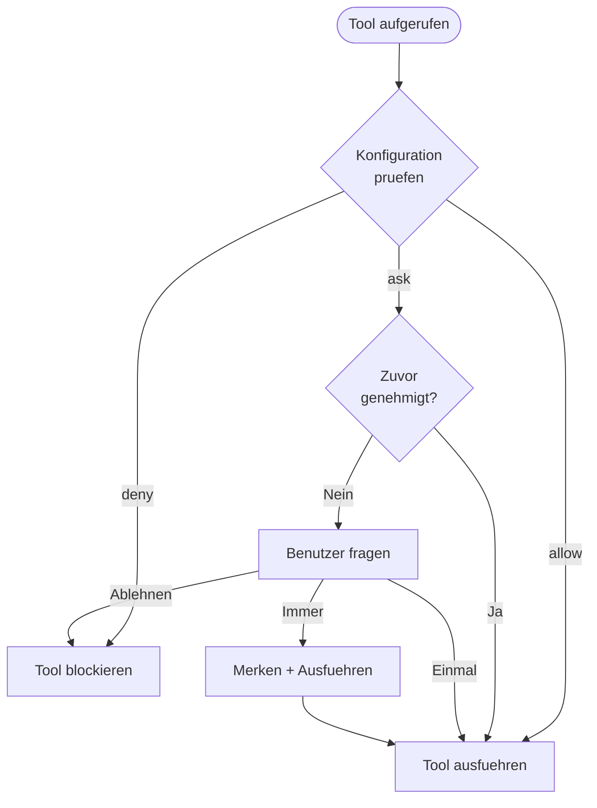

Cyberstrike verwendet ein Berechtigungssystem, um zu kontrollieren, welche Werkzeuge der KI-Agent ausfuehren kann. Dies bietet Sicherheitsgrenzen bei gleichzeitiger Aufrechterhaltung der Produktivitaet.

{/* TODO: GIF - Plan mode workflow */}
<div className="border-2 border-dashed border-gray-400 dark:border-gray-600 rounded-lg p-8 my-6 text-center bg-gray-100 dark:bg-gray-800">
  <p className="text-gray-500 dark:text-gray-400 font-mono text-sm">🎬 GIF: g04-plan-mode.gif</p>
  <p className="text-gray-400 dark:text-gray-500 text-xs mt-2">Plan-Modus-Workflow-Demo (20s)</p>
</div>

{/* TODO: Screenshot - Permission prompt */}
<div className="border-2 border-dashed border-gray-400 dark:border-gray-600 rounded-lg p-8 my-6 text-center bg-gray-100 dark:bg-gray-800">
  <p className="text-gray-500 dark:text-gray-400 font-mono text-sm">📸 SCREENSHOT: s06-permission-prompt.png</p>
  <p className="text-gray-400 dark:text-gray-500 text-xs mt-2">Berechtigungsabfrage-Ansicht</p>
</div>

{/* TODO: Screenshot - Plan mode UI */}
<div className="border-2 border-dashed border-gray-400 dark:border-gray-600 rounded-lg p-8 my-6 text-center bg-gray-100 dark:bg-gray-800">
  <p className="text-gray-500 dark:text-gray-400 font-mono text-sm">📸 SCREENSHOT: s07-plan-mode.png</p>
  <p className="text-gray-400 dark:text-gray-500 text-xs mt-2">Plan-Modus-Oberflaeche</p>
</div>

## Berechtigungsmodell



---

## Berechtigungsmodi

| Modus | Verhalten | Anwendungsfall |
|-------|-----------|----------------|
| `ask` | Genehmigung erfragen | Standard fuer sensible Werkzeuge |
| `allow` | Automatisch genehmigen | Vertrauenswuerdige Werkzeuge, Automatisierung |
| `deny` | Ausfuehrung blockieren | Eingeschraenkte Operationen |

---

## Berechtigungen konfigurieren

### Globale Konfiguration

Berechtigungen in `~/.config/cyberstrike/cyberstrike.json` setzen:

```json title="~/.config/cyberstrike/cyberstrike.json"
{
  "permission": {
    "read": "allow",
    "glob": "allow",
    "grep": "allow",
    "edit": "ask",
    "bash": "ask",
    "websearch": "ask"
  }
}
```

### Projektkonfiguration

Berechtigungen pro Projekt in `cyberstrike.json` ueberschreiben:

```json title="cyberstrike.json"
{
  "permission": {
    "bash": "allow",
    "edit": "allow",
    "external_directory": "deny"
  }
}
```

Projekteinstellungen ueberschreiben globale Einstellungen.

---

## Berechtigungstypen

### Dateioperationen

| Berechtigung | Werkzeuge | Standard | Beschreibung |
|--------------|-----------|----------|--------------|
| `read` | Read | `ask` | Dateiinhalte lesen |
| `edit` | Write, Edit | `ask` | Dateien aendern |
| `glob` | Glob | `allow` | Dateien nach Muster finden |
| `grep` | Grep | `allow` | Dateiinhalte durchsuchen |

### Befehlsausfuehrung

| Berechtigung | Werkzeuge | Standard | Beschreibung |
|--------------|-----------|----------|--------------|
| `bash` | Bash | `ask` | Shell-Befehle ausfuehren |
| `task` | Task | `ask` | Sub-Agenten erstellen |

### Web-Operationen

| Berechtigung | Werkzeuge | Standard | Beschreibung |
|--------------|-----------|----------|--------------|
| `websearch` | WebSearch | `ask` | Im Web suchen |
| `webfetch` | WebFetch | `ask` | Web-Inhalte abrufen |
| `codesearch` | CodeSearch | `ask` | Code-Repositories durchsuchen |

### Sonderberechtigungen

| Berechtigung | Beschreibung |
|--------------|--------------|
| `external_directory` | Zugriff auf Dateien ausserhalb des Projekts |
| `lsp` | Sprachserver-Operationen |
| `doom_loop` | Endlosschleifen erkennen und unterbrechen |

---

## Musterbasierte Berechtigungen

Verwenden Sie Muster fuer granulare Berechtigungen.

### Verzeichnismuster

Bestimmte Verzeichnisse erlauben:

```json
{
  "permission": {
    "read": {
      "src/**": "allow",
      "test/**": "allow",
      "node_modules/**": "deny"
    },
    "edit": {
      "src/**": "allow",
      "*.config.js": "deny"
    }
  }
}
```

### Befehlsmuster

Bestimmte Befehle erlauben:

```json
{
  "permission": {
    "bash": {
      "git *": "allow",
      "npm test": "allow",
      "npm run *": "allow",
      "rm *": "deny"
    }
  }
}
```

### Wildcard-Zuordnung

| Muster | Trifft zu auf |
|--------|---------------|
| `*` | Jedes einzelne Pfadsegment |
| `**` | Jede Pfadtiefe |
| `*.ts` | Dateien mit Endung .ts |
| `src/**/*.ts` | TypeScript-Dateien in src |

---

## Agentenberechtigungen

Berechtigungen pro Agent konfigurieren:

```json title="cyberstrike.json"
{
  "agent": {
    "web-application": {
      "permission": {
        "bash": "allow",
        "browser": "allow",
        "edit": "ask"
      }
    },
    "code-review": {
      "permission": {
        "read": "allow",
        "glob": "allow",
        "grep": "allow",
        "edit": "deny",
        "bash": "deny"
      }
    }
  }
}
```

---

## Interaktive Genehmigung

Wenn ein Werkzeug eine Berechtigung erfordert, fordert Cyberstrike zur Genehmigung auf.

### Antwortoptionen

| Option | Verhalten |
|--------|-----------|
| **Einmal** | Diesen bestimmten Aufruf genehmigen |
| **Immer** | Alle aehnlichen Aufrufe in der Sitzung genehmigen |
| **Ablehnen** | Diesen Aufruf blockieren |

### Genehmigungsdialog

```
┌─────────────────────────────────────────┐
│  Berechtigung erforderlich               │
├─────────────────────────────────────────┤
│  Werkzeug: Bash                          │
│  Befehl: git push origin main            │
│                                          │
│  [Einmal]  [Immer]  [Ablehnen]           │
└─────────────────────────────────────────┘
```

### Tastaturkuerzel

| Taste | Aktion |
|-------|--------|
| `y` | Einmal genehmigen |
| `a` | Immer genehmigen |
| `n` | Ablehnen |
| `Esc` | Ablehnen |

---

## Sitzungs-Genehmigungsspeicher

Wenn Sie "Immer" waehlen, merkt sich Cyberstrike das Genehmigungsmuster fuer die Sitzung.

### Wie der Speicher funktioniert

1. Benutzer genehmigt `git push` mit "Immer"
2. Muster `git *` wird fuer die Sitzung gespeichert
3. Zukuenftige `git pull`, `git commit` usw. werden automatisch genehmigt
4. Der Speicher wird beim Sitzungsende zurueckgesetzt

### Genehmigte Muster anzeigen

Genehmigte Muster bleiben bis zum Neustart der Sitzung bestehen.

---

## Automatisierungsmodus

Fuer CI/CD und Automatisierung konfigurieren Sie volles Vertrauen:

```json title="cyberstrike.json"
{
  "permission": "allow"
}
```

Dies setzt alle Berechtigungen auf Erlauben ohne Rueckfrage.

<Aside variant="caution">
  Die Verwendung von `"permission": "allow"` umgeht alle Sicherheitspruefungen. Verwenden Sie dies nur in kontrollierten Umgebungen.
</Aside>

---

## Nur-Lese-Modus

Den Agenten auf schreibgeschuetzte Operationen beschraenken:

```json title="cyberstrike.json"
{
  "permission": {
    "read": "allow",
    "glob": "allow",
    "grep": "allow",
    "lsp": "allow",
    "edit": "deny",
    "bash": "deny",
    "websearch": "deny"
  }
}
```

Verwenden Sie dies fuer Code-Review- oder Erkundungsaufgaben.

---

## Externer Verzeichniszugriff

Standardmaessig beschraenkt Cyberstrike den Zugriff auf das Projektverzeichnis.

### Externen Zugriff erlauben

```json
{
  "permission": {
    "external_directory": "ask"
  }
}
```

### Bestimmte externe Pfade

```json
{
  "permission": {
    "external_directory": {
      "/home/user/shared/**": "allow",
      "/tmp/**": "allow",
      "/etc/**": "deny"
    }
  }
}
```

---

## Berechtigungs-Hooks

Verwenden Sie Plugin-Hooks fuer programmatische Berechtigungskontrolle.

### permission.ask-Hook

```typescript
const hooks: Hooks = {
  "permission.ask": async (input, output) => {
    // Leseoperationen in src automatisch genehmigen
    if (input.type === "read" && input.path?.startsWith("src/")) {
      output.status = "allow"
      return
    }

    // Zugriff auf Geheimnisse blockieren
    if (input.path?.includes("secret") || input.path?.includes(".env")) {
      output.status = "deny"
      return
    }

    // Standard: Benutzer fragen
    output.status = "ask"
  },
}
```

### Hook-Eingabe

| Feld | Typ | Beschreibung |
|------|-----|--------------|
| `id` | string | Berechtigungsanfrage-ID |
| `type` | string | Berechtigungstyp |
| `pattern` | string | Uebereinstimmendes Muster |
| `sessionID` | string | Sitzungskennung |
| `messageID` | string | Nachrichtenkennung |
| `callID` | string | Tool-Aufruf-ID |
| `message` | string | Beschreibung |
| `metadata` | object | Zusaetzlicher Kontext |

### Hook-Ausgabe

| Feld | Wert | Beschreibung |
|------|------|--------------|
| `status` | `"ask"` | Benutzer fragen |
| `status` | `"allow"` | Automatisch genehmigen |
| `status` | `"deny"` | Blockieren |

---

## Best Practices fuer die Sicherheit

### Entwicklungsumgebung

```json
{
  "permission": {
    "read": "allow",
    "glob": "allow",
    "grep": "allow",
    "edit": "ask",
    "bash": "ask"
  }
}
```

### Produktions-/CI-Umgebung

```json
{
  "permission": {
    "read": "allow",
    "glob": "allow",
    "grep": "allow",
    "edit": "allow",
    "bash": {
      "npm test": "allow",
      "npm run build": "allow",
      "*": "deny"
    }
  }
}
```

### Sicherheitsaudit-Modus

```json
{
  "permission": {
    "read": "allow",
    "glob": "allow",
    "grep": "allow",
    "lsp": "allow",
    "websearch": "allow",
    "edit": "deny",
    "bash": "deny"
  }
}
```

---

## Berechtigungsprioritaet

Berechtigungen werden in dieser Reihenfolge ausgewertet:

1. **Agentenspezifische** Berechtigungen (hoechste Prioritaet)
2. **Projekt** `cyberstrike.json`
3. **Globale** `~/.config/cyberstrike/cyberstrike.json`
4. **Standard** eingebaute Werte (niedrigste Prioritaet)

Spezifischere Muster haben Vorrang:

```json
{
  "permission": {
    "bash": "deny",
    "bash": {
      "git *": "allow"
    }
  }
}
```

In diesem Fall ist `git push` erlaubt, aber `rm -rf` wird abgelehnt.

---

## Fehlerbehebung

### Berechtigung fragt staendig nach

Pruefen Sie, ob Ihre Konfiguration gueltig ist:

```bash
cyberstrike config validate
```

Ueberpruefen Sie, ob die Berechtigung korrekt gesetzt ist:

```bash
cat ~/.config/cyberstrike/cyberstrike.json | jq .permission
```

### Berechtigung wird nicht angewendet

1. Pruefen Sie die Prioritaet von Projekt- vs. globaler Konfiguration
2. Ueberpruefen Sie, ob die Mustersyntax mit dem Pfad uebereinstimmt
3. Starten Sie Cyberstrike neu, um die Konfiguration neu zu laden

### Blockierte Operation

Wenn ein Werkzeug unerwartet blockiert wird:

1. Pruefen Sie auf `deny`-Regeln in der Konfiguration
2. Pruefen Sie auf Muster-Nichtubereinstimmungen
3. Pruefen Sie Plugin-Hooks, die blockieren koennten

---

## Beispiele

### Web-Sicherheitstests

```json title="cyberstrike.json"
{
  "permission": {
    "bash": {
      "nmap *": "allow",
      "nikto *": "allow",
      "sqlmap *": "allow",
      "nuclei *": "allow"
    },
    "browser": "allow",
    "websearch": "allow",
    "edit": "ask"
  }
}
```

### Nur Code-Review

```json title="cyberstrike.json"
{
  "permission": {
    "read": "allow",
    "glob": "allow",
    "grep": "allow",
    "lsp": "allow",
    "edit": "deny",
    "bash": "deny",
    "browser": "deny"
  }
}
```

### Vollstaendige Automatisierung

```json title="cyberstrike.json"
{
  "permission": "allow"
}
```

<Aside variant="tip">
  Beginnen Sie mit restriktiven Berechtigungen und lockern Sie diese nach Bedarf. Es ist sicherer, einzelne Aktionen zu genehmigen, als pauschalen Zugriff zu gewaehren.
</Aside>
