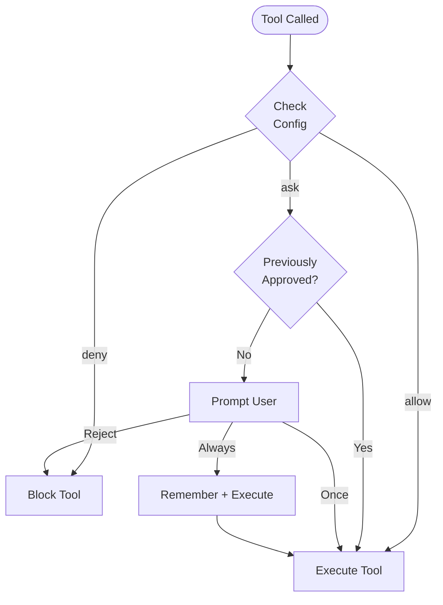

Cyberstrike utilise un système de permissions pour contrôler quels outils l'agent IA peut exécuter. Cela fournit des limites de sécurité tout en maintenant la productivité.

{/* TODO: GIF - Plan mode workflow */}
<div className="border-2 border-dashed border-gray-400 dark:border-gray-600 rounded-lg p-8 my-6 text-center bg-gray-100 dark:bg-gray-800">
  <p className="text-gray-500 dark:text-gray-400 font-mono text-sm">🎬 GIF: g04-plan-mode.gif</p>
  <p className="text-gray-400 dark:text-gray-500 text-xs mt-2">Démonstration du flux du mode plan (20s)</p>
</div>

{/* TODO: Screenshot - Permission prompt */}
<div className="border-2 border-dashed border-gray-400 dark:border-gray-600 rounded-lg p-8 my-6 text-center bg-gray-100 dark:bg-gray-800">
  <p className="text-gray-500 dark:text-gray-400 font-mono text-sm">📸 SCREENSHOT: s06-permission-prompt.png</p>
  <p className="text-gray-400 dark:text-gray-500 text-xs mt-2">Vue de l'invite de permission</p>
</div>

{/* TODO: Screenshot - Plan mode UI */}
<div className="border-2 border-dashed border-gray-400 dark:border-gray-600 rounded-lg p-8 my-6 text-center bg-gray-100 dark:bg-gray-800">
  <p className="text-gray-500 dark:text-gray-400 font-mono text-sm">📸 SCREENSHOT: s07-plan-mode.png</p>
  <p className="text-gray-400 dark:text-gray-500 text-xs mt-2">Interface du mode plan</p>
</div>

## Modèle de permissions



---

## Modes de permission

| Mode | Comportement | Cas d'utilisation |
|------|-------------|-------------------|
| `ask` | Demander l'approbation | Par défaut pour les outils sensibles |
| `allow` | Approbation automatique | Outils de confiance, automatisation |
| `deny` | Bloquer l'exécution | Opérations restreintes |

---

## Configurer les permissions

### Configuration globale

Définissez les permissions dans `~/.config/cyberstrike/cyberstrike.json` :

```json title="~/.config/cyberstrike/cyberstrike.json"
{
  "permission": {
    "read": "allow",
    "glob": "allow",
    "grep": "allow",
    "edit": "ask",
    "bash": "ask",
    "websearch": "ask"
  }
}
```

### Configuration par projet

Remplacez les permissions par projet dans `cyberstrike.json` :

```json title="cyberstrike.json"
{
  "permission": {
    "bash": "allow",
    "edit": "allow",
    "external_directory": "deny"
  }
}
```

Les paramètres du projet prennent le pas sur les paramètres globaux.

---

## Types de permissions

### Opérations sur les fichiers

| Permission | Outils | Par défaut | Description |
|------------|--------|------------|-------------|
| `read` | Read | `ask` | Lire le contenu des fichiers |
| `edit` | Write, Edit | `ask` | Modifier les fichiers |
| `glob` | Glob | `allow` | Trouver des fichiers par motif |
| `grep` | Grep | `allow` | Rechercher dans le contenu des fichiers |

### Exécution de commandes

| Permission | Outils | Par défaut | Description |
|------------|--------|------------|-------------|
| `bash` | Bash | `ask` | Exécuter des commandes shell |
| `task` | Task | `ask` | Créer des sous-agents |

### Opérations web

| Permission | Outils | Par défaut | Description |
|------------|--------|------------|-------------|
| `websearch` | WebSearch | `ask` | Rechercher sur le web |
| `webfetch` | WebFetch | `ask` | Récupérer du contenu web |
| `codesearch` | CodeSearch | `ask` | Rechercher dans les dépôts de code |

### Permissions spéciales

| Permission | Description |
|------------|-------------|
| `external_directory` | Accéder aux fichiers hors du projet |
| `lsp` | Opérations du serveur de langage |
| `doom_loop` | Détecter et interrompre les boucles infinies |

---

## Permissions basées sur des motifs

Utilisez des motifs pour accorder des permissions granulaires.

### Motifs de répertoires

Autoriser des répertoires spécifiques :

```json
{
  "permission": {
    "read": {
      "src/**": "allow",
      "test/**": "allow",
      "node_modules/**": "deny"
    },
    "edit": {
      "src/**": "allow",
      "*.config.js": "deny"
    }
  }
}
```

### Motifs de commandes

Autoriser des commandes spécifiques :

```json
{
  "permission": {
    "bash": {
      "git *": "allow",
      "npm test": "allow",
      "npm run *": "allow",
      "rm *": "deny"
    }
  }
}
```

### Correspondance par jokers

| Motif | Correspond à |
|-------|-------------|
| `*` | N'importe quel segment de chemin |
| `**` | N'importe quelle profondeur de chemin |
| `*.ts` | Fichiers se terminant par .ts |
| `src/**/*.ts` | Fichiers TypeScript dans src |

---

## Permissions par agent

Configurer les permissions par agent :

```json title="cyberstrike.json"
{
  "agent": {
    "web-application": {
      "permission": {
        "bash": "allow",
        "browser": "allow",
        "edit": "ask"
      }
    },
    "code-review": {
      "permission": {
        "read": "allow",
        "glob": "allow",
        "grep": "allow",
        "edit": "deny",
        "bash": "deny"
      }
    }
  }
}
```

---

## Approbation interactive

Lorsqu'un outil nécessite une permission, Cyberstrike demande l'approbation.

### Options de réponse

| Option | Comportement |
|--------|-------------|
| **Une fois** | Approuver cet appel spécifique |
| **Toujours** | Approuver tous les appels similaires dans la session |
| **Rejeter** | Bloquer cet appel |

### Boîte de dialogue d'approbation

```
┌─────────────────────────────────────────┐
│  Permission Required                     │
├─────────────────────────────────────────┤
│  Tool: Bash                              │
│  Command: git push origin main           │
│                                          │
│  [Once]  [Always]  [Reject]              │
└─────────────────────────────────────────┘
```

### Raccourcis clavier

| Touche | Action |
|--------|--------|
| `y` | Approuver une fois |
| `a` | Approuver toujours |
| `n` | Rejeter |
| `Esc` | Rejeter |

---

## Mémoire d'approbation de session

Lorsque vous sélectionnez « Toujours », Cyberstrike mémorise le motif d'approbation pour la session.

### Fonctionnement de la mémoire

1. L'utilisateur approuve `git push` avec « Toujours »
2. Le motif `git *` est stocké pour la session
3. Les futurs `git pull`, `git commit`, etc. sont automatiquement approuvés
4. La mémoire se réinitialise à la fin de la session

### Voir les motifs approuvés

Les motifs approuvés persistent jusqu'au redémarrage de la session.

---

## Mode automatisation

Pour le CI/CD et l'automatisation, configurez la confiance totale :

```json title="cyberstrike.json"
{
  "permission": "allow"
}
```

Cela définit toutes les permissions sur « autoriser » sans demander de confirmation.

<Aside variant="caution">
  L'utilisation de `"permission": "allow"` contourne toutes les vérifications de sécurité. À n'utiliser que dans des environnements contrôlés.
</Aside>

---

## Mode lecture seule

Restreindre l'agent aux opérations de lecture seule :

```json title="cyberstrike.json"
{
  "permission": {
    "read": "allow",
    "glob": "allow",
    "grep": "allow",
    "lsp": "allow",
    "edit": "deny",
    "bash": "deny",
    "websearch": "deny"
  }
}
```

Utilisez ceci pour les tâches de revue de code ou d'exploration.

---

## Accès aux répertoires externes

Par défaut, Cyberstrike restreint l'accès au répertoire du projet.

### Autoriser l'accès externe

```json
{
  "permission": {
    "external_directory": "ask"
  }
}
```

### Chemins externes spécifiques

```json
{
  "permission": {
    "external_directory": {
      "/home/user/shared/**": "allow",
      "/tmp/**": "allow",
      "/etc/**": "deny"
    }
  }
}
```

---

## Hooks de permissions

Utilisez les hooks de plugins pour un contrôle programmatique des permissions.

### Hook permission.ask

```typescript
const hooks: Hooks = {
  "permission.ask": async (input, output) => {
    // Approuver automatiquement les lectures dans src
    if (input.type === "read" && input.path?.startsWith("src/")) {
      output.status = "allow"
      return
    }

    // Bloquer l'accès aux secrets
    if (input.path?.includes("secret") || input.path?.includes(".env")) {
      output.status = "deny"
      return
    }

    // Par défaut : demander à l'utilisateur
    output.status = "ask"
  },
}
```

### Entrée du hook

| Champ | Type | Description |
|-------|------|-------------|
| `id` | string | ID de la demande de permission |
| `type` | string | Type de permission |
| `pattern` | string | Motif de correspondance |
| `sessionID` | string | Identifiant de session |
| `messageID` | string | Identifiant de message |
| `callID` | string | ID de l'appel d'outil |
| `message` | string | Description |
| `metadata` | object | Contexte supplémentaire |

### Sortie du hook

| Champ | Valeur | Description |
|-------|--------|-------------|
| `status` | `"ask"` | Demander à l'utilisateur |
| `status` | `"allow"` | Approuver automatiquement |
| `status` | `"deny"` | Bloquer |

---

## Bonnes pratiques de sécurité

### Environnement de développement

```json
{
  "permission": {
    "read": "allow",
    "glob": "allow",
    "grep": "allow",
    "edit": "ask",
    "bash": "ask"
  }
}
```

### Environnement de production/CI

```json
{
  "permission": {
    "read": "allow",
    "glob": "allow",
    "grep": "allow",
    "edit": "allow",
    "bash": {
      "npm test": "allow",
      "npm run build": "allow",
      "*": "deny"
    }
  }
}
```

### Mode audit de sécurité

```json
{
  "permission": {
    "read": "allow",
    "glob": "allow",
    "grep": "allow",
    "lsp": "allow",
    "websearch": "allow",
    "edit": "deny",
    "bash": "deny"
  }
}
```

---

## Priorité des permissions

Les permissions sont évaluées dans l'ordre :

1. Permissions **spécifiques à l'agent** (priorité la plus haute)
2. `cyberstrike.json` du **projet**
3. `~/.config/cyberstrike/cyberstrike.json` **global**
4. Valeurs **par défaut** intégrées (priorité la plus basse)

Les motifs plus spécifiques ont la priorité :

```json
{
  "permission": {
    "bash": "deny",
    "bash": {
      "git *": "allow"
    }
  }
}
```

Dans ce cas, `git push` est autorisé mais `rm -rf` est refusé.

---

## Dépannage

### La permission demande toujours confirmation

Vérifiez que votre configuration est valide :

```bash
cyberstrike config validate
```

Vérifiez que la permission est correctement définie :

```bash
cat ~/.config/cyberstrike/cyberstrike.json | jq .permission
```

### Permission non appliquée

1. Vérifiez la priorité entre configuration projet et globale
2. Vérifiez que la syntaxe du motif correspond au chemin
3. Redémarrez Cyberstrike pour recharger la configuration

### Opération bloquée

Si un outil est bloqué de manière inattendue :

1. Vérifiez les règles `deny` dans la configuration
2. Vérifiez les incompatibilités de motifs
3. Vérifiez les hooks de plugins qui pourraient bloquer

---

## Exemples

### Test de sécurité web

```json title="cyberstrike.json"
{
  "permission": {
    "bash": {
      "nmap *": "allow",
      "nikto *": "allow",
      "sqlmap *": "allow",
      "nuclei *": "allow"
    },
    "browser": "allow",
    "websearch": "allow",
    "edit": "ask"
  }
}
```

### Revue de code uniquement

```json title="cyberstrike.json"
{
  "permission": {
    "read": "allow",
    "glob": "allow",
    "grep": "allow",
    "lsp": "allow",
    "edit": "deny",
    "bash": "deny",
    "browser": "deny"
  }
}
```

### Automatisation complète

```json title="cyberstrike.json"
{
  "permission": "allow"
}
```

<Aside variant="tip">
  Commencez avec des permissions restrictives et assouplissez-les au besoin. Il est plus sûr d'approuver des actions individuelles que d'accorder un accès global.
</Aside>
