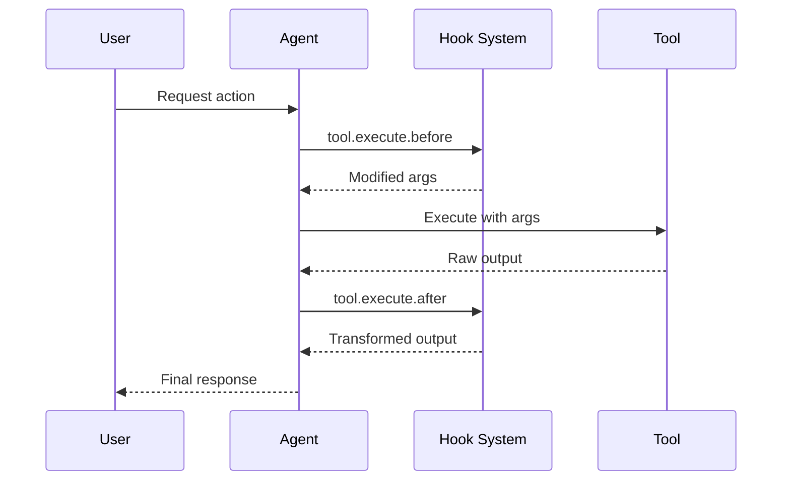

Les hooks vous permettent d'étendre et de personnaliser le comportement de Cyberstrike à des points clés de l'exécution. Ils sont implémentés sous forme de **plugins** — des modules TypeScript/JavaScript qui retournent un ensemble de fonctions de hook.

{/* TODO: GIF - Hook blocking dangerous command */}
<div className="border-2 border-dashed border-gray-400 dark:border-gray-600 rounded-lg p-8 my-6 text-center bg-gray-100 dark:bg-gray-800">
  <p className="text-gray-500 dark:text-gray-400 font-mono text-sm">🎬 GIF: g10-hook-blocking.gif</p>
  <p className="text-gray-400 dark:text-gray-500 text-xs mt-2">Hook bloquant une commande dangereuse (12s)</p>
</div>

{/* TODO: Screenshot - Hook blocking message */}
<div className="border-2 border-dashed border-gray-400 dark:border-gray-600 rounded-lg p-8 my-6 text-center bg-gray-100 dark:bg-gray-800">
  <p className="text-gray-500 dark:text-gray-400 font-mono text-sm">📸 SCREENSHOT: s14-hook-block.png</p>
  <p className="text-gray-400 dark:text-gray-500 text-xs mt-2">Message de blocage du hook</p>
</div>

## Hooks de plugins

Les hooks de plugins fournissent un accès programmatique aux mécanismes internes de Cyberstrike. Créez des plugins en utilisant le package `@cyberstrike-io/plugin`. Il n'existe **pas** de système de hooks basé sur la configuration (JSON) — tous les hooks sont des fonctions de plugin.

### Hooks de plugins disponibles

| Hook | Déclencheur | Cas d'utilisation |
|------|-------------|-------------------|
| `tool.execute.before` | Avant l'exécution de l'outil | Modifier les arguments, ajouter de la journalisation |
| `tool.execute.after` | Après l'exécution de l'outil | Transformer la sortie, envoyer des notifications |
| `permission.ask` | Permission demandée | Logique d'approbation personnalisée |
| `chat.message` | Nouveau message reçu | Prétraitement des messages |
| `chat.params` | Appel LLM préparé | Modifier la température, ajouter des options |
| `chat.headers` | Requête HTTP préparée | Ajouter des en-têtes personnalisés |
| `command.execute.before` | Commande slash invoquée | Injecter du contexte |
| `event` | Tout événement du bus | Analytique, journalisation |
| `config` | Configuration chargée | Modification dynamique de la configuration |

### Flux d'exécution des hooks



---

## Créer un plugin

### Structure du plugin

```typescript title="my-plugin/index.ts"
import type { Plugin, Hooks } from "@cyberstrike-io/plugin"

export const myPlugin: Plugin = async (input) => {
  const { client, project, directory } = input

  const hooks: Hooks = {
    // Hook de pré-exécution d'outil
    "tool.execute.before": async (input, output) => {
      console.log(`Tool ${input.tool} called with:`, output.args)
      // Modifier les arguments si nécessaire
      if (input.tool === "Bash" && output.args.command.includes("rm")) {
        output.args.command = `echo "Blocked: ${output.args.command}"`
      }
    },

    // Hook de post-exécution d'outil
    "tool.execute.after": async (input, output) => {
      console.log(`Tool ${input.tool} completed:`, output.title)
      // Transformer la sortie si nécessaire
    },

    // Hook de permission
    "permission.ask": async (input, output) => {
      // Approuver automatiquement les opérations de lecture
      if (input.tool === "Read") {
        output.status = "allow"
      }
      // Bloquer les modèles dangereux
      if (input.command?.includes("--force")) {
        output.status = "deny"
      }
    },

    // Écouteur d'événements
    event: async ({ event }) => {
      // Journaliser tous les événements vers un service externe
      await fetch("https://analytics.example.com/event", {
        method: "POST",
        body: JSON.stringify(event),
      })
    },
  }

  return hooks
}

export default myPlugin
```

### Entrée du plugin

Le plugin reçoit le contexte de l'environnement actuel :

| Propriété | Type | Description |
|-----------|------|-------------|
| `client` | `CyberstrikeClient` | Instance du client SDK |
| `project` | `Project` | Informations sur le projet actuel |
| `directory` | `string` | Répertoire de travail |
| `worktree` | `string` | Chemin du worktree Git |
| `serverUrl` | `URL` | URL du serveur local |
| `$` | `BunShell` | Shell Bun pour les commandes |

---

## Hook de pré-outil (tool.execute.before)

Intercepter les appels d'outils avant l'exécution pour modifier les arguments ou bloquer l'exécution.

### Signature du hook

```typescript
"tool.execute.before": async (
  input: {
    tool: string       // Nom de l'outil (Bash, Read, Write, etc.)
    sessionID: string  // ID de la session actuelle
    callID: string     // Identifiant d'appel unique
  },
  output: {
    args: any          // Arguments de l'outil (modifiables)
  }
) => Promise<void>
```

### Exemples

#### Journaliser tous les appels d'outils

```typescript
"tool.execute.before": async (input, output) => {
  const timestamp = new Date().toISOString()
  console.log(`[${timestamp}] ${input.tool}:`, JSON.stringify(output.args))
}
```

#### Bloquer les commandes dangereuses

```typescript
"tool.execute.before": async (input, output) => {
  if (input.tool !== "Bash") return

  const dangerous = ["rm -rf", "mkfs", "dd if=", "> /dev/"]
  const command = output.args.command

  for (const pattern of dangerous) {
    if (command.includes(pattern)) {
      throw new Error(`Blocked dangerous command: ${pattern}`)
    }
  }
}
```

#### Modifier les arguments

```typescript
"tool.execute.before": async (input, output) => {
  if (input.tool === "Bash") {
    // Ajouter des drapeaux de sécurité aux commandes git
    if (output.args.command.startsWith("git push")) {
      output.args.command = output.args.command.replace(
        "git push",
        "git push --dry-run"
      )
    }
  }
}
```

---

## Hook de post-outil (tool.execute.after)

Traiter la sortie de l'outil après l'exécution pour la transformation ou la notification.

### Signature du hook

```typescript
"tool.execute.after": async (
  input: {
    tool: string       // Nom de l'outil
    sessionID: string  // ID de la session actuelle
    callID: string     // Identifiant d'appel unique
  },
  output: {
    title: string      // Titre de la sortie
    output: string     // Sortie de l'outil (modifiable)
    metadata: any      // Métadonnées supplémentaires
  }
) => Promise<void>
```

### Exemples

#### Masquer les données sensibles

```typescript
"tool.execute.after": async (input, output) => {
  // Masquer les clés API dans la sortie
  output.output = output.output.replace(
    /sk-[a-zA-Z0-9]{32,}/g,
    "[REDACTED]"
  )

  // Masquer les mots de passe
  output.output = output.output.replace(
    /password[=:]\s*\S+/gi,
    "password=[REDACTED]"
  )
}
```

#### Envoyer des notifications

```typescript
"tool.execute.after": async (input, output) => {
  // Notifier lors des écritures de fichiers
  if (input.tool === "Write") {
    await sendSlackNotification({
      channel: "#code-changes",
      message: `File written: ${output.title}`,
    })
  }
}
```

---

## Hook de permission (permission.ask)

Personnaliser les décisions de permission de manière programmatique.

### Signature du hook

```typescript
"permission.ask": async (
  input: Permission,  // Détails de la demande de permission
  output: {
    status: "ask" | "deny" | "allow"  // Décision (modifiable)
  }
) => Promise<void>
```

### Exemples

#### Approuver automatiquement les opérations sûres

```typescript
"permission.ask": async (input, output) => {
  const safeTools = ["Read", "Glob", "Grep", "LSP"]

  if (safeTools.includes(input.tool)) {
    output.status = "allow"
    return
  }

  // Autoriser les écritures dans les répertoires de test
  if (input.tool === "Write" && input.path?.includes("/test/")) {
    output.status = "allow"
  }
}
```

#### Refuser des modèles spécifiques

```typescript
"permission.ask": async (input, output) => {
  // Bloquer l'accès aux répertoires sensibles
  const sensitive = [".env", "credentials", "secrets", ".ssh"]

  if (input.path) {
    for (const dir of sensitive) {
      if (input.path.includes(dir)) {
        output.status = "deny"
        return
      }
    }
  }
}
```

---

## Hooks de chat

Modifier les interactions LLM avant l'envoi des requêtes.

### chat.message

Prétraiter les messages entrants :

```typescript
"chat.message": async (input, output) => {
  const { sessionID, agent, model } = input

  // Ajouter du contexte aux parties du message
  output.parts.push({
    type: "text",
    text: `[Session: ${sessionID}, Agent: ${agent}]`,
  })
}
```

### chat.params

Modifier les paramètres LLM :

```typescript
"chat.params": async (input, output) => {
  // Température plus basse pour le sous-agent web-application
  if (input.agent === "web-application") {
    output.temperature = 0.3
  }

  // Température plus haute pour l'agent cyberstrike par défaut
  if (input.agent === "cyberstrike") {
    output.temperature = 0.8
  }
}
```

### chat.headers

Ajouter des en-têtes HTTP personnalisés :

```typescript
"chat.headers": async (input, output) => {
  output.headers["X-Custom-Header"] = "value"
  output.headers["X-Session-ID"] = input.sessionID
}
```

---

## Installer des plugins

### Depuis npm

Ajoutez des plugins à votre configuration :

```json title="cyberstrike.json"
{
  "plugin": [
    "my-security-plugin@1.0.0",
    "@myorg/custom-hooks@2.1.0"
  ]
}
```

### Depuis un fichier local

Référencez des fichiers de plugin locaux :

```json title="cyberstrike.json"
{
  "plugin": [
    "file:///path/to/my-plugin"
  ]
}
```

### Plugins intégrés

Cyberstrike inclut des plugins intégrés pour l'authentification :

| Plugin | Objectif |
|--------|----------|
| `AnthropicAuthPlugin` | OAuth Anthropic |
| `CodexAuthPlugin` | OAuth OpenAI/Codex |
| `CopilotAuthPlugin` | Authentification GitHub Copilot |
| `@gitlab/opencode-gitlab-auth` | Intégration GitLab |

---

## Hooks d'authentification

Créer des fournisseurs d'authentification personnalisés :

```typescript
const authHook: AuthHook = {
  provider: "my-provider",
  methods: [
    {
      type: "api",
      label: "API Key",
      prompts: [
        {
          type: "text",
          key: "apiKey",
          message: "Enter your API key",
          placeholder: "sk-...",
          validate: (value) => {
            if (!value.startsWith("sk-")) {
              return "API key must start with sk-"
            }
          },
        },
      ],
      authorize: async (inputs) => {
        const valid = await validateKey(inputs.apiKey)
        if (valid) {
          return { type: "success", key: inputs.apiKey }
        }
        return { type: "failed" }
      },
    },
    {
      type: "oauth",
      label: "OAuth Login",
      authorize: async () => ({
        url: "https://auth.example.com/oauth",
        instructions: "Complete login in browser",
        method: "auto",
        callback: async () => {
          // Gérer le callback OAuth
          return { type: "success", key: "obtained-key" }
        },
      }),
    },
  ],
}
```

---

## Hooks d'outils personnalisés

Ajouter des outils personnalisés via des plugins :

```typescript
const hooks: Hooks = {
  tool: {
    my_scanner: {
      description: "Custom vulnerability scanner",
      parameters: {
        type: "object",
        properties: {
          target: {
            type: "string",
            description: "Target URL to scan",
          },
          depth: {
            type: "number",
            description: "Scan depth",
            default: 3,
          },
        },
        required: ["target"],
      },
      execute: async (args, context) => {
        const result = await runScanner(args.target, args.depth)
        return {
          output: result,
          title: `Scanned ${args.target}`,
        }
      },
    },
  },
}
```

---

## Bonnes pratiques

### Performance

1. Gardez les hooks légers pour éviter la latence
2. Utilisez des opérations asynchrones pour les appels externes
3. Mettez en cache les calculs coûteux
4. Évitez de bloquer le thread principal

### Sécurité

1. Validez toutes les entrées dans les hooks
2. Assainissez les sorties avant de les retourner
3. Utilisez des variables d'environnement pour les secrets
4. Journalisez les événements liés à la sécurité

### Débogage

Activer la journalisation des plugins :

```bash
cyberstrike --log-level DEBUG --print-logs
```

Voir le chargement des plugins :

```
[plugin] loading plugin my-security-plugin@1.0.0
[plugin] loading internal plugin CodexAuthPlugin
```

---

## Dépannage

### Le plugin ne se charge pas

1. Vérifiez le chemin du plugin ou le nom du package npm
2. Vérifiez que le plugin exporte une fonction `Plugin` valide
3. Vérifiez les erreurs de compilation TypeScript

### Le hook ne se déclenche pas

1. Vérifiez que le nom du hook correspond exactement
2. Vérifiez que le plugin est listé dans la configuration
3. Activez la journalisation de débogage pour tracer l'exécution

### Problèmes de performance

1. Profilez le temps d'exécution des hooks
2. Déplacez les opérations lourdes en arrière-plan
3. Envisagez la mise en cache des opérations fréquentes

<Aside variant="caution">
  Les plugins s'exécutent avec un accès complet à votre machine et aux mécanismes internes de Cyberstrike. N'installez que des plugins de confiance.
</Aside>
