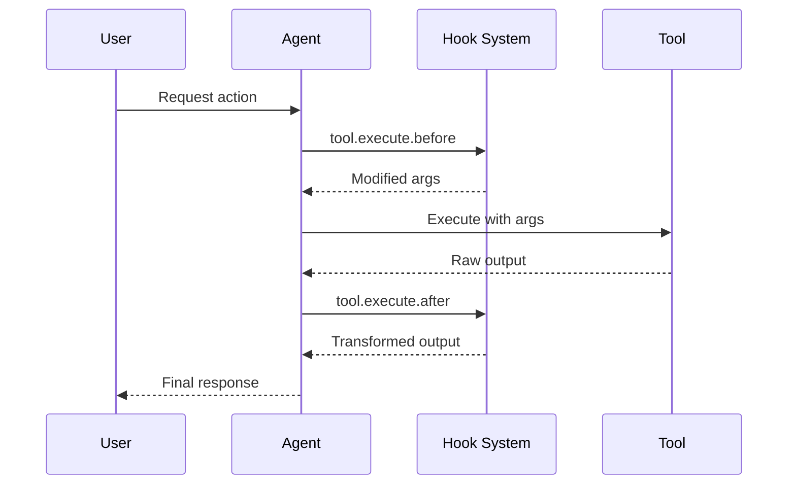

हुक्स आपको निष्पादन के दौरान प्रमुख बिंदुओं पर Cyberstrike के व्यवहार को विस्तारित और अनुकूलित करने देते हैं। इन्हें **प्लगइन्स** के रूप में लागू किया जाता है — TypeScript/JavaScript मॉड्यूल जो हुक फंक्शन्स का एक सेट लौटाते हैं।

{/* TODO: GIF - Hook blocking dangerous command */}
<div className="border-2 border-dashed border-gray-400 dark:border-gray-600 rounded-lg p-8 my-6 text-center bg-gray-100 dark:bg-gray-800">
  <p className="text-gray-500 dark:text-gray-400 font-mono text-sm">🎬 GIF: g10-hook-blocking.gif</p>
  <p className="text-gray-400 dark:text-gray-500 text-xs mt-2">हुक खतरनाक कमांड को रोकते हुए (12s)</p>
</div>

{/* TODO: Screenshot - Hook blocking message */}
<div className="border-2 border-dashed border-gray-400 dark:border-gray-600 rounded-lg p-8 my-6 text-center bg-gray-100 dark:bg-gray-800">
  <p className="text-gray-500 dark:text-gray-400 font-mono text-sm">📸 SCREENSHOT: s14-hook-block.png</p>
  <p className="text-gray-400 dark:text-gray-500 text-xs mt-2">हुक अवरोधन संदेश</p>
</div>

## प्लगइन हुक्स

प्लगइन हुक्स Cyberstrike के आंतरिक भागों तक प्रोग्रामेटिक पहुँच प्रदान करते हैं। `@cyberstrike-io/plugin` पैकेज का उपयोग करके प्लगइन बनाएं। कॉन्फ़िग-आधारित (JSON) हुक सिस्टम **नहीं** है — सभी हुक्स प्लगइन फंक्शन हैं।

### उपलब्ध प्लगइन हुक्स

| हुक | ट्रिगर | उपयोग का मामला |
|------|---------|----------|
| `tool.execute.before` | टूल निष्पादन से पहले | आर्गुमेंट्स संशोधित करें, लॉगिंग जोड़ें |
| `tool.execute.after` | टूल निष्पादन के बाद | आउटपुट बदलें, सूचनाएं भेजें |
| `permission.ask` | अनुमति का अनुरोध | कस्टम अनुमोदन लॉजिक |
| `chat.message` | नया संदेश प्राप्त | संदेश प्री-प्रोसेसिंग |
| `chat.params` | LLM कॉल तैयार | तापमान संशोधित करें, विकल्प जोड़ें |
| `chat.headers` | HTTP अनुरोध तैयार | कस्टम हेडर्स जोड़ें |
| `command.execute.before` | स्लैश कमांड चालू | कॉन्टेक्स्ट इंजेक्ट करें |
| `event` | कोई भी बस इवेंट | एनालिटिक्स, लॉगिंग |
| `config` | कॉन्फ़िगरेशन लोड | डायनामिक कॉन्फ़िग संशोधन |

### हुक निष्पादन प्रवाह



---

## प्लगइन बनाना

### प्लगइन संरचना

```typescript title="my-plugin/index.ts"
import type { Plugin, Hooks } from "@cyberstrike-io/plugin"

export const myPlugin: Plugin = async (input) => {
  const { client, project, directory } = input

  const hooks: Hooks = {
    // प्री-टूल निष्पादन हुक
    "tool.execute.before": async (input, output) => {
      console.log(`Tool ${input.tool} called with:`, output.args)
      // आवश्यकतानुसार आर्ग्स संशोधित करें
      if (input.tool === "Bash" && output.args.command.includes("rm")) {
        output.args.command = `echo "Blocked: ${output.args.command}"`
      }
    },

    // पोस्ट-टूल निष्पादन हुक
    "tool.execute.after": async (input, output) => {
      console.log(`Tool ${input.tool} completed:`, output.title)
      // आवश्यकतानुसार आउटपुट बदलें
    },

    // अनुमति हुक
    "permission.ask": async (input, output) => {
      // रीड ऑपरेशन्स को ऑटो-अप्रूव करें
      if (input.tool === "Read") {
        output.status = "allow"
      }
      // खतरनाक पैटर्न को ब्लॉक करें
      if (input.command?.includes("--force")) {
        output.status = "deny"
      }
    },

    // इवेंट लिसनर
    event: async ({ event }) => {
      // सभी इवेंट्स को बाहरी सेवा में लॉग करें
      await fetch("https://analytics.example.com/event", {
        method: "POST",
        body: JSON.stringify(event),
      })
    },
  }

  return hooks
}

export default myPlugin
```

### प्लगइन इनपुट

प्लगइन को वर्तमान वातावरण के बारे में कॉन्टेक्स्ट प्राप्त होता है:

| प्रॉपर्टी | टाइप | विवरण |
|----------|------|-------------|
| `client` | `CyberstrikeClient` | SDK क्लाइंट इंस्टेंस |
| `project` | `Project` | वर्तमान प्रोजेक्ट जानकारी |
| `directory` | `string` | वर्किंग डायरेक्टरी |
| `worktree` | `string` | Git worktree पथ |
| `serverUrl` | `URL` | स्थानीय सर्वर URL |
| `$` | `BunShell` | कमांड के लिए Bun शेल |

---

## प्री-टूल हुक (tool.execute.before)

निष्पादन से पहले टूल कॉल्स को इंटरसेप्ट करें — आर्गुमेंट्स संशोधित करें या निष्पादन को ब्लॉक करें।

### हुक सिग्नेचर

```typescript
"tool.execute.before": async (
  input: {
    tool: string       // टूल का नाम (Bash, Read, Write, आदि)
    sessionID: string  // वर्तमान सत्र ID
    callID: string     // यूनिक कॉल आइडेंटिफायर
  },
  output: {
    args: any          // टूल आर्गुमेंट्स (परिवर्तनीय)
  }
) => Promise<void>
```

### उदाहरण

#### सभी टूल कॉल्स की लॉगिंग

```typescript
"tool.execute.before": async (input, output) => {
  const timestamp = new Date().toISOString()
  console.log(`[${timestamp}] ${input.tool}:`, JSON.stringify(output.args))
}
```

#### खतरनाक कमांड्स को ब्लॉक करना

```typescript
"tool.execute.before": async (input, output) => {
  if (input.tool !== "Bash") return

  const dangerous = ["rm -rf", "mkfs", "dd if=", "> /dev/"]
  const command = output.args.command

  for (const pattern of dangerous) {
    if (command.includes(pattern)) {
      throw new Error(`Blocked dangerous command: ${pattern}`)
    }
  }
}
```

#### आर्गुमेंट्स संशोधित करना

```typescript
"tool.execute.before": async (input, output) => {
  if (input.tool === "Bash") {
    // git कमांड्स में सुरक्षा फ्लैग जोड़ें
    if (output.args.command.startsWith("git push")) {
      output.args.command = output.args.command.replace(
        "git push",
        "git push --dry-run"
      )
    }
  }
}
```

---

## पोस्ट-टूल हुक (tool.execute.after)

परिवर्तन या सूचना के लिए निष्पादन के बाद टूल आउटपुट को प्रोसेस करें।

### हुक सिग्नेचर

```typescript
"tool.execute.after": async (
  input: {
    tool: string       // टूल का नाम
    sessionID: string  // वर्तमान सत्र ID
    callID: string     // यूनिक कॉल आइडेंटिफायर
  },
  output: {
    title: string      // आउटपुट शीर्षक
    output: string     // टूल आउटपुट (परिवर्तनीय)
    metadata: any      // अतिरिक्त मेटाडेटा
  }
) => Promise<void>
```

### उदाहरण

#### संवेदनशील डेटा को छिपाना

```typescript
"tool.execute.after": async (input, output) => {
  // आउटपुट से API कुंजियाँ छिपाएं
  output.output = output.output.replace(
    /sk-[a-zA-Z0-9]{32,}/g,
    "[REDACTED]"
  )

  // पासवर्ड छिपाएं
  output.output = output.output.replace(
    /password[=:]\s*\S+/gi,
    "password=[REDACTED]"
  )
}
```

#### सूचनाएं भेजना

```typescript
"tool.execute.after": async (input, output) => {
  // फ़ाइल लिखने पर सूचित करें
  if (input.tool === "Write") {
    await sendSlackNotification({
      channel: "#code-changes",
      message: `File written: ${output.title}`,
    })
  }
}
```

---

## अनुमति हुक (permission.ask)

प्रोग्रामेटिक रूप से अनुमति निर्णयों को अनुकूलित करें।

### हुक सिग्नेचर

```typescript
"permission.ask": async (
  input: Permission,  // अनुमति अनुरोध विवरण
  output: {
    status: "ask" | "deny" | "allow"  // निर्णय (परिवर्तनीय)
  }
) => Promise<void>
```

### उदाहरण

#### सुरक्षित ऑपरेशन्स को ऑटो-अप्रूव करना

```typescript
"permission.ask": async (input, output) => {
  const safeTools = ["Read", "Glob", "Grep", "LSP"]

  if (safeTools.includes(input.tool)) {
    output.status = "allow"
    return
  }

  // टेस्ट डायरेक्टरी में लिखने की अनुमति दें
  if (input.tool === "Write" && input.path?.includes("/test/")) {
    output.status = "allow"
  }
}
```

#### विशिष्ट पैटर्न को अस्वीकार करना

```typescript
"permission.ask": async (input, output) => {
  // संवेदनशील डायरेक्टरी तक पहुँच ब्लॉक करें
  const sensitive = [".env", "credentials", "secrets", ".ssh"]

  if (input.path) {
    for (const dir of sensitive) {
      if (input.path.includes(dir)) {
        output.status = "deny"
        return
      }
    }
  }
}
```

---

## चैट हुक्स

अनुरोध भेजने से पहले LLM इंटरैक्शन को संशोधित करें।

### chat.message

आने वाले संदेशों को प्री-प्रोसेस करें:

```typescript
"chat.message": async (input, output) => {
  const { sessionID, agent, model } = input

  // संदेश भागों में कॉन्टेक्स्ट जोड़ें
  output.parts.push({
    type: "text",
    text: `[Session: ${sessionID}, Agent: ${agent}]`,
  })
}
```

### chat.params

LLM पैरामीटर संशोधित करें:

```typescript
"chat.params": async (input, output) => {
  // web-application सबएजेंट के लिए कम तापमान
  if (input.agent === "web-application") {
    output.temperature = 0.3
  }

  // डिफ़ॉल्ट cyberstrike एजेंट के लिए अधिक तापमान
  if (input.agent === "cyberstrike") {
    output.temperature = 0.8
  }
}
```

### chat.headers

कस्टम HTTP हेडर्स जोड़ें:

```typescript
"chat.headers": async (input, output) => {
  output.headers["X-Custom-Header"] = "value"
  output.headers["X-Session-ID"] = input.sessionID
}
```

---

## प्लगइन इंस्टॉल करना

### npm से

अपने कॉन्फ़िगरेशन में प्लगइन जोड़ें:

```json title="cyberstrike.json"
{
  "plugin": [
    "my-security-plugin@1.0.0",
    "@myorg/custom-hooks@2.1.0"
  ]
}
```

### स्थानीय फ़ाइल से

स्थानीय प्लगइन फ़ाइलों का संदर्भ दें:

```json title="cyberstrike.json"
{
  "plugin": [
    "file:///path/to/my-plugin"
  ]
}
```

### बिल्ट-इन प्लगइन्स

Cyberstrike में प्रमाणीकरण के लिए बिल्ट-इन प्लगइन शामिल हैं:

| प्लगइन | उद्देश्य |
|--------|---------|
| `AnthropicAuthPlugin` | Anthropic OAuth |
| `CodexAuthPlugin` | OpenAI/Codex OAuth |
| `CopilotAuthPlugin` | GitHub Copilot प्रमाणीकरण |
| `@gitlab/opencode-gitlab-auth` | GitLab एकीकरण |

---

## प्रमाणीकरण हुक्स

कस्टम प्रमाणीकरण प्रदाता बनाएं:

```typescript
const authHook: AuthHook = {
  provider: "my-provider",
  methods: [
    {
      type: "api",
      label: "API Key",
      prompts: [
        {
          type: "text",
          key: "apiKey",
          message: "Enter your API key",
          placeholder: "sk-...",
          validate: (value) => {
            if (!value.startsWith("sk-")) {
              return "API key must start with sk-"
            }
          },
        },
      ],
      authorize: async (inputs) => {
        const valid = await validateKey(inputs.apiKey)
        if (valid) {
          return { type: "success", key: inputs.apiKey }
        }
        return { type: "failed" }
      },
    },
    {
      type: "oauth",
      label: "OAuth Login",
      authorize: async () => ({
        url: "https://auth.example.com/oauth",
        instructions: "Complete login in browser",
        method: "auto",
        callback: async () => {
          // OAuth कॉलबैक हैंडल करें
          return { type: "success", key: "obtained-key" }
        },
      }),
    },
  ],
}
```

---

## कस्टम टूल हुक्स

प्लगइन के माध्यम से कस्टम टूल जोड़ें:

```typescript
const hooks: Hooks = {
  tool: {
    my_scanner: {
      description: "Custom vulnerability scanner",
      parameters: {
        type: "object",
        properties: {
          target: {
            type: "string",
            description: "Target URL to scan",
          },
          depth: {
            type: "number",
            description: "Scan depth",
            default: 3,
          },
        },
        required: ["target"],
      },
      execute: async (args, context) => {
        const result = await runScanner(args.target, args.depth)
        return {
          output: result,
          title: `Scanned ${args.target}`,
        }
      },
    },
  },
}
```

---

## सर्वोत्तम प्रथाएं

### प्रदर्शन

1. विलंबता से बचने के लिए हुक्स को हल्का रखें
2. बाहरी कॉल्स के लिए async ऑपरेशन्स का उपयोग करें
3. महंगी गणनाओं को कैश करें
4. मुख्य थ्रेड को ब्लॉक करने से बचें

### सुरक्षा

1. हुक्स में सभी इनपुट्स को मान्य करें
2. लौटाने से पहले आउटपुट को सैनिटाइज़ करें
3. सीक्रेट्स के लिए एनवायरनमेंट वेरिएबल्स का उपयोग करें
4. सुरक्षा-संबंधित इवेंट्स को लॉग करें

### डीबगिंग

प्लगइन लॉगिंग सक्षम करें:

```bash
cyberstrike --log-level DEBUG --print-logs
```

प्लगइन लोडिंग देखें:

```
[plugin] loading plugin my-security-plugin@1.0.0
[plugin] loading internal plugin CodexAuthPlugin
```

---

## समस्या निवारण

### प्लगइन लोड नहीं हो रहा

1. प्लगइन पथ या npm पैकेज नाम की जाँच करें
2. सत्यापित करें कि प्लगइन एक वैध `Plugin` फंक्शन निर्यात करता है
3. TypeScript संकलन त्रुटियों की जाँच करें

### हुक ट्रिगर नहीं हो रहा

1. सत्यापित करें कि हुक नाम बिल्कुल मेल खाता है
2. जाँचें कि प्लगइन कॉन्फ़िगरेशन में सूचीबद्ध है
3. निष्पादन ट्रेस करने के लिए डीबग लॉगिंग सक्षम करें

### प्रदर्शन समस्याएं

1. हुक निष्पादन समय को प्रोफ़ाइल करें
2. भारी ऑपरेशन्स को बैकग्राउंड में ले जाएं
3. बार-बार होने वाले ऑपरेशन्स के लिए कैशिंग पर विचार करें

<Aside variant="caution">
  प्लगइन्स आपकी मशीन और Cyberstrike के आंतरिक भागों तक पूर्ण पहुँच के साथ चलते हैं। केवल विश्वसनीय प्लगइन ही इंस्टॉल करें।
</Aside>
