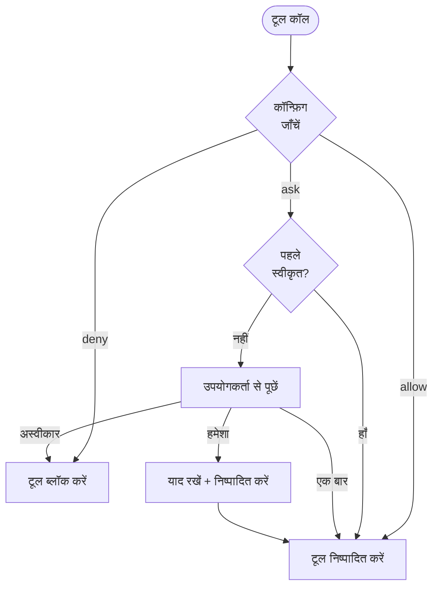

Cyberstrike एक अनुमति प्रणाली का उपयोग करता है जो नियंत्रित करती है कि AI एजेंट कौन से उपकरण निष्पादित कर सकता है। यह उत्पादकता बनाए रखते हुए सुरक्षा सीमाएं प्रदान करता है।

{/* TODO: GIF - Plan mode workflow */}
<div className="border-2 border-dashed border-gray-400 dark:border-gray-600 rounded-lg p-8 my-6 text-center bg-gray-100 dark:bg-gray-800">
  <p className="text-gray-500 dark:text-gray-400 font-mono text-sm">🎬 GIF: g04-plan-mode.gif</p>
  <p className="text-gray-400 dark:text-gray-500 text-xs mt-2">Plan mode कार्यप्रवाह डेमो (20s)</p>
</div>

{/* TODO: Screenshot - Permission prompt */}
<div className="border-2 border-dashed border-gray-400 dark:border-gray-600 rounded-lg p-8 my-6 text-center bg-gray-100 dark:bg-gray-800">
  <p className="text-gray-500 dark:text-gray-400 font-mono text-sm">📸 SCREENSHOT: s06-permission-prompt.png</p>
  <p className="text-gray-400 dark:text-gray-500 text-xs mt-2">अनुमति संकेत दृश्य</p>
</div>

{/* TODO: Screenshot - Plan mode UI */}
<div className="border-2 border-dashed border-gray-400 dark:border-gray-600 rounded-lg p-8 my-6 text-center bg-gray-100 dark:bg-gray-800">
  <p className="text-gray-500 dark:text-gray-400 font-mono text-sm">📸 SCREENSHOT: s07-plan-mode.png</p>
  <p className="text-gray-400 dark:text-gray-500 text-xs mt-2">Plan mode इंटरफ़ेस</p>
</div>

## अनुमति मॉडल



---

## अनुमति मोड

| मोड | व्यवहार | उपयोग का मामला |
|------|----------|----------|
| `ask` | अनुमोदन के लिए संकेत | संवेदनशील उपकरणों के लिए डिफ़ॉल्ट |
| `allow` | ऑटो-अनुमोदन | विश्वसनीय उपकरण, ऑटोमेशन |
| `deny` | निष्पादन ब्लॉक करें | प्रतिबंधित ऑपरेशन |

---

## अनुमतियाँ कॉन्फ़िगर करना

### ग्लोबल कॉन्फ़िगरेशन

`~/.config/cyberstrike/cyberstrike.json` में अनुमतियाँ सेट करें:

```json title="~/.config/cyberstrike/cyberstrike.json"
{
  "permission": {
    "read": "allow",
    "glob": "allow",
    "grep": "allow",
    "edit": "ask",
    "bash": "ask",
    "websearch": "ask"
  }
}
```

### प्रोजेक्ट कॉन्फ़िगरेशन

`cyberstrike.json` में प्रति-प्रोजेक्ट अनुमतियाँ ओवरराइड करें:

```json title="cyberstrike.json"
{
  "permission": {
    "bash": "allow",
    "edit": "allow",
    "external_directory": "deny"
  }
}
```

प्रोजेक्ट सेटिंग्स ग्लोबल सेटिंग्स को ओवरराइड करती हैं।

---

## अनुमति प्रकार

### फ़ाइल ऑपरेशन

| अनुमति | उपकरण | डिफ़ॉल्ट | विवरण |
|------------|-------|---------|-------------|
| `read` | Read | `ask` | फ़ाइल सामग्री पढ़ें |
| `edit` | Write, Edit | `ask` | फ़ाइलें संशोधित करें |
| `glob` | Glob | `allow` | पैटर्न से फ़ाइलें खोजें |
| `grep` | Grep | `allow` | फ़ाइल सामग्री खोजें |

### कमांड निष्पादन

| अनुमति | उपकरण | डिफ़ॉल्ट | विवरण |
|------------|-------|---------|-------------|
| `bash` | Bash | `ask` | शेल कमांड निष्पादित करें |
| `task` | Task | `ask` | सब-एजेंट बनाएं |

### वेब ऑपरेशन

| अनुमति | उपकरण | डिफ़ॉल्ट | विवरण |
|------------|-------|---------|-------------|
| `websearch` | WebSearch | `ask` | वेब खोजें |
| `webfetch` | WebFetch | `ask` | वेब सामग्री प्राप्त करें |
| `codesearch` | CodeSearch | `ask` | कोड रिपॉज़िटरी खोजें |

### विशेष अनुमतियाँ

| अनुमति | विवरण |
|------------|-------------|
| `external_directory` | प्रोजेक्ट के बाहर फ़ाइलों तक पहुँच |
| `lsp` | भाषा सर्वर ऑपरेशन |
| `doom_loop` | अनंत लूप का पता लगाएं और तोड़ें |

---

## पैटर्न-आधारित अनुमतियाँ

विस्तृत अनुमतियाँ प्रदान करने के लिए पैटर्न का उपयोग करें।

### डायरेक्टरी पैटर्न

विशिष्ट डायरेक्टरी की अनुमति दें:

```json
{
  "permission": {
    "read": {
      "src/**": "allow",
      "test/**": "allow",
      "node_modules/**": "deny"
    },
    "edit": {
      "src/**": "allow",
      "*.config.js": "deny"
    }
  }
}
```

### कमांड पैटर्न

विशिष्ट कमांड की अनुमति दें:

```json
{
  "permission": {
    "bash": {
      "git *": "allow",
      "npm test": "allow",
      "npm run *": "allow",
      "rm *": "deny"
    }
  }
}
```

### वाइल्डकार्ड मिलान

| पैटर्न | मिलान |
|---------|---------|
| `*` | कोई भी एकल पथ खंड |
| `**` | कोई भी पथ गहराई |
| `*.ts` | .ts में समाप्त होने वाली फ़ाइलें |
| `src/**/*.ts` | src में TypeScript फ़ाइलें |

---

## एजेंट अनुमतियाँ

प्रति-एजेंट अनुमतियाँ कॉन्फ़िगर करें:

```json title="cyberstrike.json"
{
  "agent": {
    "web-application": {
      "permission": {
        "bash": "allow",
        "browser": "allow",
        "edit": "ask"
      }
    },
    "code-review": {
      "permission": {
        "read": "allow",
        "glob": "allow",
        "grep": "allow",
        "edit": "deny",
        "bash": "deny"
      }
    }
  }
}
```

---

## इंटरैक्टिव अनुमोदन

जब किसी उपकरण को अनुमति की आवश्यकता होती है, तो Cyberstrike अनुमोदन के लिए संकेत करता है।

### प्रतिक्रिया विकल्प

| विकल्प | व्यवहार |
|--------|----------|
| **एक बार** | इस विशिष्ट कॉल को स्वीकृत करें |
| **हमेशा** | सत्र में सभी समान कॉल स्वीकृत करें |
| **अस्वीकार** | इस कॉल को ब्लॉक करें |

### अनुमोदन डायलॉग

```
┌─────────────────────────────────────────┐
│  अनुमति आवश्यक                          │
├─────────────────────────────────────────┤
│  उपकरण: Bash                            │
│  कमांड: git push origin main             │
│                                          │
│  [एक बार]  [हमेशा]  [अस्वीकार]           │
└─────────────────────────────────────────┘
```

### कीबोर्ड शॉर्टकट

| कुंजी | कार्य |
|-----|--------|
| `y` | एक बार स्वीकृत |
| `a` | हमेशा स्वीकृत |
| `n` | अस्वीकार |
| `Esc` | अस्वीकार |

---

## सत्र अनुमोदन मेमोरी

जब आप "हमेशा" चुनते हैं, तो Cyberstrike सत्र के लिए अनुमोदन पैटर्न याद रखता है।

### मेमोरी कैसे काम करती है

1. उपयोगकर्ता "हमेशा" के साथ `git push` को स्वीकृत करता है
2. पैटर्न `git *` सत्र के लिए संग्रहित होता है
3. भविष्य में `git pull`, `git commit`, आदि ऑटो-स्वीकृत होते हैं
4. सत्र समाप्त होने पर मेमोरी रीसेट होती है

### स्वीकृत पैटर्न देखना

स्वीकृत पैटर्न सत्र पुनः आरंभ होने तक बने रहते हैं।

---

## ऑटोमेशन मोड

CI/CD और ऑटोमेशन के लिए, पूर्ण विश्वास कॉन्फ़िगर करें:

```json title="cyberstrike.json"
{
  "permission": "allow"
}
```

यह बिना संकेत के सभी अनुमतियों को अनुमति पर सेट करता है।

<Aside variant="caution">
  `"permission": "allow"` का उपयोग सभी सुरक्षा जाँचों को बायपास करता है। केवल नियंत्रित वातावरण में उपयोग करें।
</Aside>

---

## केवल-पठन मोड

एजेंट को केवल-पठन ऑपरेशन तक प्रतिबंधित करें:

```json title="cyberstrike.json"
{
  "permission": {
    "read": "allow",
    "glob": "allow",
    "grep": "allow",
    "lsp": "allow",
    "edit": "deny",
    "bash": "deny",
    "websearch": "deny"
  }
}
```

कोड समीक्षा या अन्वेषण कार्यों के लिए इसका उपयोग करें।

---

## बाहरी डायरेक्टरी पहुँच

डिफ़ॉल्ट रूप से, Cyberstrike प्रोजेक्ट डायरेक्टरी तक पहुँच प्रतिबंधित करता है।

### बाहरी पहुँच की अनुमति

```json
{
  "permission": {
    "external_directory": "ask"
  }
}
```

### विशिष्ट बाहरी पथ

```json
{
  "permission": {
    "external_directory": {
      "/home/user/shared/**": "allow",
      "/tmp/**": "allow",
      "/etc/**": "deny"
    }
  }
}
```

---

## अनुमति हुक्स

प्रोग्रामेटिक अनुमति नियंत्रण के लिए प्लगइन हुक्स का उपयोग करें।

### permission.ask हुक

```typescript
const hooks: Hooks = {
  "permission.ask": async (input, output) => {
    // src में रीड ऑपरेशन्स को ऑटो-अप्रूव करें
    if (input.type === "read" && input.path?.startsWith("src/")) {
      output.status = "allow"
      return
    }

    // सीक्रेट्स तक पहुँच ब्लॉक करें
    if (input.path?.includes("secret") || input.path?.includes(".env")) {
      output.status = "deny"
      return
    }

    // डिफ़ॉल्ट: उपयोगकर्ता से पूछें
    output.status = "ask"
  },
}
```

### हुक इनपुट

| फ़ील्ड | टाइप | विवरण |
|-------|------|-------------|
| `id` | string | अनुमति अनुरोध ID |
| `type` | string | अनुमति प्रकार |
| `pattern` | string | मिलान पैटर्न |
| `sessionID` | string | सत्र पहचानकर्ता |
| `messageID` | string | संदेश पहचानकर्ता |
| `callID` | string | टूल कॉल ID |
| `message` | string | विवरण |
| `metadata` | object | अतिरिक्त संदर्भ |

### हुक आउटपुट

| फ़ील्ड | मान | विवरण |
|-------|-------|-------------|
| `status` | `"ask"` | उपयोगकर्ता से पूछें |
| `status` | `"allow"` | ऑटो-अनुमोदन |
| `status` | `"deny"` | ब्लॉक करें |

---

## सुरक्षा सर्वोत्तम प्रथाएं

### विकास वातावरण

```json
{
  "permission": {
    "read": "allow",
    "glob": "allow",
    "grep": "allow",
    "edit": "ask",
    "bash": "ask"
  }
}
```

### उत्पादन/CI वातावरण

```json
{
  "permission": {
    "read": "allow",
    "glob": "allow",
    "grep": "allow",
    "edit": "allow",
    "bash": {
      "npm test": "allow",
      "npm run build": "allow",
      "*": "deny"
    }
  }
}
```

### सुरक्षा ऑडिट मोड

```json
{
  "permission": {
    "read": "allow",
    "glob": "allow",
    "grep": "allow",
    "lsp": "allow",
    "websearch": "allow",
    "edit": "deny",
    "bash": "deny"
  }
}
```

---

## अनुमति प्राथमिकता

अनुमतियाँ क्रम में मूल्यांकित की जाती हैं:

1. **एजेंट-विशिष्ट** अनुमतियाँ (सर्वोच्च प्राथमिकता)
2. **प्रोजेक्ट** `cyberstrike.json`
3. **ग्लोबल** `~/.config/cyberstrike/cyberstrike.json`
4. **डिफ़ॉल्ट** बिल्ट-इन मान (सबसे कम प्राथमिकता)

अधिक विशिष्ट पैटर्न को प्राथमिकता मिलती है:

```json
{
  "permission": {
    "bash": "deny",
    "bash": {
      "git *": "allow"
    }
  }
}
```

इस मामले में, `git push` की अनुमति है लेकिन `rm -rf` अस्वीकृत है।

---

## समस्या निवारण

### अनुमति हमेशा संकेत कर रही है

जाँचें कि आपका कॉन्फ़िगरेशन वैध है:

```bash
cyberstrike config validate
```

सत्यापित करें कि अनुमति सही ढंग से सेट है:

```bash
cat ~/.config/cyberstrike/cyberstrike.json | jq .permission
```

### अनुमति लागू नहीं हो रही

1. प्रोजेक्ट बनाम ग्लोबल कॉन्फ़िग प्राथमिकता जाँचें
2. सत्यापित करें कि पैटर्न सिंटैक्स पथ से मेल खाता है
3. कॉन्फ़िग पुनः लोड करने के लिए Cyberstrike पुनः आरंभ करें

### अवरोधित ऑपरेशन

यदि कोई उपकरण अप्रत्याशित रूप से अवरोधित है:

1. कॉन्फ़िग में `deny` नियम जाँचें
2. पैटर्न बेमेल जाँचें
3. प्लगइन हुक्स जाँचें जो ब्लॉक कर सकते हैं

---

## उदाहरण

### वेब सुरक्षा परीक्षण

```json title="cyberstrike.json"
{
  "permission": {
    "bash": {
      "nmap *": "allow",
      "nikto *": "allow",
      "sqlmap *": "allow",
      "nuclei *": "allow"
    },
    "browser": "allow",
    "websearch": "allow",
    "edit": "ask"
  }
}
```

### केवल कोड समीक्षा

```json title="cyberstrike.json"
{
  "permission": {
    "read": "allow",
    "glob": "allow",
    "grep": "allow",
    "lsp": "allow",
    "edit": "deny",
    "bash": "deny",
    "browser": "deny"
  }
}
```

### पूर्ण ऑटोमेशन

```json title="cyberstrike.json"
{
  "permission": "allow"
}
```

<Aside variant="tip">
  प्रतिबंधात्मक अनुमतियों से शुरू करें और आवश्यकतानुसार ढीला करें। व्यक्तिगत कार्यों को स्वीकृत करना व्यापक पहुँच प्रदान करने से अधिक सुरक्षित है।
</Aside>
