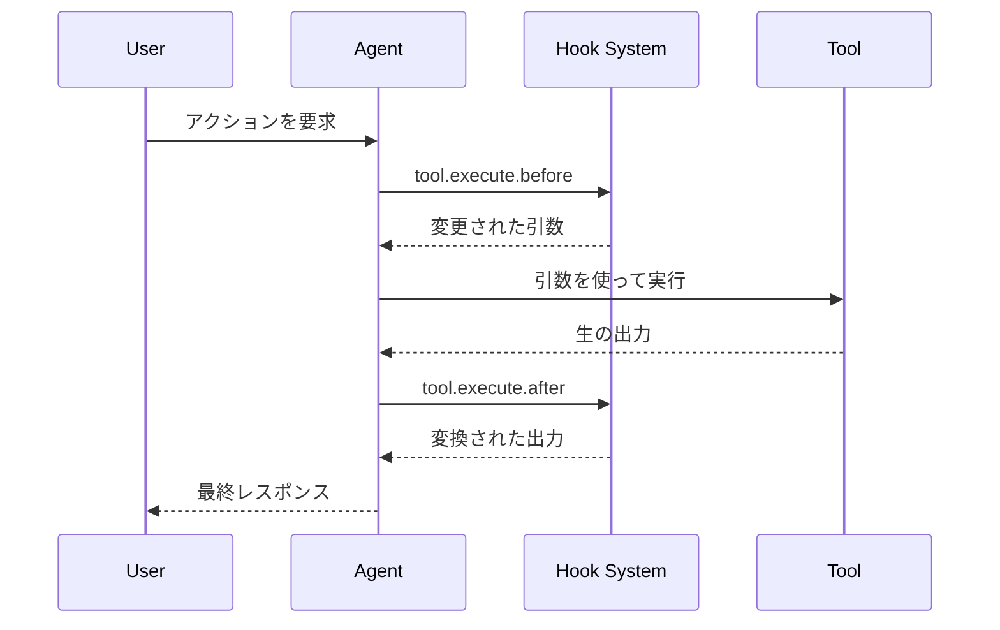

フックを使うと、実行中の重要なポイントでCyberstrikeの動作を拡張・カスタマイズできます。フックは**プラグイン**として実装されます — フック関数のセットを返すTypeScript/JavaScriptモジュールです。

{/* TODO: GIF - Hook blocking dangerous command */}
<div className="border-2 border-dashed border-gray-400 dark:border-gray-600 rounded-lg p-8 my-6 text-center bg-gray-100 dark:bg-gray-800">
  <p className="text-gray-500 dark:text-gray-400 font-mono text-sm">🎬 GIF: g10-hook-blocking.gif</p>
  <p className="text-gray-400 dark:text-gray-500 text-xs mt-2">フックが危険なコマンドをブロックしている様子（12秒）</p>
</div>

{/* TODO: Screenshot - Hook blocking message */}
<div className="border-2 border-dashed border-gray-400 dark:border-gray-600 rounded-lg p-8 my-6 text-center bg-gray-100 dark:bg-gray-800">
  <p className="text-gray-500 dark:text-gray-400 font-mono text-sm">📸 SCREENSHOT: s14-hook-block.png</p>
  <p className="text-gray-400 dark:text-gray-500 text-xs mt-2">フックのブロックメッセージ</p>
</div>

## プラグインフック

プラグインフックはCyberstrikeの内部へのプログラマティックなアクセスを提供します。`@cyberstrike-io/plugin` パッケージを使用してプラグインを作成します。設定ベース（JSON）のフックシステムは**ありません** — すべてのフックはプラグイン関数です。

### 利用可能なプラグインフック

| フック | トリガー | ユースケース |
|------|---------|----------|
| `tool.execute.before` | ツール実行前 | 引数の変更、ログの追加 |
| `tool.execute.after` | ツール実行後 | 出力の変換、通知の送信 |
| `permission.ask` | パーミッションの要求時 | カスタム承認ロジック |
| `chat.message` | 新しいメッセージ受信時 | メッセージの前処理 |
| `chat.params` | LLMコールの準備時 | 温度の変更、オプションの追加 |
| `chat.headers` | HTTPリクエストの準備時 | カスタムヘッダーの追加 |
| `command.execute.before` | スラッシュコマンド実行時 | コンテキストの注入 |
| `event` | 任意のバスイベント | 分析、ログ |
| `config` | 設定の読み込み時 | 動的な設定変更 |

### フック実行フロー



---

## プラグインの作成

### プラグイン構造

```typescript title="my-plugin/index.ts"
import type { Plugin, Hooks } from "@cyberstrike-io/plugin"

export const myPlugin: Plugin = async (input) => {
  const { client, project, directory } = input

  const hooks: Hooks = {
    // ツール実行前フック
    "tool.execute.before": async (input, output) => {
      console.log(`Tool ${input.tool} called with:`, output.args)
      // 必要に応じて引数を変更
      if (input.tool === "Bash" && output.args.command.includes("rm")) {
        output.args.command = `echo "Blocked: ${output.args.command}"`
      }
    },

    // ツール実行後フック
    "tool.execute.after": async (input, output) => {
      console.log(`Tool ${input.tool} completed:`, output.title)
      // 必要に応じて出力を変換
    },

    // パーミッションフック
    "permission.ask": async (input, output) => {
      // 読み取り操作を自動承認
      if (input.tool === "Read") {
        output.status = "allow"
      }
      // 危険なパターンをブロック
      if (input.command?.includes("--force")) {
        output.status = "deny"
      }
    },

    // イベントリスナー
    event: async ({ event }) => {
      // すべてのイベントを外部サービスに記録
      await fetch("https://analytics.example.com/event", {
        method: "POST",
        body: JSON.stringify(event),
      })
    },
  }

  return hooks
}

export default myPlugin
```

### プラグイン入力

プラグインは現在の環境に関するコンテキストを受け取ります：

| プロパティ | 型 | 説明 |
|----------|------|-------------|
| `client` | `CyberstrikeClient` | SDKクライアントインスタンス |
| `project` | `Project` | 現在のプロジェクト情報 |
| `directory` | `string` | 作業ディレクトリ |
| `worktree` | `string` | Gitワークツリーパス |
| `serverUrl` | `URL` | ローカルサーバーURL |
| `$` | `BunShell` | コマンド用のBunシェル |

---

## ツール実行前フック（tool.execute.before）

ツールコールを実行前にインターセプトし、引数の変更や実行のブロックを行います。

### フックシグネチャ

```typescript
"tool.execute.before": async (
  input: {
    tool: string       // ツール名（Bash、Read、Writeなど）
    sessionID: string  // 現在のセッションID
    callID: string     // 一意のコール識別子
  },
  output: {
    args: any          // ツール引数（変更可能）
  }
) => Promise<void>
```

### 例

#### すべてのツールコールのログ

```typescript
"tool.execute.before": async (input, output) => {
  const timestamp = new Date().toISOString()
  console.log(`[${timestamp}] ${input.tool}:`, JSON.stringify(output.args))
}
```

#### 危険なコマンドのブロック

```typescript
"tool.execute.before": async (input, output) => {
  if (input.tool !== "Bash") return

  const dangerous = ["rm -rf", "mkfs", "dd if=", "> /dev/"]
  const command = output.args.command

  for (const pattern of dangerous) {
    if (command.includes(pattern)) {
      throw new Error(`Blocked dangerous command: ${pattern}`)
    }
  }
}
```

#### 引数の変更

```typescript
"tool.execute.before": async (input, output) => {
  if (input.tool === "Bash") {
    // gitコマンドに安全フラグを追加
    if (output.args.command.startsWith("git push")) {
      output.args.command = output.args.command.replace(
        "git push",
        "git push --dry-run"
      )
    }
  }
}
```

---

## ツール実行後フック（tool.execute.after）

実行後のツール出力を処理し、変換や通知を行います。

### フックシグネチャ

```typescript
"tool.execute.after": async (
  input: {
    tool: string       // ツール名
    sessionID: string  // 現在のセッションID
    callID: string     // 一意のコール識別子
  },
  output: {
    title: string      // 出力タイトル
    output: string     // ツール出力（変更可能）
    metadata: any      // 追加メタデータ
  }
) => Promise<void>
```

### 例

#### 機密データのリダクション

```typescript
"tool.execute.after": async (input, output) => {
  // 出力からAPIキーをリダクト
  output.output = output.output.replace(
    /sk-[a-zA-Z0-9]{32,}/g,
    "[REDACTED]"
  )

  // パスワードをリダクト
  output.output = output.output.replace(
    /password[=:]\s*\S+/gi,
    "password=[REDACTED]"
  )
}
```

#### 通知の送信

```typescript
"tool.execute.after": async (input, output) => {
  // ファイル書き込み時に通知
  if (input.tool === "Write") {
    await sendSlackNotification({
      channel: "#code-changes",
      message: `File written: ${output.title}`,
    })
  }
}
```

---

## パーミッションフック（permission.ask）

パーミッションの判断をプログラマティックにカスタマイズします。

### フックシグネチャ

```typescript
"permission.ask": async (
  input: Permission,  // パーミッションリクエストの詳細
  output: {
    status: "ask" | "deny" | "allow"  // 判断（変更可能）
  }
) => Promise<void>
```

### 例

#### 安全な操作の自動承認

```typescript
"permission.ask": async (input, output) => {
  const safeTools = ["Read", "Glob", "Grep", "LSP"]

  if (safeTools.includes(input.tool)) {
    output.status = "allow"
    return
  }

  // テストディレクトリへの書き込みを許可
  if (input.tool === "Write" && input.path?.includes("/test/")) {
    output.status = "allow"
  }
}
```

#### 特定パターンの拒否

```typescript
"permission.ask": async (input, output) => {
  // 機密ディレクトリへのアクセスをブロック
  const sensitive = [".env", "credentials", "secrets", ".ssh"]

  if (input.path) {
    for (const dir of sensitive) {
      if (input.path.includes(dir)) {
        output.status = "deny"
        return
      }
    }
  }
}
```

---

## チャットフック

LLMリクエスト送信前にLLMインタラクションを変更します。

### chat.message

受信メッセージの前処理：

```typescript
"chat.message": async (input, output) => {
  const { sessionID, agent, model } = input

  // メッセージパーツにコンテキストを追加
  output.parts.push({
    type: "text",
    text: `[Session: ${sessionID}, Agent: ${agent}]`,
  })
}
```

### chat.params

LLMパラメータの変更：

```typescript
"chat.params": async (input, output) => {
  // web-applicationサブエージェントの温度を下げる
  if (input.agent === "web-application") {
    output.temperature = 0.3
  }

  // デフォルトのcyberstrikeエージェントの温度を上げる
  if (input.agent === "cyberstrike") {
    output.temperature = 0.8
  }
}
```

### chat.headers

カスタムHTTPヘッダーの追加：

```typescript
"chat.headers": async (input, output) => {
  output.headers["X-Custom-Header"] = "value"
  output.headers["X-Session-ID"] = input.sessionID
}
```

---

## プラグインのインストール

### npmから

設定にプラグインを追加します：

```json title="cyberstrike.json"
{
  "plugin": [
    "my-security-plugin@1.0.0",
    "@myorg/custom-hooks@2.1.0"
  ]
}
```

### ローカルファイルから

ローカルプラグインファイルを参照します：

```json title="cyberstrike.json"
{
  "plugin": [
    "file:///path/to/my-plugin"
  ]
}
```

### 組み込みプラグイン

Cyberstrikeには認証用の組み込みプラグインが含まれています：

| プラグイン | 用途 |
|--------|---------|
| `AnthropicAuthPlugin` | Anthropic OAuth |
| `CodexAuthPlugin` | OpenAI/Codex OAuth |
| `CopilotAuthPlugin` | GitHub Copilot認証 |
| `@gitlab/opencode-gitlab-auth` | GitLab連携 |

---

## 認証フック

カスタム認証プロバイダーを作成します：

```typescript
const authHook: AuthHook = {
  provider: "my-provider",
  methods: [
    {
      type: "api",
      label: "API Key",
      prompts: [
        {
          type: "text",
          key: "apiKey",
          message: "Enter your API key",
          placeholder: "sk-...",
          validate: (value) => {
            if (!value.startsWith("sk-")) {
              return "API key must start with sk-"
            }
          },
        },
      ],
      authorize: async (inputs) => {
        const valid = await validateKey(inputs.apiKey)
        if (valid) {
          return { type: "success", key: inputs.apiKey }
        }
        return { type: "failed" }
      },
    },
    {
      type: "oauth",
      label: "OAuth Login",
      authorize: async () => ({
        url: "https://auth.example.com/oauth",
        instructions: "Complete login in browser",
        method: "auto",
        callback: async () => {
          // OAuthコールバックを処理
          return { type: "success", key: "obtained-key" }
        },
      }),
    },
  ],
}
```

---

## カスタムツールフック

プラグインでカスタムツールを追加します：

```typescript
const hooks: Hooks = {
  tool: {
    my_scanner: {
      description: "Custom vulnerability scanner",
      parameters: {
        type: "object",
        properties: {
          target: {
            type: "string",
            description: "Target URL to scan",
          },
          depth: {
            type: "number",
            description: "Scan depth",
            default: 3,
          },
        },
        required: ["target"],
      },
      execute: async (args, context) => {
        const result = await runScanner(args.target, args.depth)
        return {
          output: result,
          title: `Scanned ${args.target}`,
        }
      },
    },
  },
}
```

---

## ベストプラクティス

### パフォーマンス

1. レイテンシを避けるためフックを軽量に保つ
2. 外部コールには非同期操作を使用
3. コストの高い計算をキャッシュ
4. メインスレッドをブロックしない

### セキュリティ

1. フック内ですべての入力をバリデーション
2. 返す前に出力をサニタイズ
3. シークレットには環境変数を使用
4. セキュリティ関連のイベントをログ

### デバッグ

プラグインログを有効にします：

```bash
cyberstrike --log-level DEBUG --print-logs
```

プラグインの読み込みを確認：

```
[plugin] loading plugin my-security-plugin@1.0.0
[plugin] loading internal plugin CodexAuthPlugin
```

---

## トラブルシューティング

### プラグインが読み込まれない

1. プラグインパスまたはnpmパッケージ名を確認
2. プラグインが有効な `Plugin` 関数をエクスポートしているか確認
3. TypeScriptコンパイルエラーを確認

### フックがトリガーされない

1. フック名が正確に一致しているか確認
2. プラグインが設定に含まれているか確認
3. デバッグログを有効にして実行を追跡

### パフォーマンスの問題

1. フックの実行時間をプロファイル
2. 重い操作をバックグラウンドに移動
3. 頻繁な操作のキャッシュを検討

<Aside variant="caution">
  プラグインはあなたのマシンとCyberstrike内部への完全なアクセス権限を持って実行されます。信頼できるプラグインのみをインストールしてください。
</Aside>
