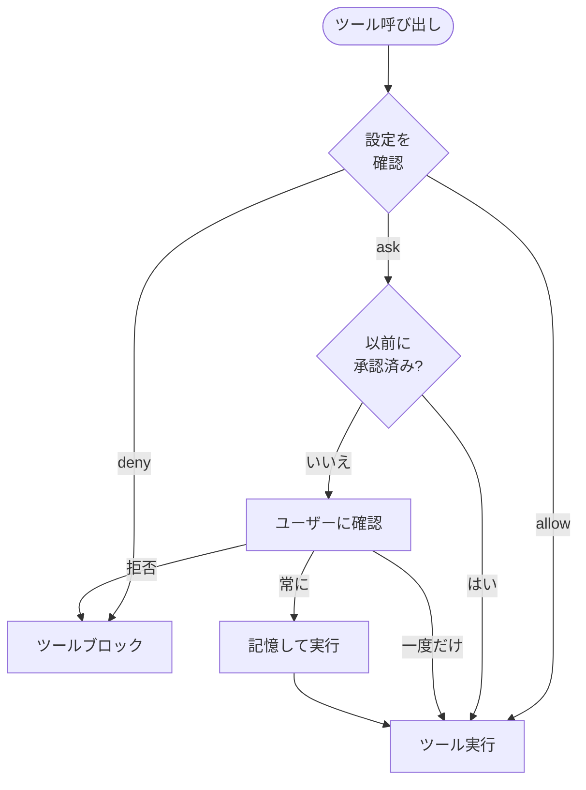

Cyberstrikeは、AIエージェントが実行できるツールを制御する権限システムを使用します。生産性を維持しながらセキュリティ境界を提供します。

{/* TODO: GIF - Plan mode workflow */}
<div className="border-2 border-dashed border-gray-400 dark:border-gray-600 rounded-lg p-8 my-6 text-center bg-gray-100 dark:bg-gray-800">
  <p className="text-gray-500 dark:text-gray-400 font-mono text-sm">🎬 GIF: g04-plan-mode.gif</p>
  <p className="text-gray-400 dark:text-gray-500 text-xs mt-2">Planモードワークフローデモ (20秒)</p>
</div>

{/* TODO: Screenshot - Permission prompt */}
<div className="border-2 border-dashed border-gray-400 dark:border-gray-600 rounded-lg p-8 my-6 text-center bg-gray-100 dark:bg-gray-800">
  <p className="text-gray-500 dark:text-gray-400 font-mono text-sm">📸 SCREENSHOT: s06-permission-prompt.png</p>
  <p className="text-gray-400 dark:text-gray-500 text-xs mt-2">権限プロンプトの表示</p>
</div>

{/* TODO: Screenshot - Plan mode UI */}
<div className="border-2 border-dashed border-gray-400 dark:border-gray-600 rounded-lg p-8 my-6 text-center bg-gray-100 dark:bg-gray-800">
  <p className="text-gray-500 dark:text-gray-400 font-mono text-sm">📸 SCREENSHOT: s07-plan-mode.png</p>
  <p className="text-gray-400 dark:text-gray-500 text-xs mt-2">Planモードインターフェース</p>
</div>

## 権限モデル



---

## 権限モード

| モード | 動作 | 用途 |
|------|----------|----------|
| `ask` | 承認を求める | 機密ツールのデフォルト |
| `allow` | 自動承認 | 信頼済みツール、自動化 |
| `deny` | 実行をブロック | 制限された操作 |

---

## 権限の設定

### グローバル設定

`~/.config/cyberstrike/cyberstrike.json`で権限を設定:

```json title="~/.config/cyberstrike/cyberstrike.json"
{
  "permission": {
    "read": "allow",
    "glob": "allow",
    "grep": "allow",
    "edit": "ask",
    "bash": "ask",
    "websearch": "ask"
  }
}
```

### プロジェクト設定

`cyberstrike.json`でプロジェクトごとに権限を上書き:

```json title="cyberstrike.json"
{
  "permission": {
    "bash": "allow",
    "edit": "allow",
    "external_directory": "deny"
  }
}
```

プロジェクト設定はグローバル設定を上書きします。

---

## 権限の種類

### ファイル操作

| 権限 | ツール | デフォルト | 説明 |
|------------|-------|---------|-------------|
| `read` | Read | `ask` | ファイル内容を読み取る |
| `edit` | Write, Edit | `ask` | ファイルを変更する |
| `glob` | Glob | `allow` | パターンでファイルを検索 |
| `grep` | Grep | `allow` | ファイル内容を検索 |

### コマンド実行

| 権限 | ツール | デフォルト | 説明 |
|------------|-------|---------|-------------|
| `bash` | Bash | `ask` | シェルコマンドを実行 |
| `task` | Task | `ask` | サブエージェントを作成 |

### Web操作

| 権限 | ツール | デフォルト | 説明 |
|------------|-------|---------|-------------|
| `websearch` | WebSearch | `ask` | Web検索 |
| `webfetch` | WebFetch | `ask` | Webコンテンツの取得 |
| `codesearch` | CodeSearch | `ask` | コードリポジトリの検索 |

### 特殊な権限

| 権限 | 説明 |
|------------|-------------|
| `external_directory` | プロジェクト外のファイルにアクセス |
| `lsp` | 言語サーバー操作 |
| `doom_loop` | 無限ループの検出と中断 |

---

## パターンベースの権限

パターンを使用して細かい権限制御を行います。

### ディレクトリパターン

特定のディレクトリを許可:

```json
{
  "permission": {
    "read": {
      "src/**": "allow",
      "test/**": "allow",
      "node_modules/**": "deny"
    },
    "edit": {
      "src/**": "allow",
      "*.config.js": "deny"
    }
  }
}
```

### コマンドパターン

特定のコマンドを許可:

```json
{
  "permission": {
    "bash": {
      "git *": "allow",
      "npm test": "allow",
      "npm run *": "allow",
      "rm *": "deny"
    }
  }
}
```

### ワイルドカードマッチング

| パターン | マッチ対象 |
|---------|---------|
| `*` | 任意の1つのパスセグメント |
| `**` | 任意のパス深度 |
| `*.ts` | .tsで終わるファイル |
| `src/**/*.ts` | src内のTypeScriptファイル |

---

## エージェント権限

エージェントごとに権限を設定:

```json title="cyberstrike.json"
{
  "agent": {
    "web-application": {
      "permission": {
        "bash": "allow",
        "browser": "allow",
        "edit": "ask"
      }
    },
    "code-review": {
      "permission": {
        "read": "allow",
        "glob": "allow",
        "grep": "allow",
        "edit": "deny",
        "bash": "deny"
      }
    }
  }
}
```

---

## 対話的承認

ツールが権限を必要とする場合、Cyberstrikeは承認を求めます。

### 応答オプション

| オプション | 動作 |
|--------|----------|
| **一度だけ** | この特定の呼び出しを承認 |
| **常に** | セッション中の類似の呼び出しをすべて承認 |
| **拒否** | この呼び出しをブロック |

### 承認ダイアログ

```
┌─────────────────────────────────────────┐
│  権限が必要です                          │
├─────────────────────────────────────────┤
│  ツール: Bash                            │
│  コマンド: git push origin main          │
│                                          │
│  [一度だけ]  [常に]  [拒否]              │
└─────────────────────────────────────────┘
```

### キーボードショートカット

| キー | アクション |
|-----|--------|
| `y` | 一度だけ承認 |
| `a` | 常に承認 |
| `n` | 拒否 |
| `Esc` | 拒否 |

---

## セッション承認メモリ

「常に」を選択すると、Cyberstrikeはセッション中の承認パターンを記憶します。

### メモリの仕組み

1. ユーザーが「常に」で`git push`を承認
2. パターン`git *`がセッションに保存される
3. 以降の`git pull`、`git commit`などは自動承認
4. セッション終了時にメモリがリセット

### 承認済みパターンの確認

承認済みパターンはセッション再起動まで持続します。

---

## 自動化モード

CI/CDおよび自動化には、完全信頼を設定:

```json title="cyberstrike.json"
{
  "permission": "allow"
}
```

これですべての権限がプロンプトなしで許可に設定されます。

<Aside variant="caution">
  `"permission": "allow"`の使用はすべてのセキュリティチェックをバイパスします。制御された環境でのみ使用してください。
</Aside>

---

## 読み取り専用モード

エージェントを読み取り専用操作に制限:

```json title="cyberstrike.json"
{
  "permission": {
    "read": "allow",
    "glob": "allow",
    "grep": "allow",
    "lsp": "allow",
    "edit": "deny",
    "bash": "deny",
    "websearch": "deny"
  }
}
```

コードレビューや調査タスクに使用してください。

---

## 外部ディレクトリアクセス

デフォルトでは、Cyberstrikeはプロジェクトディレクトリへのアクセスを制限します。

### 外部アクセスの許可

```json
{
  "permission": {
    "external_directory": "ask"
  }
}
```

### 特定の外部パス

```json
{
  "permission": {
    "external_directory": {
      "/home/user/shared/**": "allow",
      "/tmp/**": "allow",
      "/etc/**": "deny"
    }
  }
}
```

---

## 権限フック

プログラムによる権限制御にプラグインフックを使用します。

### permission.ask フック

```typescript
const hooks: Hooks = {
  "permission.ask": async (input, output) => {
    // Auto-approve read operations in src
    if (input.type === "read" && input.path?.startsWith("src/")) {
      output.status = "allow"
      return
    }

    // Block access to secrets
    if (input.path?.includes("secret") || input.path?.includes(".env")) {
      output.status = "deny"
      return
    }

    // Default: prompt user
    output.status = "ask"
  },
}
```

### フック入力

| フィールド | 型 | 説明 |
|-------|------|-------------|
| `id` | string | 権限リクエストID |
| `type` | string | 権限の種類 |
| `pattern` | string | マッチングパターン |
| `sessionID` | string | セッション識別子 |
| `messageID` | string | メッセージ識別子 |
| `callID` | string | ツール呼び出しID |
| `message` | string | 説明 |
| `metadata` | object | 追加コンテキスト |

### フック出力

| フィールド | 値 | 説明 |
|-------|-------|-------------|
| `status` | `"ask"` | ユーザーに確認 |
| `status` | `"allow"` | 自動承認 |
| `status` | `"deny"` | ブロック |

---

## セキュリティのベストプラクティス

### 開発環境

```json
{
  "permission": {
    "read": "allow",
    "glob": "allow",
    "grep": "allow",
    "edit": "ask",
    "bash": "ask"
  }
}
```

### 本番/CI環境

```json
{
  "permission": {
    "read": "allow",
    "glob": "allow",
    "grep": "allow",
    "edit": "allow",
    "bash": {
      "npm test": "allow",
      "npm run build": "allow",
      "*": "deny"
    }
  }
}
```

### セキュリティ監査モード

```json
{
  "permission": {
    "read": "allow",
    "glob": "allow",
    "grep": "allow",
    "lsp": "allow",
    "websearch": "allow",
    "edit": "deny",
    "bash": "deny"
  }
}
```

---

## 権限の優先順位

権限は以下の順序で評価されます:

1. **エージェント固有**の権限(最高優先度)
2. **プロジェクト**の`cyberstrike.json`
3. **グローバル**の`~/.config/cyberstrike/cyberstrike.json`
4. **デフォルト**の組み込み値(最低優先度)

より具体的なパターンが優先されます:

```json
{
  "permission": {
    "bash": "deny",
    "bash": {
      "git *": "allow"
    }
  }
}
```

この場合、`git push`は許可されますが`rm -rf`は拒否されます。

---

## トラブルシューティング

### 権限が常にプロンプト表示される

設定が有効であることを確認:

```bash
cyberstrike config validate
```

権限が正しく設定されていることを確認:

```bash
cat ~/.config/cyberstrike/cyberstrike.json | jq .permission
```

### 権限が適用されない

1. プロジェクトとグローバル設定の優先順位を確認
2. パターン構文がパスと一致するか確認
3. Cyberstrikeを再起動して設定を再読み込み

### ブロックされた操作

ツールが予期せずブロックされた場合:

1. 設定の`deny`ルールを確認
2. パターンの不一致を確認
3. ブロックする可能性のあるプラグインフックを確認

---

## 例

### Webセキュリティテスト

```json title="cyberstrike.json"
{
  "permission": {
    "bash": {
      "nmap *": "allow",
      "nikto *": "allow",
      "sqlmap *": "allow",
      "nuclei *": "allow"
    },
    "browser": "allow",
    "websearch": "allow",
    "edit": "ask"
  }
}
```

### コードレビューのみ

```json title="cyberstrike.json"
{
  "permission": {
    "read": "allow",
    "glob": "allow",
    "grep": "allow",
    "lsp": "allow",
    "edit": "deny",
    "bash": "deny",
    "browser": "deny"
  }
}
```

### 完全自動化

```json title="cyberstrike.json"
{
  "permission": "allow"
}
```

<Aside variant="tip">
  制限的な権限から始めて、必要に応じて緩和してください。個々のアクションを承認する方が、一括アクセスを付与するよりも安全です。
</Aside>
