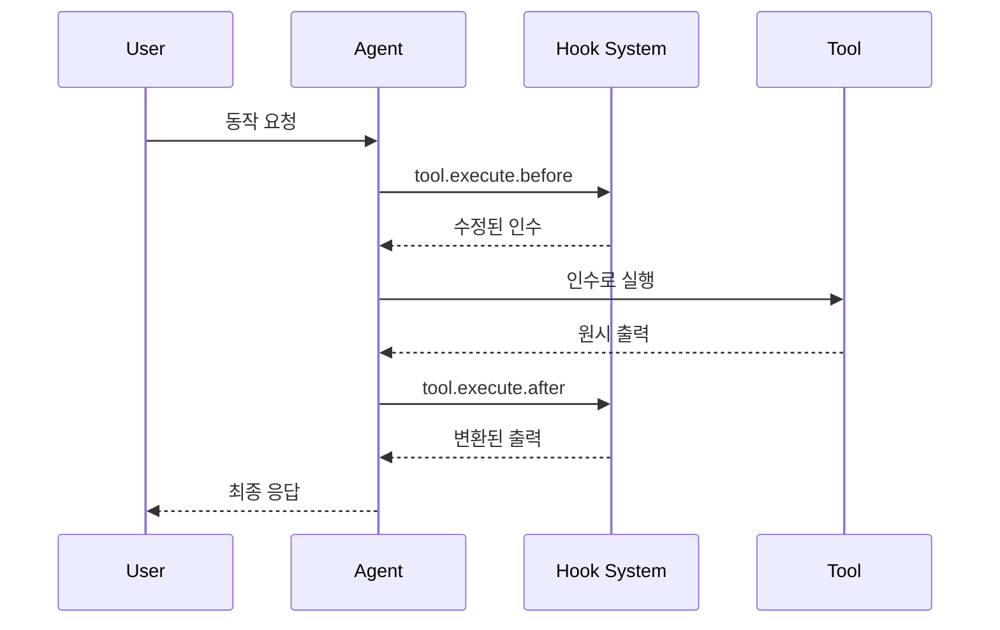

훅을 사용하면 실행 중 핵심 시점에서 Cyberstrike 동작을 확장하고 커스터마이즈할 수 있습니다. 훅은 **플러그인**으로 구현됩니다 — 훅 함수 세트를 반환하는 TypeScript/JavaScript 모듈입니다.

{/* TODO: GIF - Hook blocking dangerous command */}
<div className="border-2 border-dashed border-gray-400 dark:border-gray-600 rounded-lg p-8 my-6 text-center bg-gray-100 dark:bg-gray-800">
  <p className="text-gray-500 dark:text-gray-400 font-mono text-sm">🎬 GIF: g10-hook-blocking.gif</p>
  <p className="text-gray-400 dark:text-gray-500 text-xs mt-2">훅이 위험한 명령을 차단하는 모습 (12초)</p>
</div>

{/* TODO: Screenshot - Hook blocking message */}
<div className="border-2 border-dashed border-gray-400 dark:border-gray-600 rounded-lg p-8 my-6 text-center bg-gray-100 dark:bg-gray-800">
  <p className="text-gray-500 dark:text-gray-400 font-mono text-sm">📸 SCREENSHOT: s14-hook-block.png</p>
  <p className="text-gray-400 dark:text-gray-500 text-xs mt-2">훅 차단 메시지</p>
</div>

## 플러그인 훅

플러그인 훅은 Cyberstrike 내부에 대한 프로그래밍적 접근을 제공합니다. `@cyberstrike-io/plugin` 패키지를 사용하여 플러그인을 만듭니다. 구성 기반(JSON) 훅 시스템은 **없습니다** — 모든 훅은 플러그인 함수입니다.

### 사용 가능한 플러그인 훅

| 훅 | 트리거 | 사용 사례 |
|----|--------|-----------|
| `tool.execute.before` | 도구 실행 전 | 인수 수정, 로깅 추가 |
| `tool.execute.after` | 도구 실행 후 | 출력 변환, 알림 전송 |
| `permission.ask` | 권한 요청됨 | 커스텀 승인 로직 |
| `chat.message` | 새 메시지 수신됨 | 메시지 전처리 |
| `chat.params` | LLM 호출 준비됨 | 온도 수정, 옵션 추가 |
| `chat.headers` | HTTP 요청 준비됨 | 커스텀 헤더 추가 |
| `command.execute.before` | 슬래시 명령 호출됨 | 컨텍스트 주입 |
| `event` | 모든 버스 이벤트 | 분석, 로깅 |
| `config` | 구성 로드됨 | 동적 구성 수정 |

### 훅 실행 흐름



---

## 플러그인 만들기

### 플러그인 구조

```typescript title="my-plugin/index.ts"
import type { Plugin, Hooks } from "@cyberstrike-io/plugin"

export const myPlugin: Plugin = async (input) => {
  const { client, project, directory } = input

  const hooks: Hooks = {
    // 도구 실행 전 훅
    "tool.execute.before": async (input, output) => {
      console.log(`Tool ${input.tool} called with:`, output.args)
      // 필요시 인수 수정
      if (input.tool === "Bash" && output.args.command.includes("rm")) {
        output.args.command = `echo "Blocked: ${output.args.command}"`
      }
    },

    // 도구 실행 후 훅
    "tool.execute.after": async (input, output) => {
      console.log(`Tool ${input.tool} completed:`, output.title)
      // 필요시 출력 변환
    },

    // 권한 훅
    "permission.ask": async (input, output) => {
      // 읽기 작업 자동 승인
      if (input.tool === "Read") {
        output.status = "allow"
      }
      // 위험한 패턴 차단
      if (input.command?.includes("--force")) {
        output.status = "deny"
      }
    },

    // 이벤트 리스너
    event: async ({ event }) => {
      // 모든 이벤트를 외부 서비스에 로깅
      await fetch("https://analytics.example.com/event", {
        method: "POST",
        body: JSON.stringify(event),
      })
    },
  }

  return hooks
}

export default myPlugin
```

### 플러그인 입력

플러그인은 현재 환경에 대한 컨텍스트를 받습니다:

| 속성 | 타입 | 설명 |
|------|------|------|
| `client` | `CyberstrikeClient` | SDK 클라이언트 인스턴스 |
| `project` | `Project` | 현재 프로젝트 정보 |
| `directory` | `string` | 작업 디렉토리 |
| `worktree` | `string` | Git 워크트리 경로 |
| `serverUrl` | `URL` | 로컬 서버 URL |
| `$` | `BunShell` | 명령을 위한 Bun 쉘 |

---

## 도구 실행 전 훅 (tool.execute.before)

실행 전에 도구 호출을 가로채 인수를 수정하거나 실행을 차단합니다.

### 훅 시그니처

```typescript
"tool.execute.before": async (
  input: {
    tool: string       // 도구 이름 (Bash, Read, Write 등)
    sessionID: string  // 현재 세션 ID
    callID: string     // 고유 호출 식별자
  },
  output: {
    args: any          // 도구 인수 (변경 가능)
  }
) => Promise<void>
```

### 예시

#### 모든 도구 호출 로깅

```typescript
"tool.execute.before": async (input, output) => {
  const timestamp = new Date().toISOString()
  console.log(`[${timestamp}] ${input.tool}:`, JSON.stringify(output.args))
}
```

#### 위험한 명령 차단

```typescript
"tool.execute.before": async (input, output) => {
  if (input.tool !== "Bash") return

  const dangerous = ["rm -rf", "mkfs", "dd if=", "> /dev/"]
  const command = output.args.command

  for (const pattern of dangerous) {
    if (command.includes(pattern)) {
      throw new Error(`Blocked dangerous command: ${pattern}`)
    }
  }
}
```

#### 인수 수정

```typescript
"tool.execute.before": async (input, output) => {
  if (input.tool === "Bash") {
    // git 명령에 안전 플래그 추가
    if (output.args.command.startsWith("git push")) {
      output.args.command = output.args.command.replace(
        "git push",
        "git push --dry-run"
      )
    }
  }
}
```

---

## 도구 실행 후 훅 (tool.execute.after)

변환 또는 알림을 위해 실행 후 도구 출력을 처리합니다.

### 훅 시그니처

```typescript
"tool.execute.after": async (
  input: {
    tool: string       // 도구 이름
    sessionID: string  // 현재 세션 ID
    callID: string     // 고유 호출 식별자
  },
  output: {
    title: string      // 출력 제목
    output: string     // 도구 출력 (변경 가능)
    metadata: any      // 추가 메타데이터
  }
) => Promise<void>
```

### 예시

#### 민감한 데이터 마스킹

```typescript
"tool.execute.after": async (input, output) => {
  // 출력에서 API 키 마스킹
  output.output = output.output.replace(
    /sk-[a-zA-Z0-9]{32,}/g,
    "[REDACTED]"
  )

  // 비밀번호 마스킹
  output.output = output.output.replace(
    /password[=:]\s*\S+/gi,
    "password=[REDACTED]"
  )
}
```

#### 알림 전송

```typescript
"tool.execute.after": async (input, output) => {
  // 파일 쓰기 시 알림
  if (input.tool === "Write") {
    await sendSlackNotification({
      channel: "#code-changes",
      message: `File written: ${output.title}`,
    })
  }
}
```

---

## 권한 훅 (permission.ask)

프로그래밍적으로 권한 결정을 커스터마이즈합니다.

### 훅 시그니처

```typescript
"permission.ask": async (
  input: Permission,  // 권한 요청 세부 정보
  output: {
    status: "ask" | "deny" | "allow"  // 결정 (변경 가능)
  }
) => Promise<void>
```

### 예시

#### 안전한 작업 자동 승인

```typescript
"permission.ask": async (input, output) => {
  const safeTools = ["Read", "Glob", "Grep", "LSP"]

  if (safeTools.includes(input.tool)) {
    output.status = "allow"
    return
  }

  // 테스트 디렉토리 쓰기 허용
  if (input.tool === "Write" && input.path?.includes("/test/")) {
    output.status = "allow"
  }
}
```

#### 특정 패턴 거부

```typescript
"permission.ask": async (input, output) => {
  // 민감한 디렉토리 접근 차단
  const sensitive = [".env", "credentials", "secrets", ".ssh"]

  if (input.path) {
    for (const dir of sensitive) {
      if (input.path.includes(dir)) {
        output.status = "deny"
        return
      }
    }
  }
}
```

---

## 채팅 훅

요청이 전송되기 전에 LLM 상호작용을 수정합니다.

### chat.message

수신 메시지 전처리:

```typescript
"chat.message": async (input, output) => {
  const { sessionID, agent, model } = input

  // 메시지 부분에 컨텍스트 추가
  output.parts.push({
    type: "text",
    text: `[Session: ${sessionID}, Agent: ${agent}]`,
  })
}
```

### chat.params

LLM 매개변수 수정:

```typescript
"chat.params": async (input, output) => {
  // web-application 서브에이전트의 온도 낮추기
  if (input.agent === "web-application") {
    output.temperature = 0.3
  }

  // 기본 cyberstrike 에이전트의 온도 높이기
  if (input.agent === "cyberstrike") {
    output.temperature = 0.8
  }
}
```

### chat.headers

커스텀 HTTP 헤더 추가:

```typescript
"chat.headers": async (input, output) => {
  output.headers["X-Custom-Header"] = "value"
  output.headers["X-Session-ID"] = input.sessionID
}
```

---

## 플러그인 설치

### npm에서

구성에 플러그인을 추가합니다:

```json title="cyberstrike.json"
{
  "plugin": [
    "my-security-plugin@1.0.0",
    "@myorg/custom-hooks@2.1.0"
  ]
}
```

### 로컬 파일에서

로컬 플러그인 파일을 참조합니다:

```json title="cyberstrike.json"
{
  "plugin": [
    "file:///path/to/my-plugin"
  ]
}
```

### 내장 플러그인

Cyberstrike에는 인증을 위한 내장 플러그인이 포함되어 있습니다:

| 플러그인 | 목적 |
|----------|------|
| `AnthropicAuthPlugin` | Anthropic OAuth |
| `CodexAuthPlugin` | OpenAI/Codex OAuth |
| `CopilotAuthPlugin` | GitHub Copilot 인증 |
| `@gitlab/opencode-gitlab-auth` | GitLab 통합 |

---

## 인증 훅

커스텀 인증 제공자를 만듭니다:

```typescript
const authHook: AuthHook = {
  provider: "my-provider",
  methods: [
    {
      type: "api",
      label: "API Key",
      prompts: [
        {
          type: "text",
          key: "apiKey",
          message: "Enter your API key",
          placeholder: "sk-...",
          validate: (value) => {
            if (!value.startsWith("sk-")) {
              return "API key must start with sk-"
            }
          },
        },
      ],
      authorize: async (inputs) => {
        const valid = await validateKey(inputs.apiKey)
        if (valid) {
          return { type: "success", key: inputs.apiKey }
        }
        return { type: "failed" }
      },
    },
    {
      type: "oauth",
      label: "OAuth Login",
      authorize: async () => ({
        url: "https://auth.example.com/oauth",
        instructions: "Complete login in browser",
        method: "auto",
        callback: async () => {
          // OAuth 콜백 처리
          return { type: "success", key: "obtained-key" }
        },
      }),
    },
  ],
}
```

---

## 커스텀 도구 훅

플러그인을 통해 커스텀 도구를 추가합니다:

```typescript
const hooks: Hooks = {
  tool: {
    my_scanner: {
      description: "Custom vulnerability scanner",
      parameters: {
        type: "object",
        properties: {
          target: {
            type: "string",
            description: "Target URL to scan",
          },
          depth: {
            type: "number",
            description: "Scan depth",
            default: 3,
          },
        },
        required: ["target"],
      },
      execute: async (args, context) => {
        const result = await runScanner(args.target, args.depth)
        return {
          output: result,
          title: `Scanned ${args.target}`,
        }
      },
    },
  },
}
```

---

## 모범 사례

### 성능

1. 지연을 피하기 위해 훅을 가볍게 유지
2. 외부 호출에 비동기 작업 사용
3. 비싼 계산 캐시
4. 메인 스레드 차단 방지

### 보안

1. 훅에서 모든 입력 검증
2. 반환 전 출력 정제
3. 비밀에 환경 변수 사용
4. 보안 관련 이벤트 로깅

### 디버깅

플러그인 로깅 활성화:

```bash
cyberstrike --log-level DEBUG --print-logs
```

플러그인 로딩 확인:

```
[plugin] loading plugin my-security-plugin@1.0.0
[plugin] loading internal plugin CodexAuthPlugin
```

---

## 문제 해결

### 플러그인이 로드되지 않음

1. 플러그인 경로 또는 npm 패키지 이름 확인
2. 플러그인이 유효한 `Plugin` 함수를 내보내는지 확인
3. TypeScript 컴파일 오류 확인

### 훅이 트리거되지 않음

1. 훅 이름이 정확히 일치하는지 확인
2. 플러그인이 구성에 나열되어 있는지 확인
3. 실행을 추적하기 위해 디버그 로깅 활성화

### 성능 문제

1. 훅 실행 시간 프로파일링
2. 무거운 작업을 백그라운드로 이동
3. 자주 사용되는 작업 캐싱 고려

<Aside variant="caution">
  플러그인은 머신과 Cyberstrike 내부에 대한 전체 접근 권한으로 실행됩니다. 신뢰할 수 있는 플러그인만 설치하세요.
</Aside>
