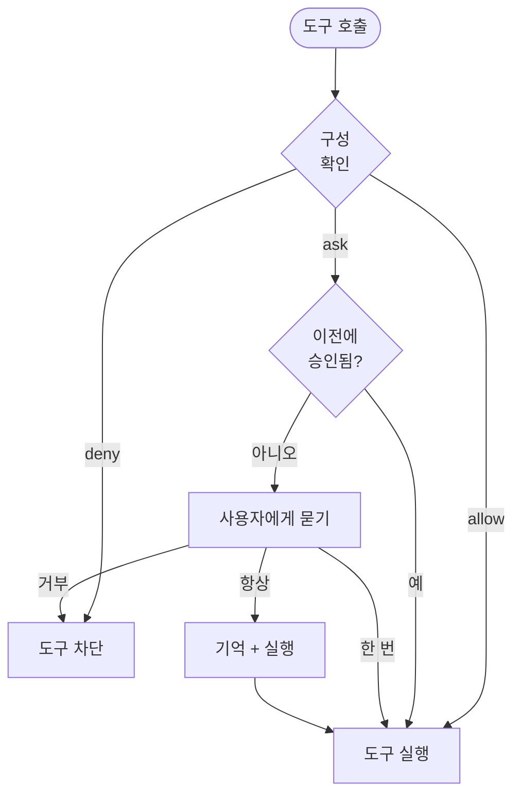

Cyberstrike는 AI 에이전트가 실행할 수 있는 도구를 제어하기 위해 권한 시스템을 사용합니다. 이는 생산성을 유지하면서 보안 경계를 제공합니다.

{/* TODO: GIF - Plan mode workflow */}
<div className="border-2 border-dashed border-gray-400 dark:border-gray-600 rounded-lg p-8 my-6 text-center bg-gray-100 dark:bg-gray-800">
  <p className="text-gray-500 dark:text-gray-400 font-mono text-sm">🎬 GIF: g04-plan-mode.gif</p>
  <p className="text-gray-400 dark:text-gray-500 text-xs mt-2">Plan 모드 워크플로 데모 (20초)</p>
</div>

{/* TODO: Screenshot - Permission prompt */}
<div className="border-2 border-dashed border-gray-400 dark:border-gray-600 rounded-lg p-8 my-6 text-center bg-gray-100 dark:bg-gray-800">
  <p className="text-gray-500 dark:text-gray-400 font-mono text-sm">📸 SCREENSHOT: s06-permission-prompt.png</p>
  <p className="text-gray-400 dark:text-gray-500 text-xs mt-2">권한 프롬프트 보기</p>
</div>

{/* TODO: Screenshot - Plan mode UI */}
<div className="border-2 border-dashed border-gray-400 dark:border-gray-600 rounded-lg p-8 my-6 text-center bg-gray-100 dark:bg-gray-800">
  <p className="text-gray-500 dark:text-gray-400 font-mono text-sm">📸 SCREENSHOT: s07-plan-mode.png</p>
  <p className="text-gray-400 dark:text-gray-500 text-xs mt-2">Plan 모드 인터페이스</p>
</div>

## 권한 모델



---

## 권한 모드

| 모드 | 동작 | 사용 사례 |
|------|------|-----------|
| `ask` | 승인 요청 | 민감한 도구의 기본값 |
| `allow` | 자동 승인 | 신뢰할 수 있는 도구, 자동화 |
| `deny` | 실행 차단 | 제한된 작업 |

---

## 권한 구성

### 글로벌 구성

`~/.config/cyberstrike/cyberstrike.json`에서 권한을 설정합니다:

```json title="~/.config/cyberstrike/cyberstrike.json"
{
  "permission": {
    "read": "allow",
    "glob": "allow",
    "grep": "allow",
    "edit": "ask",
    "bash": "ask",
    "websearch": "ask"
  }
}
```

### 프로젝트 구성

`cyberstrike.json`에서 프로젝트별로 권한을 재정의합니다:

```json title="cyberstrike.json"
{
  "permission": {
    "bash": "allow",
    "edit": "allow",
    "external_directory": "deny"
  }
}
```

프로젝트 설정이 글로벌 설정보다 우선합니다.

---

## 권한 유형

### 파일 작업

| 권한 | 도구 | 기본값 | 설명 |
|------|------|--------|------|
| `read` | Read | `ask` | 파일 내용 읽기 |
| `edit` | Write, Edit | `ask` | 파일 수정 |
| `glob` | Glob | `allow` | 패턴으로 파일 찾기 |
| `grep` | Grep | `allow` | 파일 내용 검색 |

### 명령 실행

| 권한 | 도구 | 기본값 | 설명 |
|------|------|--------|------|
| `bash` | Bash | `ask` | 쉘 명령 실행 |
| `task` | Task | `ask` | 서브 에이전트 생성 |

### 웹 작업

| 권한 | 도구 | 기본값 | 설명 |
|------|------|--------|------|
| `websearch` | WebSearch | `ask` | 웹 검색 |
| `webfetch` | WebFetch | `ask` | 웹 콘텐츠 가져오기 |
| `codesearch` | CodeSearch | `ask` | 코드 리포지토리 검색 |

### 특수 권한

| 권한 | 설명 |
|------|------|
| `external_directory` | 프로젝트 외부 파일 접근 |
| `lsp` | 언어 서버 작업 |
| `doom_loop` | 무한 루프 감지 및 중단 |

---

## 패턴 기반 권한

패턴을 사용하여 세분화된 권한을 부여합니다.

### 디렉토리 패턴

특정 디렉토리를 허용합니다:

```json
{
  "permission": {
    "read": {
      "src/**": "allow",
      "test/**": "allow",
      "node_modules/**": "deny"
    },
    "edit": {
      "src/**": "allow",
      "*.config.js": "deny"
    }
  }
}
```

### 명령 패턴

특정 명령을 허용합니다:

```json
{
  "permission": {
    "bash": {
      "git *": "allow",
      "npm test": "allow",
      "npm run *": "allow",
      "rm *": "deny"
    }
  }
}
```

### 와일드카드 매칭

| 패턴 | 매칭 |
|------|------|
| `*` | 모든 단일 경로 세그먼트 |
| `**` | 모든 경로 깊이 |
| `*.ts` | .ts로 끝나는 파일 |
| `src/**/*.ts` | src의 TypeScript 파일 |

---

## 에이전트 권한

에이전트별로 권한을 구성합니다:

```json title="cyberstrike.json"
{
  "agent": {
    "web-application": {
      "permission": {
        "bash": "allow",
        "browser": "allow",
        "edit": "ask"
      }
    },
    "code-review": {
      "permission": {
        "read": "allow",
        "glob": "allow",
        "grep": "allow",
        "edit": "deny",
        "bash": "deny"
      }
    }
  }
}
```

---

## 대화형 승인

도구에 권한이 필요한 경우 Cyberstrike가 승인을 요청합니다.

### 응답 옵션

| 옵션 | 동작 |
|------|------|
| **한 번** | 이 특정 호출을 승인 |
| **항상** | 세션 내 유사한 모든 호출을 승인 |
| **거부** | 이 호출을 차단 |

### 승인 대화상자

```
┌─────────────────────────────────────────┐
│  권한 필요                              │
├─────────────────────────────────────────┤
│  도구: Bash                             │
│  명령: git push origin main             │
│                                          │
│  [한 번]  [항상]  [거부]                 │
└─────────────────────────────────────────┘
```

### 키보드 단축키

| 키 | 동작 |
|----|------|
| `y` | 한 번 승인 |
| `a` | 항상 승인 |
| `n` | 거부 |
| `Esc` | 거부 |

---

## 세션 승인 메모리

"항상"을 선택하면 Cyberstrike가 세션 동안 승인 패턴을 기억합니다.

### 메모리 작동 방식

1. 사용자가 `git push`를 "항상"으로 승인
2. 세션에 `git *` 패턴 저장
3. 이후 `git pull`, `git commit` 등은 자동 승인
4. 세션이 끝나면 메모리 초기화

### 승인된 패턴 보기

승인된 패턴은 세션이 재시작될 때까지 유지됩니다.

---

## 자동화 모드

CI/CD 및 자동화를 위해 전체 신뢰를 구성합니다:

```json title="cyberstrike.json"
{
  "permission": "allow"
}
```

모든 권한이 프롬프트 없이 허용으로 설정됩니다.

<Aside variant="caution">
  `"permission": "allow"` 사용은 모든 안전 검사를 우회합니다. 통제된 환경에서만 사용하세요.
</Aside>

---

## 읽기 전용 모드

에이전트를 읽기 전용 작업으로 제한합니다:

```json title="cyberstrike.json"
{
  "permission": {
    "read": "allow",
    "glob": "allow",
    "grep": "allow",
    "lsp": "allow",
    "edit": "deny",
    "bash": "deny",
    "websearch": "deny"
  }
}
```

코드 리뷰 또는 탐색 작업에 사용합니다.

---

## 외부 디렉토리 접근

기본적으로 Cyberstrike는 프로젝트 디렉토리로 접근을 제한합니다.

### 외부 접근 허용

```json
{
  "permission": {
    "external_directory": "ask"
  }
}
```

### 특정 외부 경로

```json
{
  "permission": {
    "external_directory": {
      "/home/user/shared/**": "allow",
      "/tmp/**": "allow",
      "/etc/**": "deny"
    }
  }
}
```

---

## 권한 훅

프로그래밍 방식의 권한 제어를 위해 플러그인 훅을 사용합니다.

### permission.ask 훅

```typescript
const hooks: Hooks = {
  "permission.ask": async (input, output) => {
    // src의 읽기 작업 자동 승인
    if (input.type === "read" && input.path?.startsWith("src/")) {
      output.status = "allow"
      return
    }

    // 시크릿 접근 차단
    if (input.path?.includes("secret") || input.path?.includes(".env")) {
      output.status = "deny"
      return
    }

    // 기본: 사용자에게 묻기
    output.status = "ask"
  },
}
```

### 훅 입력

| 필드 | 타입 | 설명 |
|------|------|------|
| `id` | string | 권한 요청 ID |
| `type` | string | 권한 유형 |
| `pattern` | string | 매칭 패턴 |
| `sessionID` | string | 세션 식별자 |
| `messageID` | string | 메시지 식별자 |
| `callID` | string | 도구 호출 ID |
| `message` | string | 설명 |
| `metadata` | object | 추가 컨텍스트 |

### 훅 출력

| 필드 | 값 | 설명 |
|------|-----|------|
| `status` | `"ask"` | 사용자에게 묻기 |
| `status` | `"allow"` | 자동 승인 |
| `status` | `"deny"` | 차단 |

---

## 보안 모범 사례

### 개발 환경

```json
{
  "permission": {
    "read": "allow",
    "glob": "allow",
    "grep": "allow",
    "edit": "ask",
    "bash": "ask"
  }
}
```

### 프로덕션/CI 환경

```json
{
  "permission": {
    "read": "allow",
    "glob": "allow",
    "grep": "allow",
    "edit": "allow",
    "bash": {
      "npm test": "allow",
      "npm run build": "allow",
      "*": "deny"
    }
  }
}
```

### 보안 감사 모드

```json
{
  "permission": {
    "read": "allow",
    "glob": "allow",
    "grep": "allow",
    "lsp": "allow",
    "websearch": "allow",
    "edit": "deny",
    "bash": "deny"
  }
}
```

---

## 권한 우선순위

권한은 다음 순서로 평가됩니다:

1. **에이전트별** 권한 (최우선순위)
2. **프로젝트** `cyberstrike.json`
3. **글로벌** `~/.config/cyberstrike/cyberstrike.json`
4. **기본** 내장값 (최하위 우선순위)

더 구체적인 패턴이 우선합니다:

```json
{
  "permission": {
    "bash": "deny",
    "bash": {
      "git *": "allow"
    }
  }
}
```

이 경우 `git push`는 허용되지만 `rm -rf`는 거부됩니다.

---

## 문제 해결

### 권한이 항상 묻기로 표시

구성이 유효한지 확인합니다:

```bash
cyberstrike config validate
```

권한이 올바르게 설정되었는지 확인합니다:

```bash
cat ~/.config/cyberstrike/cyberstrike.json | jq .permission
```

### 권한이 적용되지 않음

1. 프로젝트 vs 글로벌 구성 우선순위 확인
2. 패턴 구문이 경로와 일치하는지 확인
3. Cyberstrike를 재시작하여 구성 다시 로드

### 차단된 작업

도구가 예기치 않게 차단된 경우:

1. 구성의 `deny` 규칙 확인
2. 패턴 불일치 확인
3. 차단할 수 있는 플러그인 훅 확인

---

## 예시

### 웹 보안 테스트

```json title="cyberstrike.json"
{
  "permission": {
    "bash": {
      "nmap *": "allow",
      "nikto *": "allow",
      "sqlmap *": "allow",
      "nuclei *": "allow"
    },
    "browser": "allow",
    "websearch": "allow",
    "edit": "ask"
  }
}
```

### 코드 리뷰 전용

```json title="cyberstrike.json"
{
  "permission": {
    "read": "allow",
    "glob": "allow",
    "grep": "allow",
    "lsp": "allow",
    "edit": "deny",
    "bash": "deny",
    "browser": "deny"
  }
}
```

### 전체 자동화

```json title="cyberstrike.json"
{
  "permission": "allow"
}
```

<Aside variant="tip">
  제한적인 권한으로 시작하고 필요에 따라 완화하세요. 포괄적 접근을 부여하는 것보다 개별 작업을 승인하는 것이 더 안전합니다.
</Aside>
