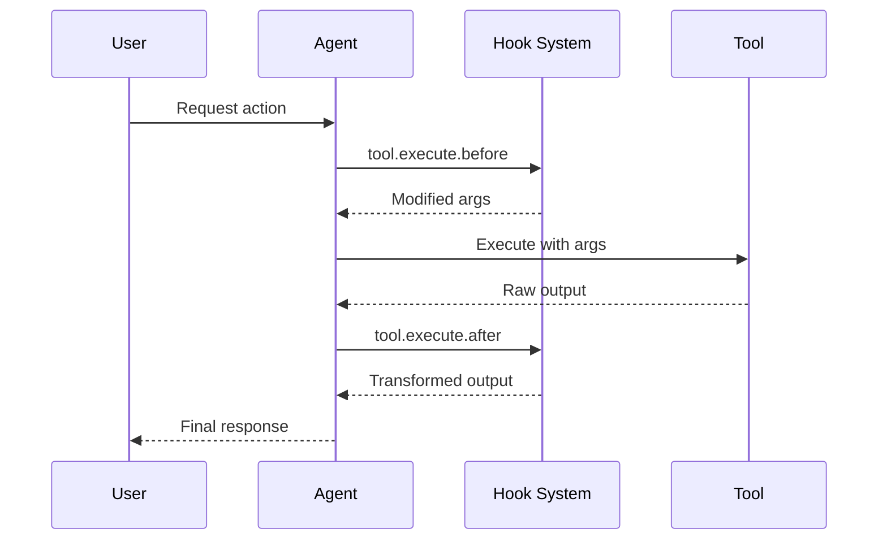

Hooks permitem estender e personalizar o comportamento do Cyberstrike em pontos chave durante a execucao. Eles sao implementados como **plugins** — modulos TypeScript/JavaScript que retornam um conjunto de funcoes de hook.

{/* TODO: GIF - Hook blocking dangerous command */}
<div className="border-2 border-dashed border-gray-400 dark:border-gray-600 rounded-lg p-8 my-6 text-center bg-gray-100 dark:bg-gray-800">
  <p className="text-gray-500 dark:text-gray-400 font-mono text-sm">🎬 GIF: g10-hook-blocking.gif</p>
  <p className="text-gray-400 dark:text-gray-500 text-xs mt-2">Hook bloqueando comando perigoso (12s)</p>
</div>

{/* TODO: Screenshot - Hook blocking message */}
<div className="border-2 border-dashed border-gray-400 dark:border-gray-600 rounded-lg p-8 my-6 text-center bg-gray-100 dark:bg-gray-800">
  <p className="text-gray-500 dark:text-gray-400 font-mono text-sm">📸 SCREENSHOT: s14-hook-block.png</p>
  <p className="text-gray-400 dark:text-gray-500 text-xs mt-2">Mensagem de bloqueio do hook</p>
</div>

## Hooks de Plugin

Hooks de plugin fornecem acesso programatico aos internos do Cyberstrike. Crie plugins usando o pacote `@cyberstrike-io/plugin`. **Nao** existe um sistema de hooks baseado em configuracao (JSON) — todos os hooks sao funcoes de plugin.

### Hooks de Plugin Disponiveis

| Hook | Gatilho | Caso de Uso |
|------|---------|-------------|
| `tool.execute.before` | Antes da execucao da ferramenta | Modificar argumentos, adicionar logs |
| `tool.execute.after` | Apos a execucao da ferramenta | Transformar saida, enviar notificacoes |
| `permission.ask` | Permissao solicitada | Logica de aprovacao personalizada |
| `chat.message` | Nova mensagem recebida | Pre-processamento de mensagens |
| `chat.params` | Chamada LLM preparada | Modificar temperatura, adicionar opcoes |
| `chat.headers` | Requisicao HTTP preparada | Adicionar headers personalizados |
| `command.execute.before` | Comando slash invocado | Injetar contexto |
| `event` | Qualquer evento do barramento | Analytics, logs |
| `config` | Configuracao carregada | Modificacao dinamica da configuracao |

### Fluxo de Execucao de Hooks



---

## Criando um Plugin

### Estrutura do Plugin

```typescript title="my-plugin/index.ts"
import type { Plugin, Hooks } from "@cyberstrike-io/plugin"

export const myPlugin: Plugin = async (input) => {
  const { client, project, directory } = input

  const hooks: Hooks = {
    // Hook pre-execucao da ferramenta
    "tool.execute.before": async (input, output) => {
      console.log(`Tool ${input.tool} called with:`, output.args)
      // Modificar args se necessario
      if (input.tool === "Bash" && output.args.command.includes("rm")) {
        output.args.command = `echo "Blocked: ${output.args.command}"`
      }
    },

    // Hook pos-execucao da ferramenta
    "tool.execute.after": async (input, output) => {
      console.log(`Tool ${input.tool} completed:`, output.title)
      // Transformar saida se necessario
    },

    // Hook de permissao
    "permission.ask": async (input, output) => {
      // Auto-aprovar operacoes de leitura
      if (input.tool === "Read") {
        output.status = "allow"
      }
      // Bloquear padroes perigosos
      if (input.command?.includes("--force")) {
        output.status = "deny"
      }
    },

    // Ouvinte de eventos
    event: async ({ event }) => {
      // Registrar todos os eventos em servico externo
      await fetch("https://analytics.example.com/event", {
        method: "POST",
        body: JSON.stringify(event),
      })
    },
  }

  return hooks
}

export default myPlugin
```

### Entrada do Plugin

O plugin recebe contexto sobre o ambiente atual:

| Propriedade | Tipo | Descricao |
|-------------|------|-----------|
| `client` | `CyberstrikeClient` | Instancia do cliente SDK |
| `project` | `Project` | Informacoes do projeto atual |
| `directory` | `string` | Diretorio de trabalho |
| `worktree` | `string` | Caminho do worktree git |
| `serverUrl` | `URL` | URL do servidor local |
| `$` | `BunShell` | Shell Bun para comandos |

---

## Hook Pre-Ferramenta (tool.execute.before)

Intercepte chamadas de ferramentas antes da execucao para modificar argumentos ou bloquear a execucao.

### Assinatura do Hook

```typescript
"tool.execute.before": async (
  input: {
    tool: string       // Nome da ferramenta (Bash, Read, Write, etc.)
    sessionID: string  // ID da sessao atual
    callID: string     // Identificador unico da chamada
  },
  output: {
    args: any          // Argumentos da ferramenta (mutavel)
  }
) => Promise<void>
```

### Exemplos

#### Registrando Todas as Chamadas de Ferramentas

```typescript
"tool.execute.before": async (input, output) => {
  const timestamp = new Date().toISOString()
  console.log(`[${timestamp}] ${input.tool}:`, JSON.stringify(output.args))
}
```

#### Bloqueando Comandos Perigosos

```typescript
"tool.execute.before": async (input, output) => {
  if (input.tool !== "Bash") return

  const dangerous = ["rm -rf", "mkfs", "dd if=", "> /dev/"]
  const command = output.args.command

  for (const pattern of dangerous) {
    if (command.includes(pattern)) {
      throw new Error(`Blocked dangerous command: ${pattern}`)
    }
  }
}
```

#### Modificando Argumentos

```typescript
"tool.execute.before": async (input, output) => {
  if (input.tool === "Bash") {
    // Adicionar flags de seguranca a comandos git
    if (output.args.command.startsWith("git push")) {
      output.args.command = output.args.command.replace(
        "git push",
        "git push --dry-run"
      )
    }
  }
}
```

---

## Hook Pos-Ferramenta (tool.execute.after)

Processe a saida da ferramenta apos a execucao para transformacao ou notificacao.

### Assinatura do Hook

```typescript
"tool.execute.after": async (
  input: {
    tool: string       // Nome da ferramenta
    sessionID: string  // ID da sessao atual
    callID: string     // Identificador unico da chamada
  },
  output: {
    title: string      // Titulo da saida
    output: string     // Saida da ferramenta (mutavel)
    metadata: any      // Metadados adicionais
  }
) => Promise<void>
```

### Exemplos

#### Redatando Dados Sensiveis

```typescript
"tool.execute.after": async (input, output) => {
  // Redatar chaves de API da saida
  output.output = output.output.replace(
    /sk-[a-zA-Z0-9]{32,}/g,
    "[REDACTED]"
  )

  // Redatar senhas
  output.output = output.output.replace(
    /password[=:]\s*\S+/gi,
    "password=[REDACTED]"
  )
}
```

#### Enviando Notificacoes

```typescript
"tool.execute.after": async (input, output) => {
  // Notificar sobre escritas de arquivo
  if (input.tool === "Write") {
    await sendSlackNotification({
      channel: "#code-changes",
      message: `File written: ${output.title}`,
    })
  }
}
```

---

## Hook de Permissao (permission.ask)

Personalize decisoes de permissao programaticamente.

### Assinatura do Hook

```typescript
"permission.ask": async (
  input: Permission,  // Detalhes da solicitacao de permissao
  output: {
    status: "ask" | "deny" | "allow"  // Decisao (mutavel)
  }
) => Promise<void>
```

### Exemplos

#### Auto-Aprovar Operacoes Seguras

```typescript
"permission.ask": async (input, output) => {
  const safeTools = ["Read", "Glob", "Grep", "LSP"]

  if (safeTools.includes(input.tool)) {
    output.status = "allow"
    return
  }

  // Permitir escritas em diretorios de teste
  if (input.tool === "Write" && input.path?.includes("/test/")) {
    output.status = "allow"
  }
}
```

#### Negar Padroes Especificos

```typescript
"permission.ask": async (input, output) => {
  // Bloquear acesso a diretorios sensiveis
  const sensitive = [".env", "credentials", "secrets", ".ssh"]

  if (input.path) {
    for (const dir of sensitive) {
      if (input.path.includes(dir)) {
        output.status = "deny"
        return
      }
    }
  }
}
```

---

## Hooks de Chat

Modifique interacoes com o LLM antes que as requisicoes sejam enviadas.

### chat.message

Pre-processe mensagens recebidas:

```typescript
"chat.message": async (input, output) => {
  const { sessionID, agent, model } = input

  // Adicionar contexto as partes da mensagem
  output.parts.push({
    type: "text",
    text: `[Session: ${sessionID}, Agent: ${agent}]`,
  })
}
```

### chat.params

Modifique parametros do LLM:

```typescript
"chat.params": async (input, output) => {
  // Diminuir temperatura para o subagente web-application
  if (input.agent === "web-application") {
    output.temperature = 0.3
  }

  // Aumentar temperatura para o agente cyberstrike padrao
  if (input.agent === "cyberstrike") {
    output.temperature = 0.8
  }
}
```

### chat.headers

Adicione headers HTTP personalizados:

```typescript
"chat.headers": async (input, output) => {
  output.headers["X-Custom-Header"] = "value"
  output.headers["X-Session-ID"] = input.sessionID
}
```

---

## Instalando Plugins

### Via npm

Adicione plugins a sua configuracao:

```json title="cyberstrike.json"
{
  "plugin": [
    "my-security-plugin@1.0.0",
    "@myorg/custom-hooks@2.1.0"
  ]
}
```

### Via Arquivo Local

Referencie arquivos de plugin locais:

```json title="cyberstrike.json"
{
  "plugin": [
    "file:///path/to/my-plugin"
  ]
}
```

### Plugins Integrados

O Cyberstrike inclui plugins integrados para autenticacao:

| Plugin | Proposito |
|--------|-----------|
| `AnthropicAuthPlugin` | OAuth Anthropic |
| `CodexAuthPlugin` | OAuth OpenAI/Codex |
| `CopilotAuthPlugin` | Autenticacao GitHub Copilot |
| `@gitlab/opencode-gitlab-auth` | Integracao GitLab |

---

## Hooks de Autenticacao

Crie provedores de autenticacao personalizados:

```typescript
const authHook: AuthHook = {
  provider: "my-provider",
  methods: [
    {
      type: "api",
      label: "API Key",
      prompts: [
        {
          type: "text",
          key: "apiKey",
          message: "Enter your API key",
          placeholder: "sk-...",
          validate: (value) => {
            if (!value.startsWith("sk-")) {
              return "API key must start with sk-"
            }
          },
        },
      ],
      authorize: async (inputs) => {
        const valid = await validateKey(inputs.apiKey)
        if (valid) {
          return { type: "success", key: inputs.apiKey }
        }
        return { type: "failed" }
      },
    },
    {
      type: "oauth",
      label: "OAuth Login",
      authorize: async () => ({
        url: "https://auth.example.com/oauth",
        instructions: "Complete login in browser",
        method: "auto",
        callback: async () => {
          // Tratar callback OAuth
          return { type: "success", key: "obtained-key" }
        },
      }),
    },
  ],
}
```

---

## Hooks de Ferramentas Personalizadas

Adicione ferramentas personalizadas por meio de plugins:

```typescript
const hooks: Hooks = {
  tool: {
    my_scanner: {
      description: "Custom vulnerability scanner",
      parameters: {
        type: "object",
        properties: {
          target: {
            type: "string",
            description: "Target URL to scan",
          },
          depth: {
            type: "number",
            description: "Scan depth",
            default: 3,
          },
        },
        required: ["target"],
      },
      execute: async (args, context) => {
        const result = await runScanner(args.target, args.depth)
        return {
          output: result,
          title: `Scanned ${args.target}`,
        }
      },
    },
  },
}
```

---

## Boas Praticas

### Performance

1. Mantenha hooks leves para evitar latencia
2. Use operacoes assincronas para chamadas externas
3. Faça cache de computacoes custosas
4. Evite bloquear a thread principal

### Seguranca

1. Valide todas as entradas nos hooks
2. Sanitize saidas antes de retornar
3. Use variaveis de ambiente para segredos
4. Registre eventos relevantes para seguranca

### Depuracao

Habilite logs do plugin:

```bash
cyberstrike --log-level DEBUG --print-logs
```

Visualize o carregamento de plugins:

```
[plugin] loading plugin my-security-plugin@1.0.0
[plugin] loading internal plugin CodexAuthPlugin
```

---

## Solucao de Problemas

### Plugin Nao Carregando

1. Verifique o caminho do plugin ou nome do pacote npm
2. Verifique se o plugin exporta uma funcao `Plugin` valida
3. Verifique erros de compilacao TypeScript

### Hook Nao Disparando

1. Verifique se o nome do hook corresponde exatamente
2. Verifique se o plugin esta listado na configuracao
3. Habilite logs de depuracao para rastrear a execucao

### Problemas de Performance

1. Perfil o tempo de execucao do hook
2. Mova operacoes pesadas para segundo plano
3. Considere fazer cache de operacoes frequentes

<Aside variant="caution">
  Plugins executam com acesso total a sua maquina e aos internos do Cyberstrike. Instale apenas plugins em que voce confia.
</Aside>
