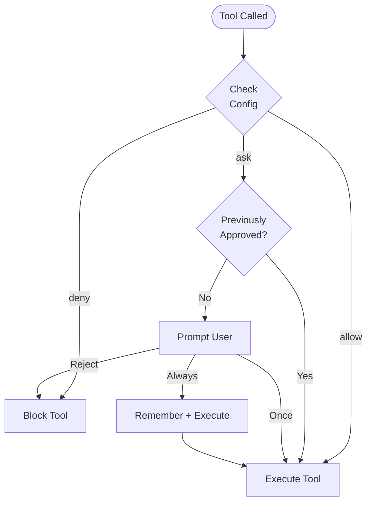

O Cyberstrike usa um sistema de permissoes para controlar quais ferramentas o agente de IA pode executar. Isso fornece limites de seguranca mantendo a produtividade.

{/* TODO: GIF - Plan mode workflow */}
<div className="border-2 border-dashed border-gray-400 dark:border-gray-600 rounded-lg p-8 my-6 text-center bg-gray-100 dark:bg-gray-800">
  <p className="text-gray-500 dark:text-gray-400 font-mono text-sm">🎬 GIF: g04-plan-mode.gif</p>
  <p className="text-gray-400 dark:text-gray-500 text-xs mt-2">Demo do fluxo de trabalho do modo plan (20s)</p>
</div>

{/* TODO: Screenshot - Permission prompt */}
<div className="border-2 border-dashed border-gray-400 dark:border-gray-600 rounded-lg p-8 my-6 text-center bg-gray-100 dark:bg-gray-800">
  <p className="text-gray-500 dark:text-gray-400 font-mono text-sm">📸 SCREENSHOT: s06-permission-prompt.png</p>
  <p className="text-gray-400 dark:text-gray-500 text-xs mt-2">Visualizacao do prompt de permissao</p>
</div>

{/* TODO: Screenshot - Plan mode UI */}
<div className="border-2 border-dashed border-gray-400 dark:border-gray-600 rounded-lg p-8 my-6 text-center bg-gray-100 dark:bg-gray-800">
  <p className="text-gray-500 dark:text-gray-400 font-mono text-sm">📸 SCREENSHOT: s07-plan-mode.png</p>
  <p className="text-gray-400 dark:text-gray-500 text-xs mt-2">Interface do modo plan</p>
</div>

## Modelo de Permissao



---

## Modos de Permissao

| Modo | Comportamento | Caso de Uso |
|------|---------------|-------------|
| `ask` | Solicitar aprovacao | Padrao para ferramentas sensiveis |
| `allow` | Auto-aprovar | Ferramentas confiaveis, automacao |
| `deny` | Bloquear execucao | Operacoes restritas |

---

## Configurando Permissoes

### Configuracao Global

Defina permissoes em `~/.config/cyberstrike/cyberstrike.json`:

```json title="~/.config/cyberstrike/cyberstrike.json"
{
  "permission": {
    "read": "allow",
    "glob": "allow",
    "grep": "allow",
    "edit": "ask",
    "bash": "ask",
    "websearch": "ask"
  }
}
```

### Configuracao de Projeto

Sobrescreva permissoes por projeto em `cyberstrike.json`:

```json title="cyberstrike.json"
{
  "permission": {
    "bash": "allow",
    "edit": "allow",
    "external_directory": "deny"
  }
}
```

Configuracoes de projeto sobrescrevem configuracoes globais.

---

## Tipos de Permissao

### Operacoes de Arquivo

| Permissao | Ferramentas | Padrao | Descricao |
|-----------|-------------|--------|-----------|
| `read` | Read | `ask` | Ler conteudo de arquivos |
| `edit` | Write, Edit | `ask` | Modificar arquivos |
| `glob` | Glob | `allow` | Encontrar arquivos por padrao |
| `grep` | Grep | `allow` | Buscar conteudo de arquivos |

### Execucao de Comandos

| Permissao | Ferramentas | Padrao | Descricao |
|-----------|-------------|--------|-----------|
| `bash` | Bash | `ask` | Executar comandos shell |
| `task` | Task | `ask` | Criar sub-agentes |

### Operacoes Web

| Permissao | Ferramentas | Padrao | Descricao |
|-----------|-------------|--------|-----------|
| `websearch` | WebSearch | `ask` | Buscar na web |
| `webfetch` | WebFetch | `ask` | Buscar conteudo web |
| `codesearch` | CodeSearch | `ask` | Buscar repositorios de codigo |

### Permissoes Especiais

| Permissao | Descricao |
|-----------|-----------|
| `external_directory` | Acessar arquivos fora do projeto |
| `lsp` | Operacoes do language server |
| `doom_loop` | Detectar e quebrar loops infinitos |

---

## Permissoes Baseadas em Padroes

Use padroes para conceder permissoes granulares.

### Padroes de Diretorio

Permitir diretorios especificos:

```json
{
  "permission": {
    "read": {
      "src/**": "allow",
      "test/**": "allow",
      "node_modules/**": "deny"
    },
    "edit": {
      "src/**": "allow",
      "*.config.js": "deny"
    }
  }
}
```

### Padroes de Comando

Permitir comandos especificos:

```json
{
  "permission": {
    "bash": {
      "git *": "allow",
      "npm test": "allow",
      "npm run *": "allow",
      "rm *": "deny"
    }
  }
}
```

### Correspondencia de Curingas

| Padrao | Corresponde |
|--------|-------------|
| `*` | Qualquer segmento unico de caminho |
| `**` | Qualquer profundidade de caminho |
| `*.ts` | Arquivos terminando em .ts |
| `src/**/*.ts` | Arquivos TypeScript em src |

---

## Permissoes por Agente

Configure permissoes por agente:

```json title="cyberstrike.json"
{
  "agent": {
    "web-application": {
      "permission": {
        "bash": "allow",
        "browser": "allow",
        "edit": "ask"
      }
    },
    "code-review": {
      "permission": {
        "read": "allow",
        "glob": "allow",
        "grep": "allow",
        "edit": "deny",
        "bash": "deny"
      }
    }
  }
}
```

---

## Aprovacao Interativa

Quando uma ferramenta requer permissao, o Cyberstrike solicita aprovacao.

### Opcoes de Resposta

| Opcao | Comportamento |
|-------|---------------|
| **Uma vez** | Aprovar esta chamada especifica |
| **Sempre** | Aprovar todas as chamadas similares na sessao |
| **Rejeitar** | Bloquear esta chamada |

### Dialogo de Aprovacao

```
┌─────────────────────────────────────────┐
│  Permissao Necessaria                    │
├─────────────────────────────────────────┤
│  Ferramenta: Bash                        │
│  Comando: git push origin main           │
│                                          │
│  [Uma vez]  [Sempre]  [Rejeitar]         │
└─────────────────────────────────────────┘
```

### Atalhos de Teclado

| Tecla | Acao |
|-------|------|
| `y` | Aprovar uma vez |
| `a` | Aprovar sempre |
| `n` | Rejeitar |
| `Esc` | Rejeitar |

---

## Memoria de Aprovacao da Sessao

Quando voce seleciona "Sempre", o Cyberstrike lembra o padrao de aprovacao para a sessao.

### Como a Memoria Funciona

1. Usuario aprova `git push` com "Sempre"
2. Padrao `git *` e armazenado para a sessao
3. Futuros `git pull`, `git commit`, etc. sao auto-aprovados
4. Memoria e resetada quando a sessao termina

### Visualizando Padroes Aprovados

Padroes aprovados persistem ate a reinicializacao da sessao.

---

## Modo de Automacao

Para CI/CD e automacao, configure confianca total:

```json title="cyberstrike.json"
{
  "permission": "allow"
}
```

Isso define todas as permissoes como permitidas sem solicitar.

<Aside variant="caution">
  Usar `"permission": "allow"` ignora todas as verificacoes de seguranca. Use apenas em ambientes controlados.
</Aside>

---

## Modo Somente Leitura

Restrinja o agente a operacoes somente leitura:

```json title="cyberstrike.json"
{
  "permission": {
    "read": "allow",
    "glob": "allow",
    "grep": "allow",
    "lsp": "allow",
    "edit": "deny",
    "bash": "deny",
    "websearch": "deny"
  }
}
```

Use isso para tarefas de revisao de codigo ou exploracao.

---

## Acesso a Diretorio Externo

Por padrao, o Cyberstrike restringe o acesso ao diretorio do projeto.

### Permitindo Acesso Externo

```json
{
  "permission": {
    "external_directory": "ask"
  }
}
```

### Caminhos Externos Especificos

```json
{
  "permission": {
    "external_directory": {
      "/home/user/shared/**": "allow",
      "/tmp/**": "allow",
      "/etc/**": "deny"
    }
  }
}
```

---

## Hooks de Permissao

Use hooks de plugin para controle programatico de permissoes.

### Hook permission.ask

```typescript
const hooks: Hooks = {
  "permission.ask": async (input, output) => {
    // Auto-aprovar operacoes de leitura em src
    if (input.type === "read" && input.path?.startsWith("src/")) {
      output.status = "allow"
      return
    }

    // Bloquear acesso a segredos
    if (input.path?.includes("secret") || input.path?.includes(".env")) {
      output.status = "deny"
      return
    }

    // Padrao: solicitar ao usuario
    output.status = "ask"
  },
}
```

### Entrada do Hook

| Campo | Tipo | Descricao |
|-------|------|-----------|
| `id` | string | ID da solicitacao de permissao |
| `type` | string | Tipo de permissao |
| `pattern` | string | Padrao correspondente |
| `sessionID` | string | Identificador da sessao |
| `messageID` | string | Identificador da mensagem |
| `callID` | string | ID da chamada de ferramenta |
| `message` | string | Descricao |
| `metadata` | object | Contexto adicional |

### Saida do Hook

| Campo | Valor | Descricao |
|-------|-------|-----------|
| `status` | `"ask"` | Solicitar ao usuario |
| `status` | `"allow"` | Auto-aprovar |
| `status` | `"deny"` | Bloquear |

---

## Boas Praticas de Seguranca

### Ambiente de Desenvolvimento

```json
{
  "permission": {
    "read": "allow",
    "glob": "allow",
    "grep": "allow",
    "edit": "ask",
    "bash": "ask"
  }
}
```

### Ambiente de Producao/CI

```json
{
  "permission": {
    "read": "allow",
    "glob": "allow",
    "grep": "allow",
    "edit": "allow",
    "bash": {
      "npm test": "allow",
      "npm run build": "allow",
      "*": "deny"
    }
  }
}
```

### Modo de Auditoria de Seguranca

```json
{
  "permission": {
    "read": "allow",
    "glob": "allow",
    "grep": "allow",
    "lsp": "allow",
    "websearch": "allow",
    "edit": "deny",
    "bash": "deny"
  }
}
```

---

## Prioridade de Permissao

Permissoes sao avaliadas em ordem:

1. Permissoes **especificas do agente** (maior prioridade)
2. **Projeto** `cyberstrike.json`
3. **Global** `~/.config/cyberstrike/cyberstrike.json`
4. Valores **padrao** integrados (menor prioridade)

Padroes mais especificos tem precedencia:

```json
{
  "permission": {
    "bash": "deny",
    "bash": {
      "git *": "allow"
    }
  }
}
```

Neste caso, `git push` e permitido mas `rm -rf` e negado.

---

## Solucao de Problemas

### Permissao Sempre Solicitando

Verifique se sua configuracao e valida:

```bash
cyberstrike config validate
```

Verifique se a permissao esta definida corretamente:

```bash
cat ~/.config/cyberstrike/cyberstrike.json | jq .permission
```

### Permissao Nao Aplicada

1. Verifique a prioridade da configuracao de projeto vs global
2. Verifique se a sintaxe do padrao corresponde ao caminho
3. Reinicie o Cyberstrike para recarregar a configuracao

### Operacao Bloqueada

Se uma ferramenta for bloqueada inesperadamente:

1. Verifique regras `deny` na configuracao
2. Verifique divergencias de padroes
3. Verifique hooks de plugin que possam bloquear

---

## Exemplos

### Testes de Seguranca Web

```json title="cyberstrike.json"
{
  "permission": {
    "bash": {
      "nmap *": "allow",
      "nikto *": "allow",
      "sqlmap *": "allow",
      "nuclei *": "allow"
    },
    "browser": "allow",
    "websearch": "allow",
    "edit": "ask"
  }
}
```

### Apenas Revisao de Codigo

```json title="cyberstrike.json"
{
  "permission": {
    "read": "allow",
    "glob": "allow",
    "grep": "allow",
    "lsp": "allow",
    "edit": "deny",
    "bash": "deny",
    "browser": "deny"
  }
}
```

### Automacao Completa

```json title="cyberstrike.json"
{
  "permission": "allow"
}
```

<Aside variant="tip">
  Comece com permissoes restritivas e relaxe conforme necessario. E mais seguro aprovar acoes individuais do que conceder acesso irrestrito.
</Aside>
