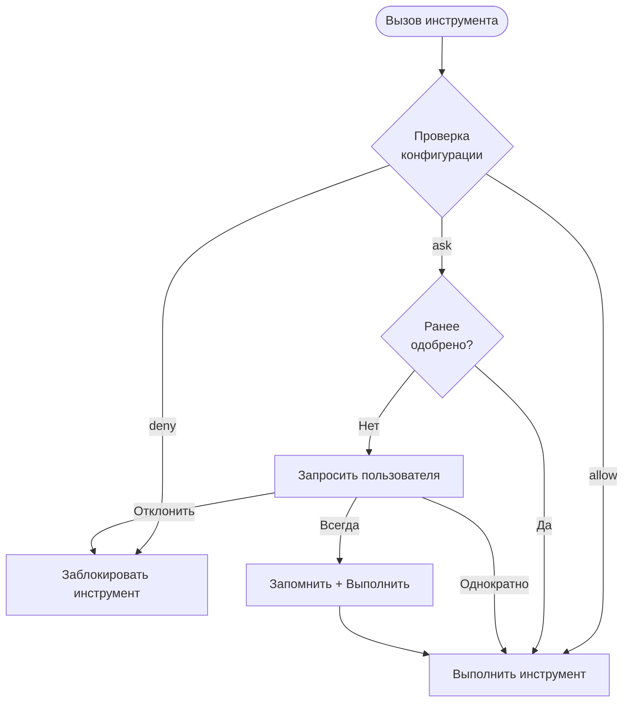

Cyberstrike использует систему разрешений для управления инструментами, которые ИИ-агент может выполнять. Это обеспечивает границы безопасности при сохранении продуктивности.

{/* TODO: GIF - Plan mode workflow */}
<div className="border-2 border-dashed border-gray-400 dark:border-gray-600 rounded-lg p-8 my-6 text-center bg-gray-100 dark:bg-gray-800">
  <p className="text-gray-500 dark:text-gray-400 font-mono text-sm">🎬 GIF: g04-plan-mode.gif</p>
  <p className="text-gray-400 dark:text-gray-500 text-xs mt-2">Демо рабочего процесса режима планирования (20s)</p>
</div>

{/* TODO: Screenshot - Permission prompt */}
<div className="border-2 border-dashed border-gray-400 dark:border-gray-600 rounded-lg p-8 my-6 text-center bg-gray-100 dark:bg-gray-800">
  <p className="text-gray-500 dark:text-gray-400 font-mono text-sm">📸 SCREENSHOT: s06-permission-prompt.png</p>
  <p className="text-gray-400 dark:text-gray-500 text-xs mt-2">Диалог запроса разрешения</p>
</div>

{/* TODO: Screenshot - Plan mode UI */}
<div className="border-2 border-dashed border-gray-400 dark:border-gray-600 rounded-lg p-8 my-6 text-center bg-gray-100 dark:bg-gray-800">
  <p className="text-gray-500 dark:text-gray-400 font-mono text-sm">📸 SCREENSHOT: s07-plan-mode.png</p>
  <p className="text-gray-400 dark:text-gray-500 text-xs mt-2">Интерфейс режима планирования</p>
</div>

## Модель разрешений



---

## Режимы разрешений

| Режим | Поведение | Применение |
|-------|-----------|------------|
| `ask` | Запросить одобрение | По умолчанию для чувствительных инструментов |
| `allow` | Автоматическое одобрение | Доверенные инструменты, автоматизация |
| `deny` | Заблокировать выполнение | Ограниченные операции |

---

## Настройка разрешений

### Глобальная конфигурация

Установите разрешения в `~/.config/cyberstrike/cyberstrike.json`:

```json title="~/.config/cyberstrike/cyberstrike.json"
{
  "permission": {
    "read": "allow",
    "glob": "allow",
    "grep": "allow",
    "edit": "ask",
    "bash": "ask",
    "websearch": "ask"
  }
}
```

### Конфигурация проекта

Переопределите разрешения для проекта в `cyberstrike.json`:

```json title="cyberstrike.json"
{
  "permission": {
    "bash": "allow",
    "edit": "allow",
    "external_directory": "deny"
  }
}
```

Настройки проекта переопределяют глобальные настройки.

---

## Типы разрешений

### Файловые операции

| Разрешение | Инструменты | По умолчанию | Описание |
|------------|-------------|-------------|----------|
| `read` | Read | `ask` | Чтение содержимого файлов |
| `edit` | Write, Edit | `ask` | Изменение файлов |
| `glob` | Glob | `allow` | Поиск файлов по шаблону |
| `grep` | Grep | `allow` | Поиск по содержимому файлов |

### Выполнение команд

| Разрешение | Инструменты | По умолчанию | Описание |
|------------|-------------|-------------|----------|
| `bash` | Bash | `ask` | Выполнение команд оболочки |
| `task` | Task | `ask` | Создание субагентов |

### Веб-операции

| Разрешение | Инструменты | По умолчанию | Описание |
|------------|-------------|-------------|----------|
| `websearch` | WebSearch | `ask` | Поиск в интернете |
| `webfetch` | WebFetch | `ask` | Получение веб-контента |
| `codesearch` | CodeSearch | `ask` | Поиск по репозиториям кода |

### Специальные разрешения

| Разрешение | Описание |
|------------|----------|
| `external_directory` | Доступ к файлам за пределами проекта |
| `lsp` | Операции языкового сервера |
| `doom_loop` | Обнаружение и прерывание бесконечных циклов |

---

## Разрешения на основе шаблонов

Используйте шаблоны для предоставления гранулярных разрешений.

### Шаблоны каталогов

Разрешение конкретных каталогов:

```json
{
  "permission": {
    "read": {
      "src/**": "allow",
      "test/**": "allow",
      "node_modules/**": "deny"
    },
    "edit": {
      "src/**": "allow",
      "*.config.js": "deny"
    }
  }
}
```

### Шаблоны команд

Разрешение конкретных команд:

```json
{
  "permission": {
    "bash": {
      "git *": "allow",
      "npm test": "allow",
      "npm run *": "allow",
      "rm *": "deny"
    }
  }
}
```

### Подстановочные знаки

| Шаблон | Совпадения |
|--------|-----------|
| `*` | Любой одиночный сегмент пути |
| `**` | Любая глубина пути |
| `*.ts` | Файлы с расширением .ts |
| `src/**/*.ts` | TypeScript-файлы в src |

---

## Разрешения агентов

Настройка разрешений для каждого агента:

```json title="cyberstrike.json"
{
  "agent": {
    "web-application": {
      "permission": {
        "bash": "allow",
        "browser": "allow",
        "edit": "ask"
      }
    },
    "code-review": {
      "permission": {
        "read": "allow",
        "glob": "allow",
        "grep": "allow",
        "edit": "deny",
        "bash": "deny"
      }
    }
  }
}
```

---

## Интерактивное одобрение

Когда инструмент требует разрешения, Cyberstrike запрашивает одобрение.

### Варианты ответа

| Вариант | Поведение |
|---------|-----------|
| **Once** | Одобрить этот конкретный вызов |
| **Always** | Одобрить все аналогичные вызовы в сессии |
| **Reject** | Заблокировать этот вызов |

### Диалог одобрения

```
┌─────────────────────────────────────────┐
│  Permission Required                     │
├─────────────────────────────────────────┤
│  Tool: Bash                              │
│  Command: git push origin main           │
│                                          │
│  [Once]  [Always]  [Reject]              │
└─────────────────────────────────────────┘
```

### Горячие клавиши

| Клавиша | Действие |
|---------|----------|
| `y` | Одобрить однократно |
| `a` | Одобрить всегда |
| `n` | Отклонить |
| `Esc` | Отклонить |

---

## Память одобрений сессии

При выборе "Always" Cyberstrike запоминает шаблон одобрения на время сессии.

### Как работает память

1. Пользователь одобряет `git push` с "Always"
2. Шаблон `git *` сохраняется для сессии
3. Будущие `git pull`, `git commit` и т.д. одобряются автоматически
4. Память сбрасывается при завершении сессии

### Просмотр одобренных шаблонов

Одобренные шаблоны сохраняются до перезапуска сессии.

---

## Режим автоматизации

Для CI/CD и автоматизации настройте полное доверие:

```json title="cyberstrike.json"
{
  "permission": "allow"
}
```

Это устанавливает все разрешения в allow без запросов.

<Aside variant="caution">
  Использование `"permission": "allow"` обходит все проверки безопасности. Используйте только в контролируемых средах.
</Aside>

---

## Режим только для чтения

Ограничьте агента операциями только для чтения:

```json title="cyberstrike.json"
{
  "permission": {
    "read": "allow",
    "glob": "allow",
    "grep": "allow",
    "lsp": "allow",
    "edit": "deny",
    "bash": "deny",
    "websearch": "deny"
  }
}
```

Используйте для обзора кода или задач исследования.

---

## Доступ к внешним каталогам

По умолчанию Cyberstrike ограничивает доступ каталогом проекта.

### Разрешение внешнего доступа

```json
{
  "permission": {
    "external_directory": "ask"
  }
}
```

### Конкретные внешние пути

```json
{
  "permission": {
    "external_directory": {
      "/home/user/shared/**": "allow",
      "/tmp/**": "allow",
      "/etc/**": "deny"
    }
  }
}
```

---

## Хуки разрешений

Используйте хуки плагинов для программного управления разрешениями.

### Хук permission.ask

```typescript
const hooks: Hooks = {
  "permission.ask": async (input, output) => {
    // Автоматическое одобрение операций чтения в src
    if (input.type === "read" && input.path?.startsWith("src/")) {
      output.status = "allow"
      return
    }

    // Блокировка доступа к секретам
    if (input.path?.includes("secret") || input.path?.includes(".env")) {
      output.status = "deny"
      return
    }

    // По умолчанию: запросить пользователя
    output.status = "ask"
  },
}
```

### Входные данные хука

| Поле | Тип | Описание |
|------|-----|----------|
| `id` | string | ID запроса разрешения |
| `type` | string | Тип разрешения |
| `pattern` | string | Совпадающий шаблон |
| `sessionID` | string | Идентификатор сессии |
| `messageID` | string | Идентификатор сообщения |
| `callID` | string | ID вызова инструмента |
| `message` | string | Описание |
| `metadata` | object | Дополнительный контекст |

### Выходные данные хука

| Поле | Значение | Описание |
|------|----------|----------|
| `status` | `"ask"` | Запросить пользователя |
| `status` | `"allow"` | Автоматически одобрить |
| `status` | `"deny"` | Заблокировать |

---

## Лучшие практики безопасности

### Среда разработки

```json
{
  "permission": {
    "read": "allow",
    "glob": "allow",
    "grep": "allow",
    "edit": "ask",
    "bash": "ask"
  }
}
```

### Продакшен/CI-среда

```json
{
  "permission": {
    "read": "allow",
    "glob": "allow",
    "grep": "allow",
    "edit": "allow",
    "bash": {
      "npm test": "allow",
      "npm run build": "allow",
      "*": "deny"
    }
  }
}
```

### Режим аудита безопасности

```json
{
  "permission": {
    "read": "allow",
    "glob": "allow",
    "grep": "allow",
    "lsp": "allow",
    "websearch": "allow",
    "edit": "deny",
    "bash": "deny"
  }
}
```

---

## Приоритет разрешений

Разрешения оцениваются в следующем порядке:

1. **Специфичные для агента** разрешения (наивысший приоритет)
2. **Проектный** `cyberstrike.json`
3. **Глобальный** `~/.config/cyberstrike/cyberstrike.json`
4. **Встроенные** значения по умолчанию (наименьший приоритет)

Более специфичные шаблоны имеют приоритет:

```json
{
  "permission": {
    "bash": "deny",
    "bash": {
      "git *": "allow"
    }
  }
}
```

В этом случае `git push` разрешён, а `rm -rf` заблокирован.

---

## Устранение неполадок

### Разрешение постоянно запрашивается

Проверьте, что конфигурация корректна:

```bash
cyberstrike config validate
```

Убедитесь, что разрешение установлено правильно:

```bash
cat ~/.config/cyberstrike/cyberstrike.json | jq .permission
```

### Разрешение не применяется

1. Проверьте приоритет проектной и глобальной конфигурации
2. Проверьте, что синтаксис шаблона соответствует пути
3. Перезапустите Cyberstrike для перезагрузки конфигурации

### Заблокированная операция

Если инструмент неожиданно заблокирован:

1. Проверьте правила `deny` в конфигурации
2. Проверьте несоответствия шаблонов
3. Проверьте хуки плагинов, которые могут блокировать

---

## Примеры

### Тестирование веб-безопасности

```json title="cyberstrike.json"
{
  "permission": {
    "bash": {
      "nmap *": "allow",
      "nikto *": "allow",
      "sqlmap *": "allow",
      "nuclei *": "allow"
    },
    "browser": "allow",
    "websearch": "allow",
    "edit": "ask"
  }
}
```

### Только обзор кода

```json title="cyberstrike.json"
{
  "permission": {
    "read": "allow",
    "glob": "allow",
    "grep": "allow",
    "lsp": "allow",
    "edit": "deny",
    "bash": "deny",
    "browser": "deny"
  }
}
```

### Полная автоматизация

```json title="cyberstrike.json"
{
  "permission": "allow"
}
```

<Aside variant="tip">
  Начните с ограничительных разрешений и ослабляйте их по мере необходимости. Безопаснее одобрять отдельные действия, чем предоставлять общий доступ.
</Aside>
