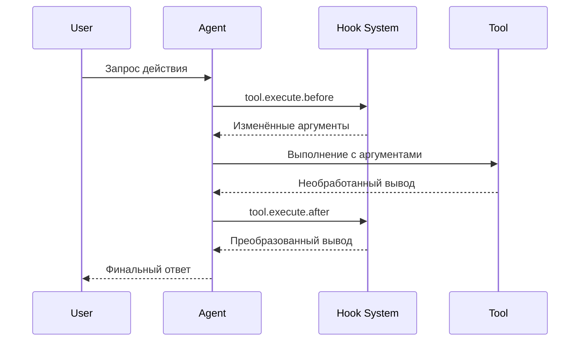

Хуки позволяют расширять и настраивать поведение Cyberstrike в ключевых точках выполнения. Они реализованы как **плагины** — модули TypeScript/JavaScript, которые возвращают набор функций-хуков.

{/* TODO: GIF - Hook blocking dangerous command */}
<div className="border-2 border-dashed border-gray-400 dark:border-gray-600 rounded-lg p-8 my-6 text-center bg-gray-100 dark:bg-gray-800">
  <p className="text-gray-500 dark:text-gray-400 font-mono text-sm">🎬 GIF: g10-hook-blocking.gif</p>
  <p className="text-gray-400 dark:text-gray-500 text-xs mt-2">Хук блокирует опасную команду (12s)</p>
</div>

{/* TODO: Screenshot - Hook blocking message */}
<div className="border-2 border-dashed border-gray-400 dark:border-gray-600 rounded-lg p-8 my-6 text-center bg-gray-100 dark:bg-gray-800">
  <p className="text-gray-500 dark:text-gray-400 font-mono text-sm">📸 SCREENSHOT: s14-hook-block.png</p>
  <p className="text-gray-400 dark:text-gray-500 text-xs mt-2">Сообщение блокировки хуком</p>
</div>

## Хуки плагинов

Хуки плагинов предоставляют программный доступ к внутренним компонентам Cyberstrike. Создавайте плагины с использованием пакета `@cyberstrike-io/plugin`. Системы хуков на основе конфигурации (JSON) **не** существует — все хуки являются функциями плагинов.

### Доступные хуки плагинов

| Хук | Триггер | Применение |
|-----|---------|-----------|
| `tool.execute.before` | Перед выполнением инструмента | Изменение аргументов, добавление логирования |
| `tool.execute.after` | После выполнения инструмента | Преобразование вывода, отправка уведомлений |
| `permission.ask` | Запрос разрешения | Пользовательская логика одобрения |
| `chat.message` | Получено новое сообщение | Предобработка сообщений |
| `chat.params` | Подготовлен вызов LLM | Изменение temperature, добавление параметров |
| `chat.headers` | Подготовлен HTTP-запрос | Добавление пользовательских заголовков |
| `command.execute.before` | Вызвана slash-команда | Внедрение контекста |
| `event` | Любое событие шины | Аналитика, логирование |
| `config` | Загружена конфигурация | Динамическое изменение конфигурации |

### Поток выполнения хуков



---

## Создание плагина

### Структура плагина

```typescript title="my-plugin/index.ts"
import type { Plugin, Hooks } from "@cyberstrike-io/plugin"

export const myPlugin: Plugin = async (input) => {
  const { client, project, directory } = input

  const hooks: Hooks = {
    // Хук перед выполнением инструмента
    "tool.execute.before": async (input, output) => {
      console.log(`Tool ${input.tool} called with:`, output.args)
      // Изменение аргументов при необходимости
      if (input.tool === "Bash" && output.args.command.includes("rm")) {
        output.args.command = `echo "Blocked: ${output.args.command}"`
      }
    },

    // Хук после выполнения инструмента
    "tool.execute.after": async (input, output) => {
      console.log(`Tool ${input.tool} completed:`, output.title)
      // Преобразование вывода при необходимости
    },

    // Хук разрешений
    "permission.ask": async (input, output) => {
      // Автоматическое одобрение операций чтения
      if (input.tool === "Read") {
        output.status = "allow"
      }
      // Блокировка опасных шаблонов
      if (input.command?.includes("--force")) {
        output.status = "deny"
      }
    },

    // Прослушиватель событий
    event: async ({ event }) => {
      // Логирование всех событий во внешний сервис
      await fetch("https://analytics.example.com/event", {
        method: "POST",
        body: JSON.stringify(event),
      })
    },
  }

  return hooks
}

export default myPlugin
```

### Входные данные плагина

Плагин получает контекст о текущем окружении:

| Свойство | Тип | Описание |
|----------|-----|----------|
| `client` | `CyberstrikeClient` | Экземпляр SDK-клиента |
| `project` | `Project` | Информация о текущем проекте |
| `directory` | `string` | Рабочий каталог |
| `worktree` | `string` | Путь к git worktree |
| `serverUrl` | `URL` | URL локального сервера |
| `$` | `BunShell` | Оболочка Bun для команд |

---

## Хук перед инструментом (tool.execute.before)

Перехват вызовов инструментов перед выполнением для изменения аргументов или блокировки выполнения.

### Сигнатура хука

```typescript
"tool.execute.before": async (
  input: {
    tool: string       // Имя инструмента (Bash, Read, Write и т.д.)
    sessionID: string  // ID текущей сессии
    callID: string     // Уникальный идентификатор вызова
  },
  output: {
    args: any          // Аргументы инструмента (изменяемые)
  }
) => Promise<void>
```

### Примеры

#### Логирование всех вызовов инструментов

```typescript
"tool.execute.before": async (input, output) => {
  const timestamp = new Date().toISOString()
  console.log(`[${timestamp}] ${input.tool}:`, JSON.stringify(output.args))
}
```

#### Блокировка опасных команд

```typescript
"tool.execute.before": async (input, output) => {
  if (input.tool !== "Bash") return

  const dangerous = ["rm -rf", "mkfs", "dd if=", "> /dev/"]
  const command = output.args.command

  for (const pattern of dangerous) {
    if (command.includes(pattern)) {
      throw new Error(`Blocked dangerous command: ${pattern}`)
    }
  }
}
```

#### Изменение аргументов

```typescript
"tool.execute.before": async (input, output) => {
  if (input.tool === "Bash") {
    // Добавление флагов безопасности к командам git
    if (output.args.command.startsWith("git push")) {
      output.args.command = output.args.command.replace(
        "git push",
        "git push --dry-run"
      )
    }
  }
}
```

---

## Хук после инструмента (tool.execute.after)

Обработка вывода инструмента после выполнения для преобразования или уведомления.

### Сигнатура хука

```typescript
"tool.execute.after": async (
  input: {
    tool: string       // Имя инструмента
    sessionID: string  // ID текущей сессии
    callID: string     // Уникальный идентификатор вызова
  },
  output: {
    title: string      // Заголовок вывода
    output: string     // Вывод инструмента (изменяемый)
    metadata: any      // Дополнительные метаданные
  }
) => Promise<void>
```

### Примеры

#### Маскирование конфиденциальных данных

```typescript
"tool.execute.after": async (input, output) => {
  // Маскирование API-ключей из вывода
  output.output = output.output.replace(
    /sk-[a-zA-Z0-9]{32,}/g,
    "[REDACTED]"
  )

  // Маскирование паролей
  output.output = output.output.replace(
    /password[=:]\s*\S+/gi,
    "password=[REDACTED]"
  )
}
```

#### Отправка уведомлений

```typescript
"tool.execute.after": async (input, output) => {
  // Уведомление при записи файлов
  if (input.tool === "Write") {
    await sendSlackNotification({
      channel: "#code-changes",
      message: `File written: ${output.title}`,
    })
  }
}
```

---

## Хук разрешений (permission.ask)

Программная настройка решений по разрешениям.

### Сигнатура хука

```typescript
"permission.ask": async (
  input: Permission,  // Детали запроса разрешения
  output: {
    status: "ask" | "deny" | "allow"  // Решение (изменяемое)
  }
) => Promise<void>
```

### Примеры

#### Автоматическое одобрение безопасных операций

```typescript
"permission.ask": async (input, output) => {
  const safeTools = ["Read", "Glob", "Grep", "LSP"]

  if (safeTools.includes(input.tool)) {
    output.status = "allow"
    return
  }

  // Разрешение записи в тестовые каталоги
  if (input.tool === "Write" && input.path?.includes("/test/")) {
    output.status = "allow"
  }
}
```

#### Запрет определённых шаблонов

```typescript
"permission.ask": async (input, output) => {
  // Блокировка доступа к конфиденциальным каталогам
  const sensitive = [".env", "credentials", "secrets", ".ssh"]

  if (input.path) {
    for (const dir of sensitive) {
      if (input.path.includes(dir)) {
        output.status = "deny"
        return
      }
    }
  }
}
```

---

## Хуки чата

Изменение взаимодействий с LLM перед отправкой запросов.

### chat.message

Предобработка входящих сообщений:

```typescript
"chat.message": async (input, output) => {
  const { sessionID, agent, model } = input

  // Добавление контекста к частям сообщения
  output.parts.push({
    type: "text",
    text: `[Session: ${sessionID}, Agent: ${agent}]`,
  })
}
```

### chat.params

Изменение параметров LLM:

```typescript
"chat.params": async (input, output) => {
  // Снижение temperature для субагента web-application
  if (input.agent === "web-application") {
    output.temperature = 0.3
  }

  // Повышение temperature для агента cyberstrike по умолчанию
  if (input.agent === "cyberstrike") {
    output.temperature = 0.8
  }
}
```

### chat.headers

Добавление пользовательских HTTP-заголовков:

```typescript
"chat.headers": async (input, output) => {
  output.headers["X-Custom-Header"] = "value"
  output.headers["X-Session-ID"] = input.sessionID
}
```

---

## Установка плагинов

### Из npm

Добавьте плагины в вашу конфигурацию:

```json title="cyberstrike.json"
{
  "plugin": [
    "my-security-plugin@1.0.0",
    "@myorg/custom-hooks@2.1.0"
  ]
}
```

### Из локального файла

Ссылка на локальные файлы плагинов:

```json title="cyberstrike.json"
{
  "plugin": [
    "file:///path/to/my-plugin"
  ]
}
```

### Встроенные плагины

Cyberstrike включает встроенные плагины для аутентификации:

| Плагин | Назначение |
|--------|-----------|
| `AnthropicAuthPlugin` | OAuth для Anthropic |
| `CodexAuthPlugin` | OAuth для OpenAI/Codex |
| `CopilotAuthPlugin` | Аутентификация GitHub Copilot |
| `@gitlab/opencode-gitlab-auth` | Интеграция GitLab |

---

## Хуки аутентификации

Создание пользовательских провайдеров аутентификации:

```typescript
const authHook: AuthHook = {
  provider: "my-provider",
  methods: [
    {
      type: "api",
      label: "API Key",
      prompts: [
        {
          type: "text",
          key: "apiKey",
          message: "Enter your API key",
          placeholder: "sk-...",
          validate: (value) => {
            if (!value.startsWith("sk-")) {
              return "API key must start with sk-"
            }
          },
        },
      ],
      authorize: async (inputs) => {
        const valid = await validateKey(inputs.apiKey)
        if (valid) {
          return { type: "success", key: inputs.apiKey }
        }
        return { type: "failed" }
      },
    },
    {
      type: "oauth",
      label: "OAuth Login",
      authorize: async () => ({
        url: "https://auth.example.com/oauth",
        instructions: "Complete login in browser",
        method: "auto",
        callback: async () => {
          // Обработка OAuth callback
          return { type: "success", key: "obtained-key" }
        },
      }),
    },
  ],
}
```

---

## Хуки пользовательских инструментов

Добавление пользовательских инструментов через плагины:

```typescript
const hooks: Hooks = {
  tool: {
    my_scanner: {
      description: "Custom vulnerability scanner",
      parameters: {
        type: "object",
        properties: {
          target: {
            type: "string",
            description: "Target URL to scan",
          },
          depth: {
            type: "number",
            description: "Scan depth",
            default: 3,
          },
        },
        required: ["target"],
      },
      execute: async (args, context) => {
        const result = await runScanner(args.target, args.depth)
        return {
          output: result,
          title: `Scanned ${args.target}`,
        }
      },
    },
  },
}
```

---

## Лучшие практики

### Производительность

1. Сохраняйте хуки легковесными для избежания задержек
2. Используйте асинхронные операции для внешних вызовов
3. Кешируйте дорогостоящие вычисления
4. Избегайте блокировки основного потока

### Безопасность

1. Валидируйте все входные данные в хуках
2. Санитизируйте вывод перед возвратом
3. Используйте переменные окружения для секретов
4. Логируйте события, связанные с безопасностью

### Отладка

Включите логирование плагинов:

```bash
cyberstrike --log-level DEBUG --print-logs
```

Просмотр загрузки плагинов:

```
[plugin] loading plugin my-security-plugin@1.0.0
[plugin] loading internal plugin CodexAuthPlugin
```

---

## Устранение неполадок

### Плагин не загружается

1. Проверьте путь к плагину или имя npm-пакета
2. Убедитесь, что плагин экспортирует валидную функцию `Plugin`
3. Проверьте ошибки компиляции TypeScript

### Хук не срабатывает

1. Убедитесь, что имя хука совпадает точно
2. Проверьте, что плагин указан в конфигурации
3. Включите отладочное логирование для трассировки выполнения

### Проблемы производительности

1. Профилируйте время выполнения хуков
2. Переместите тяжёлые операции в фон
3. Рассмотрите кеширование частых операций

<Aside variant="caution">
  Плагины запускаются с полным доступом к вашей машине и внутренним компонентам Cyberstrike. Устанавливайте только проверенные плагины.
</Aside>
