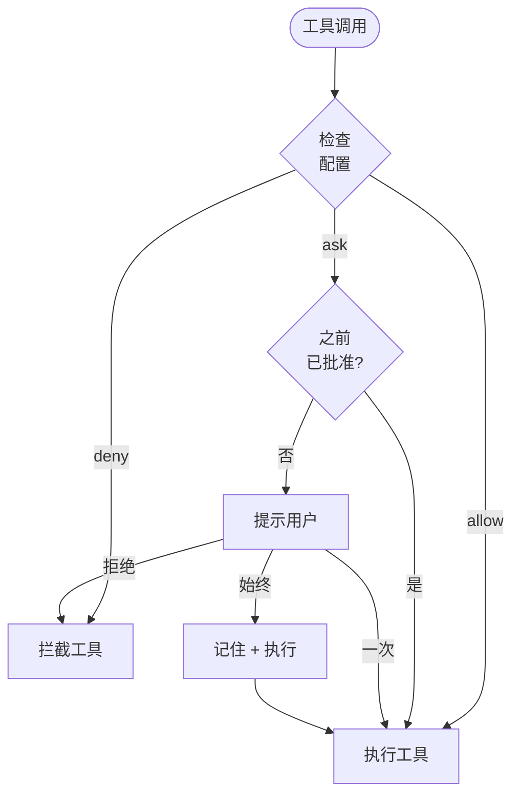

Cyberstrike 使用权限系统来控制 AI 代理可以执行哪些工具。这在保持生产力的同时提供了安全边界。

{/* TODO: GIF - Plan mode workflow */}
<div className="border-2 border-dashed border-gray-400 dark:border-gray-600 rounded-lg p-8 my-6 text-center bg-gray-100 dark:bg-gray-800">
  <p className="text-gray-500 dark:text-gray-400 font-mono text-sm">🎬 GIF: g04-plan-mode.gif</p>
  <p className="text-gray-400 dark:text-gray-500 text-xs mt-2">计划模式工作流演示 (20s)</p>
</div>

{/* TODO: Screenshot - Permission prompt */}
<div className="border-2 border-dashed border-gray-400 dark:border-gray-600 rounded-lg p-8 my-6 text-center bg-gray-100 dark:bg-gray-800">
  <p className="text-gray-500 dark:text-gray-400 font-mono text-sm">📸 SCREENSHOT: s06-permission-prompt.png</p>
  <p className="text-gray-400 dark:text-gray-500 text-xs mt-2">权限提示界面</p>
</div>

{/* TODO: Screenshot - Plan mode UI */}
<div className="border-2 border-dashed border-gray-400 dark:border-gray-600 rounded-lg p-8 my-6 text-center bg-gray-100 dark:bg-gray-800">
  <p className="text-gray-500 dark:text-gray-400 font-mono text-sm">📸 SCREENSHOT: s07-plan-mode.png</p>
  <p className="text-gray-400 dark:text-gray-500 text-xs mt-2">计划模式界面</p>
</div>

## 权限模型



---

## 权限模式

| 模式 | 行为 | 用途 |
|------|------|------|
| `ask` | 提示审批 | 敏感工具的默认值 |
| `allow` | 自动批准 | 可信工具、自动化 |
| `deny` | 拦截执行 | 受限操作 |

---

## 配置权限

### 全局配置

在 `~/.config/cyberstrike/cyberstrike.json` 中设置权限：

```json title="~/.config/cyberstrike/cyberstrike.json"
{
  "permission": {
    "read": "allow",
    "glob": "allow",
    "grep": "allow",
    "edit": "ask",
    "bash": "ask",
    "websearch": "ask"
  }
}
```

### 项目配置

在 `cyberstrike.json` 中按项目覆盖权限：

```json title="cyberstrike.json"
{
  "permission": {
    "bash": "allow",
    "edit": "allow",
    "external_directory": "deny"
  }
}
```

项目设置覆盖全局设置。

---

## 权限类型

### 文件操作

| 权限 | 工具 | 默认值 | 描述 |
|------|------|--------|------|
| `read` | Read | `ask` | 读取文件内容 |
| `edit` | Write, Edit | `ask` | 修改文件 |
| `glob` | Glob | `allow` | 按模式查找文件 |
| `grep` | Grep | `allow` | 搜索文件内容 |

### 命令执行

| 权限 | 工具 | 默认值 | 描述 |
|------|------|--------|------|
| `bash` | Bash | `ask` | 执行 Shell 命令 |
| `task` | Task | `ask` | 创建子代理 |

### Web 操作

| 权限 | 工具 | 默认值 | 描述 |
|------|------|--------|------|
| `websearch` | WebSearch | `ask` | 搜索网络 |
| `webfetch` | WebFetch | `ask` | 获取网页内容 |
| `codesearch` | CodeSearch | `ask` | 搜索代码仓库 |

### 特殊权限

| 权限 | 描述 |
|------|------|
| `external_directory` | 访问项目外的文件 |
| `lsp` | 语言服务器操作 |
| `doom_loop` | 检测并中断无限循环 |

---

## 基于模式的权限

使用模式授予细粒度权限。

### 目录模式

允许特定目录：

```json
{
  "permission": {
    "read": {
      "src/**": "allow",
      "test/**": "allow",
      "node_modules/**": "deny"
    },
    "edit": {
      "src/**": "allow",
      "*.config.js": "deny"
    }
  }
}
```

### 命令模式

允许特定命令：

```json
{
  "permission": {
    "bash": {
      "git *": "allow",
      "npm test": "allow",
      "npm run *": "allow",
      "rm *": "deny"
    }
  }
}
```

### 通配符匹配

| 模式 | 匹配 |
|------|------|
| `*` | 任何单个路径段 |
| `**` | 任何路径深度 |
| `*.ts` | 以 .ts 结尾的文件 |
| `src/**/*.ts` | src 中的 TypeScript 文件 |

---

## 代理权限

按代理配置权限：

```json title="cyberstrike.json"
{
  "agent": {
    "web-application": {
      "permission": {
        "bash": "allow",
        "browser": "allow",
        "edit": "ask"
      }
    },
    "code-review": {
      "permission": {
        "read": "allow",
        "glob": "allow",
        "grep": "allow",
        "edit": "deny",
        "bash": "deny"
      }
    }
  }
}
```

---

## 交互式审批

当工具需要权限时，Cyberstrike 会提示审批。

### 响应选项

| 选项 | 行为 |
|------|------|
| **一次** | 批准此次特定调用 |
| **始终** | 批准会话中所有类似调用 |
| **拒绝** | 拦截此次调用 |

### 审批对话框

```
┌─────────────────────────────────────────┐
│  需要权限                                │
├─────────────────────────────────────────┤
│  工具: Bash                              │
│  命令: git push origin main              │
│                                          │
│  [一次]  [始终]  [拒绝]                  │
└─────────────────────────────────────────┘
```

### 快捷键

| 按键 | 操作 |
|------|------|
| `y` | 批准一次 |
| `a` | 始终批准 |
| `n` | 拒绝 |
| `Esc` | 拒绝 |

---

## 会话审批记忆

当您选择"始终"时，Cyberstrike 会在会话中记住审批模式。

### 记忆工作原理

1. 用户通过"始终"批准 `git push`
2. 模式 `git *` 存储在会话中
3. 后续的 `git pull`、`git commit` 等自动批准
4. 会话结束时记忆重置

### 查看已批准的模式

已批准的模式在会话重启前持续有效。

---

## 自动化模式

用于 CI/CD 和自动化，配置完全信任：

```json title="cyberstrike.json"
{
  "permission": "allow"
}
```

这将所有权限设置为允许，无需提示。

<Aside variant="caution">
  使用 `"permission": "allow"` 会绕过所有安全检查。仅在受控环境中使用。
</Aside>

---

## 只读模式

将代理限制为只读操作：

```json title="cyberstrike.json"
{
  "permission": {
    "read": "allow",
    "glob": "allow",
    "grep": "allow",
    "lsp": "allow",
    "edit": "deny",
    "bash": "deny",
    "websearch": "deny"
  }
}
```

用于代码审查或探索任务。

---

## 外部目录访问

默认情况下，Cyberstrike 限制对项目目录的访问。

### 允许外部访问

```json
{
  "permission": {
    "external_directory": "ask"
  }
}
```

### 特定外部路径

```json
{
  "permission": {
    "external_directory": {
      "/home/user/shared/**": "allow",
      "/tmp/**": "allow",
      "/etc/**": "deny"
    }
  }
}
```

---

## 权限钩子

使用插件钩子进行编程权限控制。

### permission.ask 钩子

```typescript
const hooks: Hooks = {
  "permission.ask": async (input, output) => {
    // 自动批准 src 中的读取操作
    if (input.type === "read" && input.path?.startsWith("src/")) {
      output.status = "allow"
      return
    }

    // 阻止访问密钥
    if (input.path?.includes("secret") || input.path?.includes(".env")) {
      output.status = "deny"
      return
    }

    // 默认：提示用户
    output.status = "ask"
  },
}
```

### 钩子输入

| 字段 | 类型 | 描述 |
|------|------|------|
| `id` | string | 权限请求 ID |
| `type` | string | 权限类型 |
| `pattern` | string | 匹配模式 |
| `sessionID` | string | 会话标识符 |
| `messageID` | string | 消息标识符 |
| `callID` | string | 工具调用 ID |
| `message` | string | 描述 |
| `metadata` | object | 附加上下文 |

### 钩子输出

| 字段 | 值 | 描述 |
|------|-----|------|
| `status` | `"ask"` | 提示用户 |
| `status` | `"allow"` | 自动批准 |
| `status` | `"deny"` | 拦截 |

---

## 安全最佳实践

### 开发环境

```json
{
  "permission": {
    "read": "allow",
    "glob": "allow",
    "grep": "allow",
    "edit": "ask",
    "bash": "ask"
  }
}
```

### 生产/CI 环境

```json
{
  "permission": {
    "read": "allow",
    "glob": "allow",
    "grep": "allow",
    "edit": "allow",
    "bash": {
      "npm test": "allow",
      "npm run build": "allow",
      "*": "deny"
    }
  }
}
```

### 安全审计模式

```json
{
  "permission": {
    "read": "allow",
    "glob": "allow",
    "grep": "allow",
    "lsp": "allow",
    "websearch": "allow",
    "edit": "deny",
    "bash": "deny"
  }
}
```

---

## 权限优先级

权限按以下顺序评估：

1. **代理特定**权限（最高优先级）
2. **项目** `cyberstrike.json`
3. **全局** `~/.config/cyberstrike/cyberstrike.json`
4. **默认**内置值（最低优先级）

更具体的模式优先：

```json
{
  "permission": {
    "bash": "deny",
    "bash": {
      "git *": "allow"
    }
  }
}
```

在此情况下，`git push` 被允许但 `rm -rf` 被拒绝。

---

## 故障排除

### 权限始终提示

检查配置是否有效：

```bash
cyberstrike config validate
```

验证权限设置是否正确：

```bash
cat ~/.config/cyberstrike/cyberstrike.json | jq .permission
```

### 权限未生效

1. 检查项目与全局配置优先级
2. 验证模式语法与路径匹配
3. 重启 Cyberstrike 以重新加载配置

### 操作被拦截

如果工具意外被拦截：

1. 检查配置中的 `deny` 规则
2. 检查模式不匹配
3. 检查可能拦截的插件钩子

---

## 示例

### Web 安全测试

```json title="cyberstrike.json"
{
  "permission": {
    "bash": {
      "nmap *": "allow",
      "nikto *": "allow",
      "sqlmap *": "allow",
      "nuclei *": "allow"
    },
    "browser": "allow",
    "websearch": "allow",
    "edit": "ask"
  }
}
```

### 仅代码审查

```json title="cyberstrike.json"
{
  "permission": {
    "read": "allow",
    "glob": "allow",
    "grep": "allow",
    "lsp": "allow",
    "edit": "deny",
    "bash": "deny",
    "browser": "deny"
  }
}
```

### 完全自动化

```json title="cyberstrike.json"
{
  "permission": "allow"
}
```

<Aside variant="tip">
  从严格的权限开始，根据需要放宽。批准单个操作比授予全面访问更安全。
</Aside>
