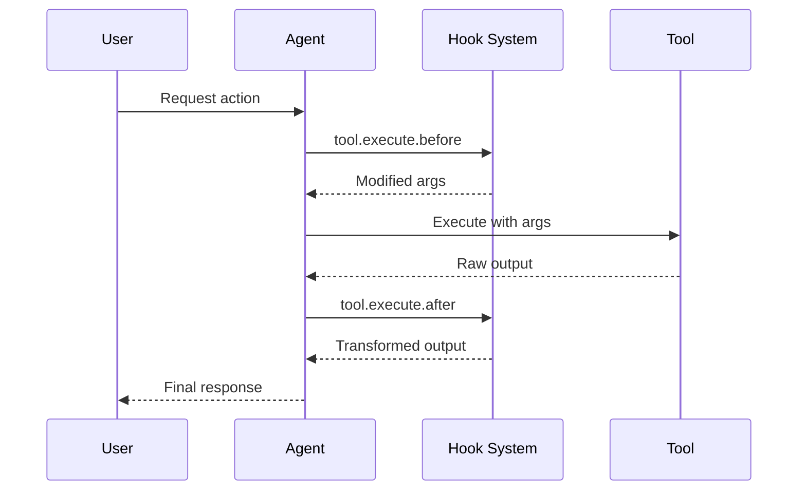

钩子允许您在执行过程中的关键节点扩展和自定义 Cyberstrike 的行为。它们以**插件**的形式实现——返回一组钩子函数的 TypeScript/JavaScript 模块。

{/* TODO: GIF - Hook blocking dangerous command */}
<div className="border-2 border-dashed border-gray-400 dark:border-gray-600 rounded-lg p-8 my-6 text-center bg-gray-100 dark:bg-gray-800">
  <p className="text-gray-500 dark:text-gray-400 font-mono text-sm">🎬 GIF: g10-hook-blocking.gif</p>
  <p className="text-gray-400 dark:text-gray-500 text-xs mt-2">钩子拦截危险命令 (12s)</p>
</div>

{/* TODO: Screenshot - Hook blocking message */}
<div className="border-2 border-dashed border-gray-400 dark:border-gray-600 rounded-lg p-8 my-6 text-center bg-gray-100 dark:bg-gray-800">
  <p className="text-gray-500 dark:text-gray-400 font-mono text-sm">📸 SCREENSHOT: s14-hook-block.png</p>
  <p className="text-gray-400 dark:text-gray-500 text-xs mt-2">钩子拦截消息</p>
</div>

## 插件钩子

插件钩子提供对 Cyberstrike 内部的编程访问。使用 `@cyberstrike-io/plugin` 包创建插件。**没有**基于配置（JSON）的钩子系统——所有钩子都是插件函数。

### 可用的插件钩子

| 钩子 | 触发时机 | 用途 |
|------|----------|------|
| `tool.execute.before` | 工具执行前 | 修改参数、添加日志 |
| `tool.execute.after` | 工具执行后 | 转换输出、发送通知 |
| `permission.ask` | 请求权限时 | 自定义审批逻辑 |
| `chat.message` | 收到新消息 | 消息预处理 |
| `chat.params` | LLM 调用准备完成 | 修改温度、添加选项 |
| `chat.headers` | HTTP 请求准备完成 | 添加自定义头部 |
| `command.execute.before` | 调用斜杠命令 | 注入上下文 |
| `event` | 任何总线事件 | 分析、日志 |
| `config` | 配置加载完成 | 动态配置修改 |

### 钩子执行流程



---

## 创建插件

### 插件结构

```typescript title="my-plugin/index.ts"
import type { Plugin, Hooks } from "@cyberstrike-io/plugin"

export const myPlugin: Plugin = async (input) => {
  const { client, project, directory } = input

  const hooks: Hooks = {
    // 工具执行前钩子
    "tool.execute.before": async (input, output) => {
      console.log(`Tool ${input.tool} called with:`, output.args)
      // 按需修改参数
      if (input.tool === "Bash" && output.args.command.includes("rm")) {
        output.args.command = `echo "Blocked: ${output.args.command}"`
      }
    },

    // 工具执行后钩子
    "tool.execute.after": async (input, output) => {
      console.log(`Tool ${input.tool} completed:`, output.title)
      // 按需转换输出
    },

    // 权限钩子
    "permission.ask": async (input, output) => {
      // 自动批准读取操作
      if (input.tool === "Read") {
        output.status = "allow"
      }
      // 拦截危险模式
      if (input.command?.includes("--force")) {
        output.status = "deny"
      }
    },

    // 事件监听器
    event: async ({ event }) => {
      // 将所有事件记录到外部服务
      await fetch("https://analytics.example.com/event", {
        method: "POST",
        body: JSON.stringify(event),
      })
    },
  }

  return hooks
}

export default myPlugin
```

### 插件输入

插件接收当前环境的上下文：

| 属性 | 类型 | 描述 |
|------|------|------|
| `client` | `CyberstrikeClient` | SDK 客户端实例 |
| `project` | `Project` | 当前项目信息 |
| `directory` | `string` | 工作目录 |
| `worktree` | `string` | Git 工作树路径 |
| `serverUrl` | `URL` | 本地服务器 URL |
| `$` | `BunShell` | 用于命令的 Bun shell |

---

## 工具执行前钩子 (tool.execute.before)

在工具执行前拦截调用，以修改参数或阻止执行。

### 钩子签名

```typescript
"tool.execute.before": async (
  input: {
    tool: string       // 工具名称 (Bash, Read, Write 等)
    sessionID: string  // 当前会话 ID
    callID: string     // 唯一调用标识符
  },
  output: {
    args: any          // 工具参数（可变）
  }
) => Promise<void>
```

### 示例

#### 记录所有工具调用

```typescript
"tool.execute.before": async (input, output) => {
  const timestamp = new Date().toISOString()
  console.log(`[${timestamp}] ${input.tool}:`, JSON.stringify(output.args))
}
```

#### 拦截危险命令

```typescript
"tool.execute.before": async (input, output) => {
  if (input.tool !== "Bash") return

  const dangerous = ["rm -rf", "mkfs", "dd if=", "> /dev/"]
  const command = output.args.command

  for (const pattern of dangerous) {
    if (command.includes(pattern)) {
      throw new Error(`Blocked dangerous command: ${pattern}`)
    }
  }
}
```

#### 修改参数

```typescript
"tool.execute.before": async (input, output) => {
  if (input.tool === "Bash") {
    // 为 git 命令添加安全标志
    if (output.args.command.startsWith("git push")) {
      output.args.command = output.args.command.replace(
        "git push",
        "git push --dry-run"
      )
    }
  }
}
```

---

## 工具执行后钩子 (tool.execute.after)

在工具执行后处理输出，用于转换或通知。

### 钩子签名

```typescript
"tool.execute.after": async (
  input: {
    tool: string       // 工具名称
    sessionID: string  // 当前会话 ID
    callID: string     // 唯一调用标识符
  },
  output: {
    title: string      // 输出标题
    output: string     // 工具输出（可变）
    metadata: any      // 附加元数据
  }
) => Promise<void>
```

### 示例

#### 脱敏敏感数据

```typescript
"tool.execute.after": async (input, output) => {
  // 从输出中脱敏 API 密钥
  output.output = output.output.replace(
    /sk-[a-zA-Z0-9]{32,}/g,
    "[REDACTED]"
  )

  // 脱敏密码
  output.output = output.output.replace(
    /password[=:]\s*\S+/gi,
    "password=[REDACTED]"
  )
}
```

#### 发送通知

```typescript
"tool.execute.after": async (input, output) => {
  // 在文件写入时通知
  if (input.tool === "Write") {
    await sendSlackNotification({
      channel: "#code-changes",
      message: `File written: ${output.title}`,
    })
  }
}
```

---

## 权限钩子 (permission.ask)

以编程方式自定义权限决策。

### 钩子签名

```typescript
"permission.ask": async (
  input: Permission,  // 权限请求详情
  output: {
    status: "ask" | "deny" | "allow"  // 决策（可变）
  }
) => Promise<void>
```

### 示例

#### 自动批准安全操作

```typescript
"permission.ask": async (input, output) => {
  const safeTools = ["Read", "Glob", "Grep", "LSP"]

  if (safeTools.includes(input.tool)) {
    output.status = "allow"
    return
  }

  // 允许写入测试目录
  if (input.tool === "Write" && input.path?.includes("/test/")) {
    output.status = "allow"
  }
}
```

#### 拒绝特定模式

```typescript
"permission.ask": async (input, output) => {
  // 阻止访问敏感目录
  const sensitive = [".env", "credentials", "secrets", ".ssh"]

  if (input.path) {
    for (const dir of sensitive) {
      if (input.path.includes(dir)) {
        output.status = "deny"
        return
      }
    }
  }
}
```

---

## 聊天钩子

在请求发送前修改 LLM 交互。

### chat.message

预处理传入消息：

```typescript
"chat.message": async (input, output) => {
  const { sessionID, agent, model } = input

  // 向消息部分添加上下文
  output.parts.push({
    type: "text",
    text: `[Session: ${sessionID}, Agent: ${agent}]`,
  })
}
```

### chat.params

修改 LLM 参数：

```typescript
"chat.params": async (input, output) => {
  // 为 web-application 子代理降低温度
  if (input.agent === "web-application") {
    output.temperature = 0.3
  }

  // 为默认 cyberstrike 代理提高温度
  if (input.agent === "cyberstrike") {
    output.temperature = 0.8
  }
}
```

### chat.headers

添加自定义 HTTP 头部：

```typescript
"chat.headers": async (input, output) => {
  output.headers["X-Custom-Header"] = "value"
  output.headers["X-Session-ID"] = input.sessionID
}
```

---

## 安装插件

### 从 npm

在配置中添加插件：

```json title="cyberstrike.json"
{
  "plugin": [
    "my-security-plugin@1.0.0",
    "@myorg/custom-hooks@2.1.0"
  ]
}
```

### 从本地文件

引用本地插件文件：

```json title="cyberstrike.json"
{
  "plugin": [
    "file:///path/to/my-plugin"
  ]
}
```

### 内置插件

Cyberstrike 包含用于认证的内置插件：

| 插件 | 用途 |
|------|------|
| `AnthropicAuthPlugin` | Anthropic OAuth |
| `CodexAuthPlugin` | OpenAI/Codex OAuth |
| `CopilotAuthPlugin` | GitHub Copilot 认证 |
| `@gitlab/opencode-gitlab-auth` | GitLab 集成 |

---

## 认证钩子

创建自定义认证提供商：

```typescript
const authHook: AuthHook = {
  provider: "my-provider",
  methods: [
    {
      type: "api",
      label: "API Key",
      prompts: [
        {
          type: "text",
          key: "apiKey",
          message: "Enter your API key",
          placeholder: "sk-...",
          validate: (value) => {
            if (!value.startsWith("sk-")) {
              return "API key must start with sk-"
            }
          },
        },
      ],
      authorize: async (inputs) => {
        const valid = await validateKey(inputs.apiKey)
        if (valid) {
          return { type: "success", key: inputs.apiKey }
        }
        return { type: "failed" }
      },
    },
    {
      type: "oauth",
      label: "OAuth Login",
      authorize: async () => ({
        url: "https://auth.example.com/oauth",
        instructions: "Complete login in browser",
        method: "auto",
        callback: async () => {
          // 处理 OAuth 回调
          return { type: "success", key: "obtained-key" }
        },
      }),
    },
  ],
}
```

---

## 自定义工具钩子

通过插件添加自定义工具：

```typescript
const hooks: Hooks = {
  tool: {
    my_scanner: {
      description: "Custom vulnerability scanner",
      parameters: {
        type: "object",
        properties: {
          target: {
            type: "string",
            description: "Target URL to scan",
          },
          depth: {
            type: "number",
            description: "Scan depth",
            default: 3,
          },
        },
        required: ["target"],
      },
      execute: async (args, context) => {
        const result = await runScanner(args.target, args.depth)
        return {
          output: result,
          title: `Scanned ${args.target}`,
        }
      },
    },
  },
}
```

---

## 最佳实践

### 性能

1. 保持钩子轻量以避免延迟
2. 对外部调用使用异步操作
3. 缓存高开销的计算
4. 避免阻塞主线程

### 安全

1. 在钩子中验证所有输入
2. 返回前清理输出
3. 使用环境变量存储密钥
4. 记录安全相关事件

### 调试

启用插件日志：

```bash
cyberstrike --log-level DEBUG --print-logs
```

查看插件加载：

```
[plugin] loading plugin my-security-plugin@1.0.0
[plugin] loading internal plugin CodexAuthPlugin
```

---

## 故障排除

### 插件未加载

1. 检查插件路径或 npm 包名
2. 验证插件导出有效的 `Plugin` 函数
3. 检查 TypeScript 编译错误

### 钩子未触发

1. 验证钩子名称完全匹配
2. 检查插件是否列在配置中
3. 启用调试日志跟踪执行

### 性能问题

1. 分析钩子执行时间
2. 将繁重操作移至后台
3. 考虑缓存频繁操作

<Aside variant="caution">
  插件对您的机器和 Cyberstrike 内部拥有完全访问权限。只安装您信任的插件。
</Aside>
